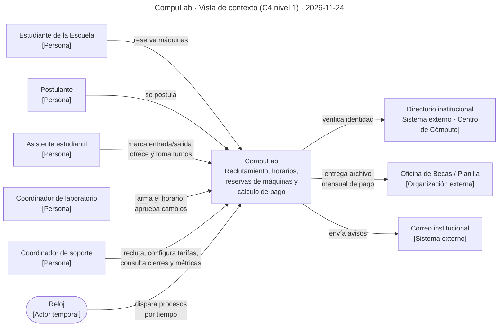

# 1. Contexto

> Responde: ¿qué problema resuelve CompuLab, para quién y con qué se tiene que entender?
> Versión 2026-11-24.

## 1.1 Introducción

La Escuela de Computación mantiene cuatro laboratorios de cómputo en dos campus. No hay personal administrativo atendiéndolos: los cubren **asistentes estudiantiles**, estudiantes becados que trabajan por turnos y cobran por hora. La **Coordinación de Soporte** responde por los laboratorios; cada laboratorio tiene además un **coordinador de laboratorio**.

CompuLab es el sistema que va a ordenar las cuatro actividades que hoy se manejan a mano: **el reclutamiento de asistentes, el horario, el uso de las máquinas y el cálculo del pago**.

## 1.2 Descripción del problema

Hoy el horario vive en una hoja de cálculo compartida, las postulaciones llegan por correo, los cambios de turno se acuerdan por mensajería y las máquinas se ocupan por orden de llegada. Eso produce los mismos problemas cada semestre:

| # | Problema observado | Consecuencia | Cómo lo ataca CompuLab |
| --- | --- | --- | --- |
| P-1 | Turnos que quedan sin cubrir y nadie lo nota | El laboratorio abre tarde o no abre | Detección automática de turnos vacantes y no cubiertos, con aviso al coordinador (RF-08, RF-19, RF-20) |
| P-2 | Cambios de turno que nunca se registran | Las horas reportadas no son las trabajadas | Los cambios pasan por el sistema con aprobación (CU-07 a CU-09) y el pago sale de las marcas reales (RF-18, CU-14) |
| P-3 | Asistentes que pasan su tope de horas y se enteran un mes después | Becas rechaza el reporte | El sistema impide asignar por encima del tope (RN-07) y reporta lo que se trabajó de más (RN-24) |
| P-4 | Estudiantes que llegan y no hay máquina, o el laboratorio está cerrado | Pérdida de tiempo y quejas | Reservas solo en franjas cubiertas por un turno, con reglas de uso y avisos si la franja se cae (CU-11, RN-15, RN-19) |

## 1.3 Objetivos del sistema

1. Que ningún turno quede sin cubrir sin que el coordinador se entere a tiempo.
2. Que el horario respete siempre las reglas de traslape, tope semanal y disponibilidad.
3. Que un estudiante con reserva encuentre su máquina y el laboratorio abierto.
4. Que el cálculo mensual del pago refleje lo trabajado de verdad y llegue a Becas en el formato que acepta.
5. Que el sistema responda rápido y siga disponible en los picos del TEC (matrícula, finales).

## 1.4 Grupos de interés

| Grupo | Qué gana o pierde con el sistema |
| --- | --- |
| Coordinación de Soporte (coordinador de soporte) | Control sobre todos los laboratorios; selección de asistentes; cierre mensual correcto; datos de uso para justificar presupuesto. |
| Coordinadores de laboratorio | Armar el horario sin violar reglas; enterarse de turnos caídos; aprobar cambios con información confiable. |
| Asistentes estudiantiles | Saber su horario; intercambiar turnos de forma ordenada; cobrar lo que trabajaron; no pasarse del tope. |
| Estudiantes de la Escuela | Reservar una máquina con certeza de que el laboratorio estará abierto. Son los más numerosos. |
| Postulantes | Postularse y conocer el resultado de forma ordenada. |
| Oficina de Becas / Planilla | Recibir cada mes un archivo correcto que no tenga que rechazar. |
| Centro de Cómputo | Que la integración con el directorio institucional sea estable y respete sus reglas. |
| Escuela de Computación | Laboratorios abiertos cuando se promete y uso de recursos sin costo de licencias ni nube. |

## 1.5 Actores

| Actor | Tipo | Qué viene a hacer al sistema |
| --- | --- | --- |
| Estudiante de la Escuela | Humano | Reservar una máquina y usarla. |
| Postulante | Humano | Postularse a la convocatoria del semestre. |
| Asistente estudiantil | Humano | Consultar su horario, marcar entrada y salida, ofrecer y tomar turnos, reportar máquinas dañadas o reparadas. |
| Coordinador de laboratorio | Humano | Armar el horario de su laboratorio, aprobar cambios de turno y vigilar la cobertura. |
| Coordinador de soporte | Humano | Reclutar y administrar asistentes, configurar tarifas, cerrar el mes, ver todo y resolver excepciones. |
| Reloj | No humano | Disparar los procesos que dependen del tiempo: vencer ofertas, liberar reservas, detectar turnos no cubiertos y cerrar el mes. |

Un mismo usuario puede tener más de un rol (por ejemplo, un asistente también reserva máquinas como estudiante).

## 1.6 Sistemas externos

| Sistema | Quién lo opera | Para qué lo usa CompuLab | Estilo de integración |
| --- | --- | --- | --- |
| Directorio institucional | Centro de Cómputo | Saber quién es quién al iniciar sesión (identidad y condición de estudiante). | Petición-respuesta (LDAP u OIDC, a confirmar) |
| Oficina de Becas / Planilla | Becas | Recibir el resultado del cierre mensual. No usa el sistema. | Transferencia de archivo (CSV) |
| Correo institucional (SMTP) | TEC | Enviar avisos a estudiantes, asistentes y coordinadores. | Envío diferido |

Por qué se eligió cada estilo, qué hubo que aceptar y cómo se comporta CompuLab si el otro lado falla: `07-arquitectura.md` (7.2, "Integraciones con sistemas externos") y QA-9 en `05-atributos-de-calidad.md`.

## 1.7 Diagrama de contexto (C4 nivel 1)

Sin tecnologías: solo el sistema, quién lo usa y con qué se habla.

Leyenda: rectángulo = persona o sistema; óvalo = actor temporal; flecha = qué hace o pide, en el sentido de quien inicia.

## 1.8 Catálogo de drivers

Los drivers son lo que empuja la arquitectura. El detalle de cada uno está en el archivo indicado.

| Código | Driver | Medida resumida | Detalle |
| --- | --- | --- | --- |
| FP-1 | Asignar un turno respetando todas sus reglas | Ninguna asignación viola RN-04 a RN-09 | `03-alcance.md`, CU-06 |
| FP-2 | Reservar una máquina respetando sus reglas | Ninguna reserva viola RN-15 a RN-17 ni RN-20 | `03-alcance.md`, CU-11 |
| FP-3 | Cerrar el mes y generar el archivo para Becas | El cálculo coincide con la regla en el 100 % de los casos de prueba | `03-alcance.md`, CU-14 |
| QA-1 | Rendimiento | p95 ≤ 1 s en operaciones de usuario | `05-atributos-de-calidad.md` |
| QA-2 | Disponibilidad | Recuperación automática ≤ 1 min | `05-atributos-de-calidad.md` |
| QA-3 | Aislamiento de picos externos | QA-1 se mantiene en matrícula y finales | `05-atributos-de-calidad.md` |
| QA-4 | Integridad ante concurrencia | 0 violaciones de reglas con solicitudes simultáneas | `05-atributos-de-calidad.md` |
| QA-5 | Modificabilidad de tarifas | Cambio sin tocar código | `05-atributos-de-calidad.md` |
| QA-6 | Comprobabilidad | Dominio probado sin BD, red ni reloj | `05-atributos-de-calidad.md` |
| QA-7 | Seguridad (autorización) | 0 operaciones fuera del alcance del rol | `05-atributos-de-calidad.md` |
| QA-8 | Usabilidad móvil | Marcar entrada en ≤ 10 s | `05-atributos-de-calidad.md` |
| QA-9 | Tolerancia a la caída del Directorio | 100 % de sesiones abiertas siguen; 0 accesos sin identidad | `05-atributos-de-calidad.md` |
| R-1 a R-4 | Contenedores Linux, PostgreSQL 14, sin nube, código abierto | No negociables (cliente) | `06-restricciones-tecnologicas.md` |
| R-5 a R-10 | Exigencias del núcleo ejecutable (interfaces inyectadas, pruebas con dobles, funciones de aptitud, README) | No negociables (curso) | `06-restricciones-tecnologicas.md` |

## 1.9 Glosario

| Término | Definición en CompuLab |
| --- | --- |
| Asistente activo | Asistente admitido en el semestre en curso que no ha renunciado ni ha sido dado de baja. Solo a él se le asignan turnos. |
| Bloque de disponibilidad | Día de la semana con hora de inicio y fin en que un postulante declaró que puede trabajar. |
| Categoría | Una de las dos clases de asistente; determina la tarifa por hora. |
| Cierre mensual | Cálculo, el día 1, de las horas y el pago de cada asistente por el mes anterior. Una vez hecho, no cambia. |
| Franja | Intervalo de tiempo con inicio y fin (por ejemplo, de un turno o de una reserva). |
| Laboratorio abierto | Laboratorio con un turno en curso cuyo asistente marcó entrada. |
| Marca | Registro de entrada o de salida de un asistente en su turno, hecho con el celular en la puerta del laboratorio. |
| Oferta de turno | Publicación de un turno propio para que otro asistente del mismo laboratorio lo tome. |
| Recargo | Porcentaje adicional sobre la tarifa para horas de turnos que empiezan a las 18:00 o después, o en sábado o domingo. |
| Reserva activa | Reserva que todavía no terminó y no fue cancelada ni liberada. |
| Semana | De lunes 00:00 a domingo 23:59 (SUP-05). |
| Tope semanal | Máximo de horas por semana que Becas permite a un asistente. |
| Turno | Un laboratorio, una fecha, una hora de inicio, una hora de fin y exactamente un asistente responsable. |
| Turno no cubierto | Turno que terminó sin que su asistente marcara entrada. |
| Turno vacante | Turno futuro que se quedó sin responsable porque el asistente renunció o fue dado de baja. |
