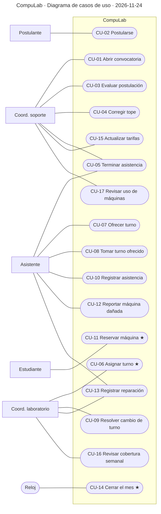
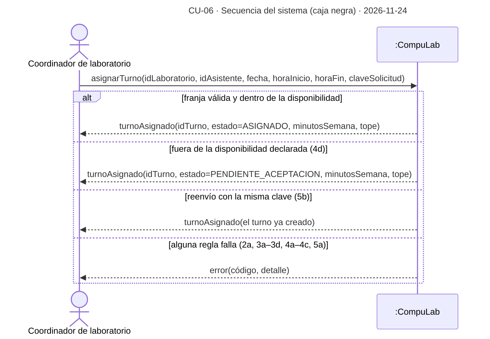
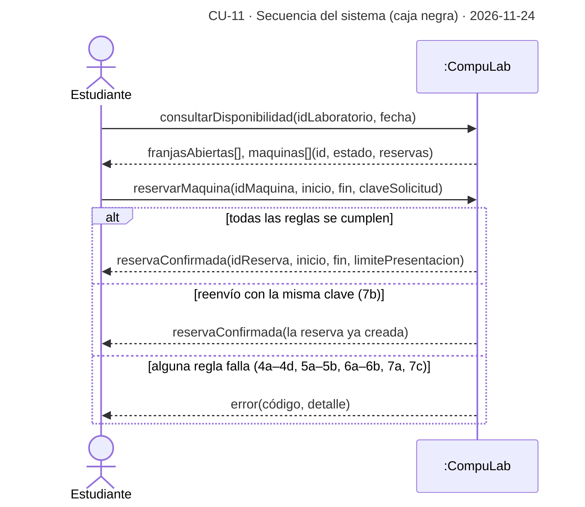
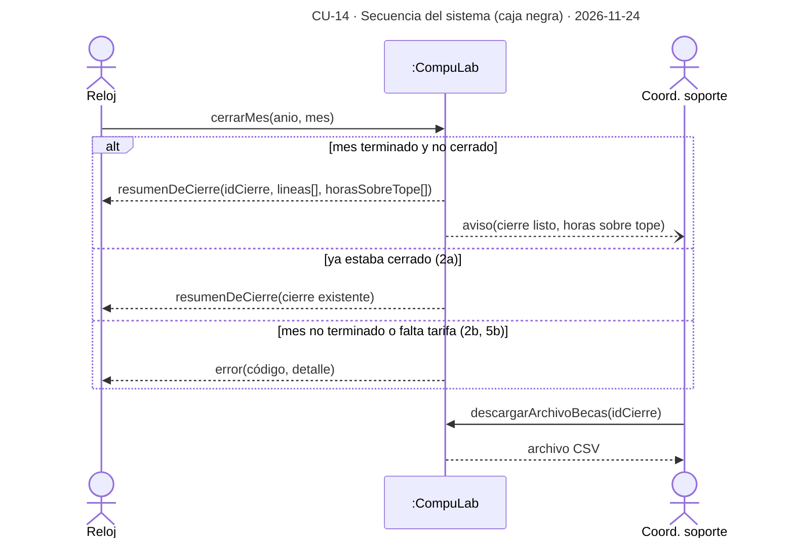

# 4. Casos de uso

> Responde: ¿qué objetivo viene a cumplir cada actor, qué puede salir mal y qué garantiza el sistema?
> Formato: plantilla de Cockburn (nivel objetivo de usuario) y contratos de operación al estilo de Larman (poscondiciones en pasado).
> Versión 2026-11-24.

## 4.1 Catálogo

Todos los casos están al nivel **objetivo de usuario**: un actor, un objetivo, una sentada. Iniciar sesión, validar el carné o vencer una oferta no son casos de uso sino pasos o reglas (RF-01, RN-11, RN-18).

| CU | Nombre | Actor principal | Módulo | Núcleo | Detalle |
| --- | --- | --- | --- | --- | --- |
| CU-01 | Abrir la convocatoria del semestre | Coord. soporte | Reclutamiento | | Ficha breve |
| CU-02 | Postularse como asistente | Postulante | Reclutamiento | | Ficha breve |
| CU-03 | Evaluar una postulación | Coord. soporte | Reclutamiento | | Ficha breve |
| CU-04 | Corregir el tope de un asistente | Coord. soporte | Asistentes | | Ficha breve |
| CU-05 | Terminar una asistencia | Coord. soporte / Asistente | Asistentes | | Ficha breve |
| **CU-06** | **Asignar un turno a un asistente** | Coord. laboratorio | Horarios | ✔ | **Completo + contrato** |
| CU-07 | Ofrecer un turno | Asistente | Horarios | | Ficha breve |
| CU-08 | Tomar un turno ofrecido | Asistente | Horarios | | Ficha breve |
| CU-09 | Resolver un cambio de turno | Coord. laboratorio | Horarios | | Ficha breve |
| CU-10 | Registrar la asistencia al turno | Asistente | Asistencia | | Ficha breve |
| **CU-11** | **Reservar una máquina** | Estudiante | Reservas | ✔ | **Completo + contrato** |
| CU-12 | Reportar una máquina dañada | Asistente | Reservas | | Ficha breve |
| CU-13 | Registrar la reparación de una máquina | Asistente / Coord. laboratorio | Reservas | | Ficha breve |
| **CU-14** | **Cerrar el mes** | Reloj | Liquidación | ✔ | **Completo + contrato** |
| CU-15 | Actualizar tarifas y recargo | Coord. soporte | Liquidación | | Ficha breve |
| CU-16 | Revisar la cobertura semanal | Coord. laboratorio | Asistencia | | Ficha breve |
| CU-17 | Revisar el uso de las máquinas | Coord. soporte | Reportes | | Ficha breve |

Son 17: dos más de los quince recomendados, porque cada uno pasa la prueba de "¿el actor se va satisfecho?" y fusionarlos mezclaría objetivos de actores distintos.

Leyenda: figura rectangular = actor; óvalo = caso de uso; línea = el actor participa en el caso de uso; recuadro = frontera del sistema; ★ = núcleo ejecutable. El coordinador de soporte puede hacer todo lo del coordinador de laboratorio sobre cualquier laboratorio (2.3 de `02-requerimientos.md`); no se dibuja para no saturar el diagrama.

---

## 4.2 CU-06 · Asignar un turno a un asistente

| Campo | Contenido |
| --- | --- |
| Actor principal | Coordinador de laboratorio (o coordinador de soporte, sobre cualquier laboratorio) |
| Alcance y nivel | CompuLab · objetivo de usuario |
| Interesados | **Coordinador de laboratorio:** armar el horario sin errores ni revisiones a mano. **Asistente:** no recibir turnos que choquen, que pasen su tope o que no puede cubrir. **Coordinador de soporte:** que las horas que luego se reportan a Becas sean válidas. **Estudiantes:** que el laboratorio esté abierto en las franjas publicadas. |
| Precondición | El actor inició sesión. La solicitud trae una clave de solicitud generada por la interfaz (ADR-0010). |
| Garantía mínima | Ningún turno que viole RN-04 a RN-09 queda registrado, ni siquiera con solicitudes simultáneas; si la asignación falla, el horario queda exactamente como estaba; un reenvío nunca crea un segundo turno. |
| Garantía de éxito | Existe un turno del asistente en ese laboratorio y franja, asignado o pendiente de aceptación del asistente. |
| Disparador | El coordinador decide cubrir una franja del horario de su laboratorio. |
| Reglas | RN-04, RN-05, RN-06, RN-07, RN-08, RN-09 |

### Escenario principal
1. El coordinador indica el laboratorio, el asistente, la fecha y las horas de inicio y fin.
2. El sistema verifica que el coordinador puede modificar el horario de ese laboratorio.
3. El sistema verifica que la franja es válida (inicio menor que fin, el mismo día, en el futuro, dentro del semestre) y que el asistente está activo.
4. El sistema verifica que el turno no se traslapa con otro del asistente ni con otro del laboratorio, que no supera el tope semanal del asistente y que la franja está dentro de su disponibilidad declarada.
5. El sistema registra el turno como asignado.
6. El sistema muestra el turno en el horario, con las horas semanales del asistente actualizadas.

### Extensiones
| Ext | Qué pasa | Qué hace el sistema | Error de dominio |
| --- | --- | --- | --- |
| 2a | El coordinador no tiene permiso sobre ese laboratorio. | Rechaza; nada cambia. | `SinPermisoSobreLaboratorio` |
| 3a | La franja no es válida (fin ≤ inicio o termina otro día). | Rechaza indicando el problema. | `FranjaDeTurnoInvalida` |
| 3b | La fecha está fuera del semestre. | Rechaza indicando las fechas del semestre. | `FueraDelSemestre` |
| 3c | La franja ya empezó o ya pasó. | Rechaza. | `TurnoEnElPasado` |
| 3d | El asistente no está activo (renunció, fue dado de baja o es de otro semestre). | Rechaza. | `AsistenteNoActivo` |
| 4a | El asistente ya tiene un turno que se traslapa, en este u otro laboratorio o campus. | Rechaza indicando el turno en conflicto (laboratorio, campus, franja). | `TraslapeDeTurno` |
| 4b | El laboratorio ya tiene otro turno en esa franja. | Rechaza indicando el turno existente. | `FranjaOcupadaEnLaboratorio` |
| 4c | Con este turno el asistente superaría su tope semanal. | Rechaza indicando horas ya programadas, horas del turno y tope. | `TopeSemanalExcedido` |
| 4d | La franja no está dentro de la disponibilidad declarada. | Registra el turno como **pendiente de aceptación**, avisa al asistente y continúa en el paso 6 mostrando ese estado. Cuando el asistente acepta, el sistema revalida 4a a 4c y el turno pasa a asignado; si rechaza, el turno se descarta. | — (no es error) |
| 5a | Dos coordinadores asignan al mismo tiempo al mismo asistente (aunque las franjas no se traslapen) o la misma franja del laboratorio. | Las asignaciones al mismo asistente se ejecutan de una en una (bloqueo de su agenda) y la segunda se valida viendo la primera; si recibe 4a, 4b o 4c, no se registra. Dos asistentes distintos en la misma franja del laboratorio: la restricción de la base rechaza al segundo (ADR-0009). | `TraslapeDeTurno` / `FranjaOcupadaEnLaboratorio` / `TopeSemanalExcedido` |
| 5b | La respuesta no llega al coordinador y la interfaz reenvía la solicitud con la misma clave. | Devuelve el turno que ya se había creado con esa clave, sin crear otro (ADR-0010). | — (no es error) |

### Diagrama de secuencia del sistema

Una sola operación del sistema para el caso de uso. La aceptación del asistente (ext 4d) es otra operación, `aceptarTurno(idTurno, acepta)`, que pertenece a RF-13 y queda fuera del núcleo.

### Contrato · `asignarTurno(idLaboratorio, idAsistente, fecha, horaInicio, horaFin, claveSolicitud)`

| | |
| --- | --- |
| Caso de uso | CU-06 Asignar un turno a un asistente |
| Precondiciones | El actor está autenticado. Existen un laboratorio con `idLaboratorio` y un asistente con `idAsistente`. `claveSolicitud` no viene vacía. |
| Poscondiciones (si no existía un turno con esa `claveSolicitud`; si existía, no cambia nada y se devuelve ese turno) | **P1** Se creó una instancia `t` de `Turno`. **P2** `t.fecha`, `t.horaInicio` y `t.horaFin` fueron asignados con los valores recibidos. **P3** Se formó una asociación entre `t` y el laboratorio. **P4** Se formó una asociación entre `t` y el asistente, como único responsable. **P5** `t.estado` fue asignado a `ASIGNADO` si la franja está dentro de la disponibilidad declarada, o a `PENDIENTE_ACEPTACION` si no lo está. **P6** Si `t.estado` es `PENDIENTE_ACEPTACION`, se creó un aviso para el asistente. **P7** `t.claveSolicitud` fue asignada con la clave recibida. |
| Invariantes (se mantienen aun con solicitudes simultáneas, ADR-0009) | **I1** Ningún asistente tiene dos turnos asignados, pendientes o en curso que se traslapen. **I2** En ninguna semana la suma de esos turnos de un asistente supera su tope. **I3** Ningún laboratorio tiene dos turnos que se traslapen. **I4** Todo turno tiene exactamente un responsable. **I5** No existen dos turnos con la misma clave de solicitud del mismo usuario. |
| Excepciones | Las de la tabla de extensiones. Ninguna deja un turno a medio registrar y todas llegan al usuario como respuesta de negocio (403, 409 o 422), nunca como error interno. |

### Pruebas que se derivan
Al menos 1 (escenario) + 7 (poscondiciones) + 11 (extensiones): `test_cu06_escenario_principal_registra_turno_asignado`, `test_cu06_p1_…` a `test_cu06_p7_…`, `test_cu06_2a_sin_permiso_no_cambia_horario`, `test_cu06_3a_…` hasta `test_cu06_5a_asignaciones_simultaneas_no_superan_el_tope` (con `Promise.all`) y `test_cu06_5b_reenvio_con_la_misma_clave_no_duplica`.

---

## 4.3 CU-11 · Reservar una máquina

| Campo | Contenido |
| --- | --- |
| Actor principal | Estudiante de la Escuela |
| Alcance y nivel | CompuLab · objetivo de usuario |
| Interesados | **Estudiante:** llegar y tener máquina y laboratorio abierto. **Otros estudiantes:** reparto justo de las máquinas (límites por persona). **Asistente de turno:** saber qué máquinas están comprometidas. **Coordinador de soporte:** datos de uso para el presupuesto. |
| Precondición | El estudiante inició sesión. La solicitud trae una clave de solicitud generada por la interfaz (ADR-0010). |
| Garantía mínima | Ninguna reserva que viole RN-15 a RN-17 o RN-20 queda registrada; una máquina nunca queda con dos reservas que se traslapen; un reenvío nunca crea una segunda reserva. |
| Garantía de éxito | Existe una reserva activa del estudiante sobre esa máquina en la franja elegida. |
| Disparador | El estudiante quiere asegurar una máquina para trabajar. |
| Reglas | RN-15, RN-16, RN-17, RN-20 |

### Escenario principal
1. El estudiante consulta un laboratorio y un día.
2. El sistema muestra las franjas en que el laboratorio estará abierto y el estado de cada máquina.
3. El estudiante elige una máquina y la franja de la reserva.
4. El sistema verifica la franja (inicio en el futuro, no más de 7 días de anticipación, no más de 2 horas) y que el laboratorio esté abierto durante toda la franja.
5. El sistema verifica que la máquina está en servicio y libre en esa franja.
6. El sistema verifica que el estudiante no tiene otra reserva activa y que con esta no supera 6 horas en la semana.
7. El sistema registra la reserva como activa.
8. El sistema muestra la reserva con la hora límite para presentarse (inicio + 15 minutos).

### Extensiones
| Ext | Qué pasa | Qué hace el sistema | Error de dominio |
| --- | --- | --- | --- |
| 2a | El laboratorio no tiene franjas abiertas ese día. | Lo informa; el estudiante puede elegir otro día o laboratorio. | — |
| 4a | La franja no es válida (fin ≤ inicio o inicio en el pasado). | Rechaza. | `FranjaDeReservaInvalida` |
| 4b | La reserva empieza a más de 7 días. | Rechaza indicando la fecha máxima. | `FueraDeHorizonteDeReserva` |
| 4c | La reserva dura más de 2 horas. | Rechaza indicando el máximo. | `ReservaExcedeDuracion` |
| 4d | Alguna parte de la franja no está cubierta por un turno asignado. | Rechaza indicando las franjas abiertas más cercanas. | `LaboratorioCerradoEnFranja` |
| 5a | La máquina está fuera de servicio. | Rechaza y sugiere otra máquina libre. | `MaquinaFueraDeServicio` |
| 5b | La máquina ya tiene una reserva que se traslapa. | Rechaza y sugiere otra máquina libre. | `MaquinaNoDisponible` |
| 6a | El estudiante ya tiene una reserva activa. | Rechaza indicando la reserva existente. | `YaTieneReservaActiva` |
| 6b | Con esta reserva superaría 6 horas en la semana. | Rechaza indicando las horas ya reservadas. | `LimiteSemanalDeReservaExcedido` |
| 7a | Dos estudiantes reservan la misma máquina y franja al mismo tiempo. | Solo una se confirma: la restricción de exclusión por máquina rechaza a la segunda, que recibe 5b (ADR-0009). | `MaquinaNoDisponible` |
| 7b | La respuesta no llega al estudiante y la interfaz reenvía la solicitud con la misma clave (doble clic o reintento). | Devuelve la reserva que ya se había creado con esa clave, sin crear otra (ADR-0010). | — (no es error) |
| 7c | El mismo estudiante envía dos reservas distintas al mismo tiempo (claves distintas). | Solo una se confirma: el índice de una reserva activa por estudiante rechaza a la otra, que recibe 6a (ADR-0009). | `YaTieneReservaActiva` |

### Diagrama de secuencia del sistema

`consultarDisponibilidad` es una consulta (no cambia estado, no lleva contrato). `reservarMaquina` es la operación que cambia el sistema.

### Contrato · `reservarMaquina(idMaquina, inicio, fin, claveSolicitud)`

| | |
| --- | --- |
| Caso de uso | CU-11 Reservar una máquina |
| Precondiciones | El estudiante está autenticado. Existe una máquina con `idMaquina`. `claveSolicitud` no viene vacía. |
| Poscondiciones (si no existía una reserva del estudiante con esa `claveSolicitud`; si existía, no cambia nada y se devuelve esa reserva) | **P1** Se creó una instancia `r` de `Reserva`. **P2** `r.inicio` y `r.fin` fueron asignados con los valores recibidos. **P3** Se formó una asociación entre `r` y la máquina. **P4** Se formó una asociación entre `r` y el estudiante. **P5** `r.estado` fue asignado a `ACTIVA`. **P6** `r.limitePresentacion` fue asignado a `r.inicio` + 15 minutos. **P7** `r.claveSolicitud` fue asignada con la clave recibida. |
| Invariantes (se mantienen aun con solicitudes simultáneas, ADR-0009) | **I1** Ninguna máquina tiene dos reservas activas o en uso que se traslapen. **I2** Ningún estudiante tiene más de una reserva activa o en uso. **I3** Ningún estudiante supera 6 horas reservadas en una semana. **I4** Toda reserva activa está dentro de una franja cubierta por turnos y su duración es de 2 horas o menos. **I5** No existen dos reservas con la misma clave de solicitud del mismo estudiante. |
| Excepciones | Las de la tabla de extensiones. Ninguna deja una reserva a medio registrar y todas llegan al usuario como respuesta de negocio (409 o 422), nunca como error interno. |

### Pruebas que se derivan
Al menos 1 (escenario) + 7 (poscondiciones) + 12 (extensiones): `test_cu11_escenario_principal_registra_reserva_activa`, `test_cu11_p1_…` a `test_cu11_p7_…`, `test_cu11_2a_dia_sin_franjas_abiertas`, `test_cu11_4a_…` hasta `test_cu11_7a_misma_maquina_simultanea_solo_confirma_una`, `test_cu11_7b_reenvio_con_la_misma_clave_no_duplica` y `test_cu11_7c_dos_reservas_simultaneas_del_mismo_estudiante`.

---

## 4.4 CU-14 · Cerrar el mes

| Campo | Contenido |
| --- | --- |
| Actor principal | Reloj (el coordinador de soporte puede dispararlo si no corrió, SUP-27) |
| Alcance y nivel | CompuLab · objetivo de usuario |
| Interesados | **Asistentes:** cobrar exactamente lo trabajado, con recargos. **Coordinador de soporte:** cálculo correcto y saber quién trabajó sobre el tope. **Oficina de Becas / Planilla:** recibir un archivo en el formato que acepta, sin errores. |
| Precondición | Ninguna además de recibir un año y un mes válidos. |
| Garantía mínima | O el mes queda cerrado completo (todas las líneas y el archivo) o no queda cerrado en absoluto. Nunca existen dos cierres del mismo mes. |
| Garantía de éxito | Existe un cierre inmutable del mes, con una línea por asistente con horas y el archivo CSV para Becas. |
| Disparador | Día 1 de cada mes a las 00:05, para el mes anterior. |
| Reglas | RN-12, RN-21, RN-22, RN-23, RN-24, RN-25, RN-26, RN-27 |

### Escenario principal
1. El Reloj solicita cerrar el mes anterior.
2. El sistema verifica que el mes ya terminó y que no está cerrado.
3. El sistema obtiene, por asistente, los turnos del mes con sus marcas y calcula las horas trabajadas de cada turno.
4. El sistema separa, semana por semana y en orden cronológico, las horas dentro del tope de las horas sobre el tope.
5. El sistema clasifica las horas pagables en normales y con recargo, y calcula el monto con la tarifa de la categoría y el recargo vigentes en la fecha de cada turno.
6. El sistema registra el cierre con sus líneas y una copia de las tarifas y el recargo aplicados.
7. El sistema genera el archivo para Becas y lo asocia al cierre.
8. El sistema avisa al coordinador de soporte que el cierre está listo, con las horas sobre el tope si las hay.

### Extensiones
| Ext | Qué pasa | Qué hace el sistema | Error de dominio |
| --- | --- | --- | --- |
| 2a | El mes ya está cerrado. | Devuelve el cierre existente sin cambiar nada (RN-26). | — (no es error) |
| 2b | El mes todavía no terminó. | Rechaza. | `MesNoTerminado` |
| 2c | El Reloj y el coordinador de soporte disparan el cierre del mismo mes al mismo tiempo. | Solo uno se registra: la restricción de unicidad por mes rechaza al segundo, que devuelve el cierre existente como en 2a (ADR-0009). | — (no es error) |
| 3a | Un asistente no tiene horas en el mes. | No genera línea para él (SUP-26). | — |
| 3b | Un turno tiene entrada pero no salida (marca incompleta sin regularizar). | Registra esas horas como no pagadas con motivo "marca incompleta" (SUP-08). | — |
| 3c | Un turno quedó no cubierto. | Cuenta 0 horas para ese turno. | — |
| 4a | En una semana el asistente trabajó más que su tope. | Las horas que exceden el tope quedan como no pagadas con motivo "sobre tope" y se incluyen en el aviso (RN-24). | — |
| 4b | La semana cruza dos meses. | Considera la semana completa; las horas del mes anterior cuentan para el acumulado del tope (SUP-05). | — |
| 5a | El turno empieza a las 18:00 o después, o es sábado o domingo. | Esas horas van con recargo, sin acumular recargos (RN-23). | — |
| 5b | No hay tarifa o recargo vigente para alguna fecha del mes. | No cierra el mes; avisa al coordinador de soporte qué falta. | `TarifaNoDefinida` |
| 5c | La tarifa o el recargo cambiaron a mitad de mes. | Cada turno usa el valor vigente en su fecha (SUP-17). | — |
| 7a | Falla la generación del archivo. | No queda nada cerrado (garantía mínima); el cierre puede reintentarse. | `ErrorAlGenerarArchivo` |

### Diagrama de secuencia del sistema

### Contrato · `cerrarMes(anio, mes)`

| | |
| --- | --- |
| Caso de uso | CU-14 Cerrar el mes |
| Precondiciones | `anio` y `mes` identifican un mes del calendario. |
| Poscondiciones (si el mes no estaba cerrado) | **P1** Se creó una instancia `c` de `CierreMensual` para ese mes. **P2** `c.fechaDeCierre` fue asignado con la hora del reloj. **P3** Por cada asistente con horas en el mes se creó una instancia `l` de `LineaDeLiquidacion` y se formaron sus asociaciones con `c` y con el asistente. **P4** `l.minutosNormales`, `l.minutosConRecargo`, `l.minutosNoPagados` y `l.montoCentimos` fueron asignados según RN-12 y RN-22 a RN-27. **P5** `c.tarifasAplicadas` fue asignado con una copia de las tarifas y el recargo usados. **P6** Se creó una instancia de `ArchivoBecas` con el contenido CSV (SUP-03) y se formó su asociación con `c`. **P7** `c.estado` fue asignado a `CERRADO`. **P8** Se creó un aviso para el coordinador de soporte con el resumen y las horas sobre el tope. |
| Invariantes | **I1** Existe a lo sumo un cierre por mes, aun con disparos simultáneos. **I2** Un cierre en estado `CERRADO` no cambia nunca (RN-25). **I3** El total del cierre es la suma de los montos de sus líneas. **I4** Ninguna hora sobre el tope semanal tiene monto. |
| Excepciones | `MesNoTerminado`, `TarifaNoDefinida` y `ErrorAlGenerarArchivo`. En los tres casos no queda ningún cierre registrado (garantía mínima). |

### Pruebas que se derivan
Al menos 1 (escenario) + 8 (poscondiciones) + 12 (extensiones): `test_cu14_escenario_principal_cierra_el_mes`, `test_cu14_p1_…` a `test_cu14_p8_…`, `test_cu14_2a_mes_cerrado_devuelve_el_existente`, `test_cu14_4a_horas_sobre_tope_no_se_pagan`, `test_cu14_5a_turno_nocturno_lleva_recargo`, etc.

---

## 4.5 Fichas breves (se diseñan, no se programan en esta entrega)

Se completarán con escenario y extensiones conforme avance el diseño.

| CU | Actor | Objetivo | Reglas | Extensiones principales identificadas |
| --- | --- | --- | --- | --- |
| CU-01 Abrir la convocatoria del semestre | Coord. soporte | Habilitar la recepción de postulaciones del semestre. | RN-01 | Ya hay una convocatoria para ese semestre; fechas inválidas. |
| CU-02 Postularse como asistente | Postulante | Quedar en consideración para ser asistente. | RN-01, RN-02 | Convocatoria cerrada; ya se postuló en esta convocatoria; sin bloques o sin laboratorios. |
| CU-03 Evaluar una postulación | Coord. soporte | Registrar la entrevista y decidir: admitir (categoría y tope) o rechazar. | RN-03 | Postulación ya resuelta; tope ≤ 0; categoría inexistente; el postulante ya es asistente activo. |
| CU-04 Corregir el tope de un asistente | Coord. soporte | Reflejar el tope que Becas fijó. | RN-07 | El nuevo tope deja semanas futuras por encima: se avisa al coordinador con los turnos afectados. |
| CU-05 Terminar una asistencia | Coord. soporte (baja) / Asistente (renuncia) | Dejar de contar con el asistente. | RN-04, RN-19 | Asistente ya inactivo; tiene un turno en curso; turnos futuros quedan vacantes y se avisa; reservas de esas franjas se cancelan. |
| CU-07 Ofrecer un turno | Asistente | Que otro asistente del laboratorio cubra un turno suyo. | RN-10, RN-11 | Faltan menos de 24 h; el turno no es suyo; ya está ofrecido; retirar la oferta mientras nadie la tome. |
| CU-08 Tomar un turno ofrecido | Asistente | Quedarse con un turno ofrecido. | RN-10 | Ya la tomó otro (gana el primero); no es del mismo laboratorio; no está activo; la oferta venció o fue retirada. |
| CU-09 Resolver un cambio de turno | Coord. laboratorio | Aprobar o rechazar la toma de una oferta. | RN-10 | Al aprobar, quien toma queda con traslape o supera su tope: no se puede aprobar; el turno ya empezó. |
| CU-10 Registrar la asistencia al turno | Asistente | Dejar constancia de entrada y salida. | RN-12, RN-14 | Fuera de la ventana de marca; no está en el laboratorio (SUP-14); salida sin entrada; marca duplicada; regularización por el coordinador (RF-21). |
| CU-12 Reportar una máquina dañada | Asistente de turno | Sacar de circulación una máquina dañada. | RN-20 | No está de turno en ese laboratorio; la máquina ya está fuera de servicio; reservas futuras se cancelan y se avisa. |
| CU-13 Registrar la reparación de una máquina | Asistente / Coord. laboratorio | Devolver la máquina al servicio. | RN-20 | La máquina no estaba fuera de servicio. |
| CU-15 Actualizar tarifas y recargo | Coord. soporte | Reflejar las tarifas del semestre. | RN-22, RN-23 | Vigencia que se traslapa con otra; fecha de vigencia dentro de un mes ya cerrado; porcentaje negativo. |
| CU-16 Revisar la cobertura semanal | Coord. laboratorio | Saber qué turnos están vacantes y cuáles terminaron sin cubrirse en una semana. | RN-13, RN-04 | Semana sin turnos; laboratorio que no es suyo. |
| CU-17 Revisar el uso de las máquinas | Coord. soporte | Obtener por laboratorio y semana las máquinas fuera de servicio y el uso de las demás. | SUP-16 | Semana sin datos; laboratorio sin máquinas. |
