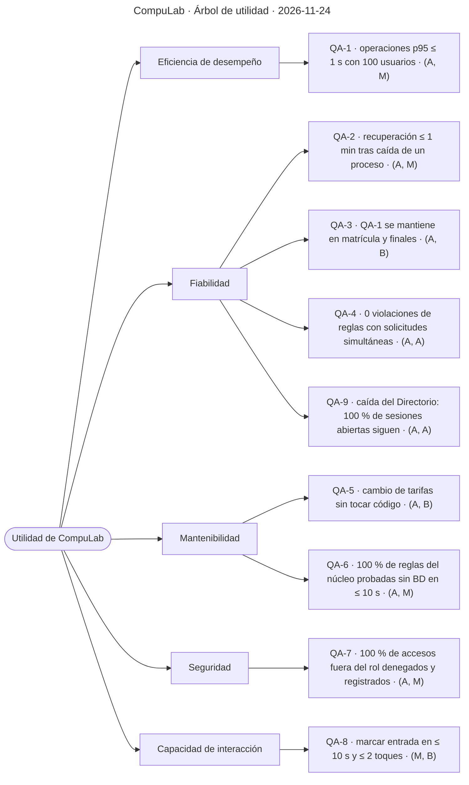

# 5. Atributos de calidad

> Responde: ¿cómo debe comportarse CompuLab, medido de forma comprobable, y qué decisiones lo sostienen o lo ponen en riesgo?
> Formato: escenarios de seis partes (fuente, estímulo, artefacto, entorno, respuesta, medida), clasificados según ISO/IEC 25010:2023, priorizados con un árbol de utilidad y analizados con los resultados del método ATAM.
> Las medidas son objetivos del equipo; requieren validación con la Escuela.
> Versión 2026-11-24 (revisión 1).

## 5.1 Árbol de utilidad

Cada hoja lleva (importancia para el negocio, dificultad técnica). Las (A, A) reciben atención temprana.

Leyenda: óvalo = raíz; rectángulo = característica ISO 25010 o escenario (hoja); flecha = "se refina en".

| QA | Característica ISO 25010 | Importancia | Dificultad | Empuja la arquitectura |
| --- | --- | --- | --- | --- |
| QA-4 | Fiabilidad · integridad ante concurrencia | A | A | Sí (ADR-0009) |
| QA-9 | Fiabilidad · tolerancia a fallos de un sistema externo | A | A | Sí (ADR-0008, ADR-0011) |
| QA-6 | Mantenibilidad · capacidad de ser probado | A | M | Sí (ADR-0001) |
| QA-1 | Eficiencia de desempeño · tiempo de respuesta | A | M | Sí |
| QA-2 | Fiabilidad · disponibilidad y recuperación | A | M | Sí (ADR-0004) |
| QA-7 | Seguridad · autorización y no repudio | A | M | Sí |
| QA-3 | Fiabilidad · tolerancia a picos externos | A | B | Sí (ADR-0004) |
| QA-5 | Mantenibilidad · modificabilidad | A | B | Sí (ADR-0005) |
| QA-8 | Capacidad de interacción · uso en móvil | M | B | Parcial (frontend) |

## 5.2 Escenarios

### QA-1 · Tiempo de respuesta
| Parte | Valor |
| --- | --- |
| Fuente | Estudiante, asistente o coordinador |
| Estímulo | Reserva una máquina, marca entrada o asigna un turno |
| Artefacto | Backend de CompuLab |
| Entorno | Operación normal en semestre, 100 usuarios concurrentes |
| Respuesta | Procesa la operación y responde con el resultado o el error de regla |
| Medida | p95 ≤ 1 s; consultas de horario y disponibilidad p95 ≤ 500 ms. Presupuesto de latencia en `07-arquitectura.md` (7.6) |

### QA-2 · Disponibilidad y recuperación
| Parte | Valor |
| --- | --- |
| Fuente | Falla interna (el proceso del backend o de la base de datos termina inesperadamente) |
| Estímulo | El contenedor deja de responder |
| Artefacto | Contenedores `backend` y `db` |
| Entorno | Horario de laboratorios en semestre |
| Respuesta | Docker detecta la falla por el healthcheck y reinicia el contenedor; no se pierden datos confirmados; las tareas programadas procesan al volver lo que quedó pendiente |
| Medida | Servicio restablecido en ≤ 1 minuto; 0 transacciones confirmadas perdidas; respaldo diario disponible |

### QA-3 · Tolerancia a picos externos
| Parte | Valor |
| --- | --- |
| Fuente | Otros sistemas del TEC (matrícula, cierre de notas) |
| Estímulo | Carga alta en la infraestructura compartida durante la semana de matrícula o de finales |
| Artefacto | CompuLab completo |
| Entorno | Semana de matrícula o finales |
| Respuesta | CompuLab mantiene su desempeño porque tiene contenedores y base de datos propios, con límites de recursos, y no consulta el Directorio en cada petición |
| Medida | QA-1 se cumple igual que en una semana normal |

### QA-4 · Integridad ante concurrencia
| Parte | Valor |
| --- | --- |
| Fuente | Dos coordinadores, dos estudiantes, o el Reloj y el coordinador de soporte |
| Estímulo | Ejecutan en el mismo instante operaciones que juntas violarían una regla: dos turnos al mismo asistente (traslapados o que juntos superan su tope), dos turnos en la misma franja de un laboratorio, dos reservas de la misma máquina, dos reservas del mismo estudiante, o dos cierres del mismo mes |
| Artefacto | Módulos horarios, reservas y liquidación, y la base de datos |
| Entorno | Inicio de semestre (armado de horarios), inicio de semana (reservas), día 1 (cierre) |
| Respuesta | Solo las operaciones compatibles se confirman; la otra recibe el error de regla correspondiente o, en el cierre, el cierre existente (ADR-0009) |
| Medida | 0 traslapes por asistente o laboratorio, 0 semanas sobre el tope, 0 dobles reservas de una máquina, 0 estudiantes con dos reservas activas y 0 cierres duplicados, verificado con pruebas concurrentes |

### QA-5 · Modificabilidad de tarifas
| Parte | Valor |
| --- | --- |
| Fuente | Coordinación de Soporte |
| Estímulo | Cambia las tarifas por categoría o el porcentaje de recargo, con poca anticipación |
| Artefacto | Módulo liquidación |
| Entorno | Cualquier momento del semestre |
| Respuesta | El coordinador registra los nuevos valores con su fecha de vigencia desde la aplicación; los cierres siguientes los usan y los cierres pasados no cambian |
| Medida | 0 líneas de código modificadas y 0 despliegues; el cambio toma ≤ 5 minutos |

### QA-6 · Capacidad de ser probado
| Parte | Valor |
| --- | --- |
| Fuente | Equipo de desarrollo |
| Estímulo | Ejecuta las pruebas del dominio y de los casos de uso |
| Artefacto | Capas de dominio y aplicación de cada módulo |
| Entorno | Máquina de desarrollo o CI, sin base de datos, red ni reloj real |
| Respuesta | Todas las reglas se prueban con dobles inyectados por los puertos |
| Medida | 100 % de poscondiciones y extensiones de CU-06, CU-11 y CU-14 con prueba; la suite de dominio corre en ≤ 10 s |

### QA-7 · Autorización
| Parte | Valor |
| --- | --- |
| Fuente | Usuario autenticado con un rol |
| Estímulo | Intenta una operación fuera de su alcance (por ejemplo, un coordinador asigna un turno en otro laboratorio o un estudiante consulta una reserva ajena manipulando el identificador) |
| Artefacto | Backend (capa de aplicación) |
| Entorno | Operación normal |
| Respuesta | Rechaza la operación sin cambiar nada, aunque la petición no venga de la interfaz, y registra el intento en la bitácora de seguridad (usuario, operación, recurso, hora e identificador de solicitud) |
| Medida | 100 % de los intentos de la matriz 2.3 denegados y 100 % registrados, verificado con pruebas de permisos |

### QA-8 · Uso en el celular
| Parte | Valor |
| --- | --- |
| Fuente | Asistente |
| Estímulo | Marca la entrada de su turno, de pie en la puerta del laboratorio |
| Artefacto | Frontend (vista móvil) |
| Entorno | Celular con pantalla de 360 px de ancho, sesión ya iniciada |
| Respuesta | La pantalla principal ofrece la acción de marcar del turno actual |
| Medida | ≤ 10 s y ≤ 2 toques desde abrir la aplicación |

### QA-9 · Caída o lentitud del Directorio institucional
| Parte | Valor |
| --- | --- |
| Fuente | Directorio institucional (sistema externo del Centro de Cómputo) |
| Estímulo | No responde o tarda más de 3 segundos |
| Artefacto | Módulo identidad (adaptador `DirectorioInstitucional`) |
| Entorno | Semana de matrícula |
| Respuesta | Quien ya tiene sesión sigue operando sin interrupción. Los nuevos inicios de sesión fallan cerrado con un mensaje claro; tras 5 fallos seguidos se abre el interruptor 30 s y se responde al instante (ADR-0011) |
| Medida | 100 % de las operaciones de usuarios con sesión siguen funcionando; el rechazo de un nuevo inicio llega en ≤ 3 s (≤ 100 ms con el interruptor abierto); 0 accesos sin identidad verificada |

## 5.3 Resultados del análisis (ATAM)

### Riesgos — decisiones o incertidumbres que pueden impedir un escenario
| ID | Riesgo | Escenario | Tratamiento |
| --- | --- | --- | --- |
| RA-1 | No se ha medido la latencia del Directorio en matrícula. | QA-9, QA-1 (inicio de sesión) | Medir con el Centro de Cómputo; los valores de ADR-0011 son ajustables. |
| RA-2 | Una sola instancia del backend: si cae el servidor completo, no hay servicio. | QA-2 | Aceptado (ADR-0004); respaldo diario y reinicio automático. |
| RA-3 | Si el backend está caído a la hora de una tarea programada, esa ejecución se pierde. | QA-2, RN-11, RN-18 | Cada tarea procesa todo lo pendiente, no solo lo del último minuto; el cierre se puede disparar a mano (ADR-0003). |
| RA-4 | PostgreSQL 14 ya no recibe parches de seguridad. | QA-7 | Base solo accesible desde el servidor (ADR-0006). |
| RA-5 | El formato del archivo de Becas no está confirmado. | FP-3 | Adaptador aislado (ADR-0007). |

### No-riesgos — decisiones justificadas para las condiciones evaluadas
| ID | Decisión | Por qué no amenaza el escenario |
| --- | --- | --- |
| NR-1 | El cierre mensual corre dentro del backend. | ≈ 50 asistentes × ≈ 60 turnos al mes: cálculo de milisegundos, no bloquea QA-1. |
| NR-2 | Bloqueo por asistente al asignar turnos. | Pocas asignaciones simultáneas al mismo asistente; la espera es de milisegundos (QA-4 sin costo visible en QA-1). |
| NR-3 | Tarifas como datos con vigencia. | QA-5 se cumple sin código y los cierres guardan sus valores (ADR-0005). |
| NR-4 | Monolito modular sin red interna. | Ninguna llamada entre módulos cruza la red (ADR-0001). |

### Puntos de sensibilidad — parámetros con gran efecto sobre un atributo
| ID | Parámetro | Atributo afectado |
| --- | --- | --- |
| S-1 | Tiempo de espera y umbral del interruptor del Directorio (3 s, 5 fallos, 30 s) | QA-9 y tiempo de inicio de sesión |
| S-2 | Duración de la transacción de asignar (tiempo que se mantiene el bloqueo) y tamaño del grupo de conexiones a la base | QA-1 bajo concurrencia |
| S-3 | Frecuencia de las tareas programadas (cada minuto) | Exactitud de RN-11, RN-13 y RN-18 (hasta 1 min de atraso) |
| S-4 | Duración de la sesión (8 h) | QA-9 (continuidad) frente a QA-7 (una baja en el Directorio tarda en surtir efecto) |

### Compromisos — decisiones que mejoran un atributo y perjudican otro
| ID | Compromiso | Decisión |
| --- | --- | --- |
| C-1 | Continuidad ante la caída del Directorio frente a control de acceso | Fallar cerrado para nuevos inicios; las sesiones abiertas siguen (ADR-0011). Lo valida la Coordinación de Soporte. |
| C-2 | Integridad (QA-4) frente a rendimiento (QA-1) | Serializar solo por asistente y usar restricciones de la base, no aislamiento serializable global (ADR-0009). |
| C-3 | Disponibilidad (QA-2) frente a la simplicidad pedida | Reinicio automático sin réplicas; recuperación de hasta 1 minuto (ADR-0004). |
| C-4 | Comprobabilidad (QA-6) frente a cantidad de archivos | Puertos e interfaces en cada módulo (ADR-0001). |

## 5.4 Tácticas asociadas

| QA | Tácticas | Dónde se ve |
| --- | --- | --- |
| QA-1 | Índices por asistente-fecha, laboratorio-fecha y máquina-fecha; transacciones cortas; presupuesto de latencia | `07-arquitectura.md` (7.6), `16-diseno-bd.md` (pendiente) |
| QA-2 | `restart: unless-stopped`, healthchecks, volumen persistente, respaldo diario, tareas que procesan lo pendiente | `docker-compose.yml`, ADR-0003, ADR-0004 |
| QA-3 | Base de datos y contenedores dedicados, límites de memoria, sesión propia | `07-arquitectura.md`, ADR-0008 |
| QA-4 | Bloqueo por asistente, restricciones `EXCLUDE` y de unicidad, transacción por caso de uso, claves de solicitud | ADR-0009, ADR-0010 |
| QA-5 | Tarifas y recargo como datos con vigencia; copia en cada cierre | ADR-0005 |
| QA-6 | Puertos y adaptadores; reloj inyectado; funciones de aptitud | ADR-0001, `07-arquitectura.md` (7.5) |
| QA-7 | Verificación de rol y laboratorio en cada caso de uso; bitácora de seguridad con identificador de solicitud | `08-componentes.md`, `07-arquitectura.md` (7.8) |
| QA-8 | Diseño móvil primero para la vista del asistente | `diseno-ux-ui.md` (pendiente) |
| QA-9 | Tiempo de espera, un reintento con espera aleatoria, interruptor, fallar cerrado, sesión propia | ADR-0008, ADR-0011, `08-componentes.md` |
