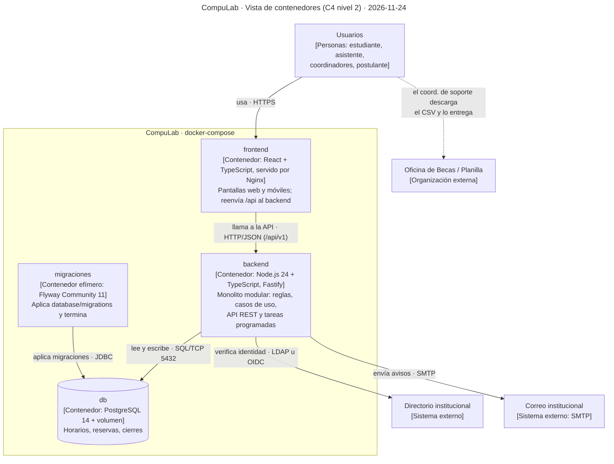
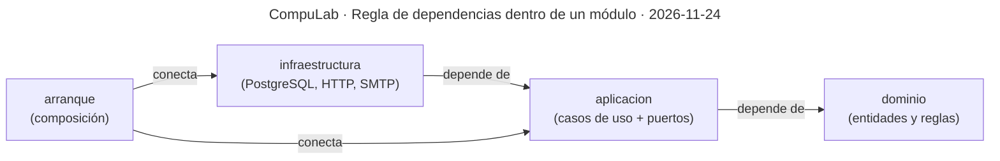
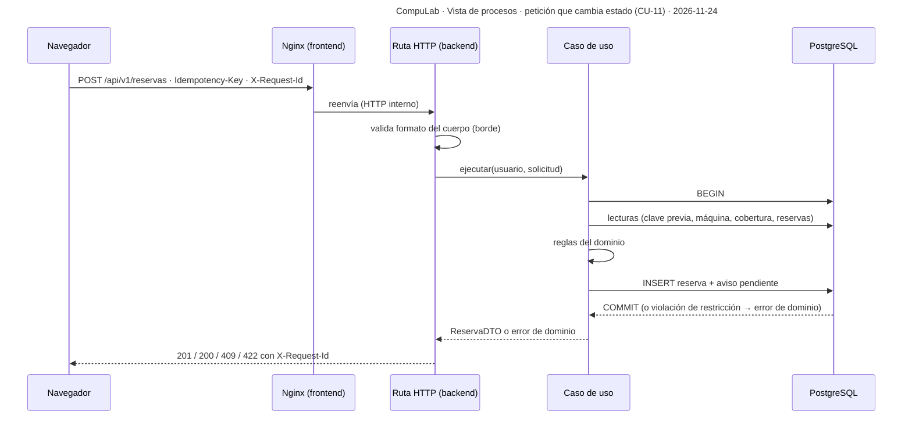
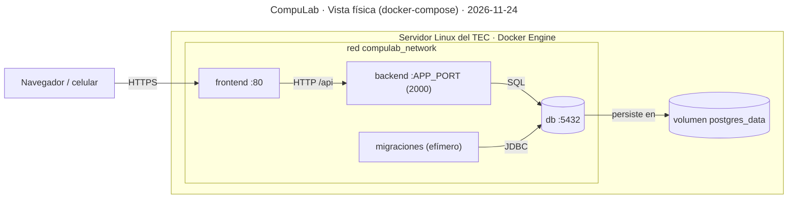
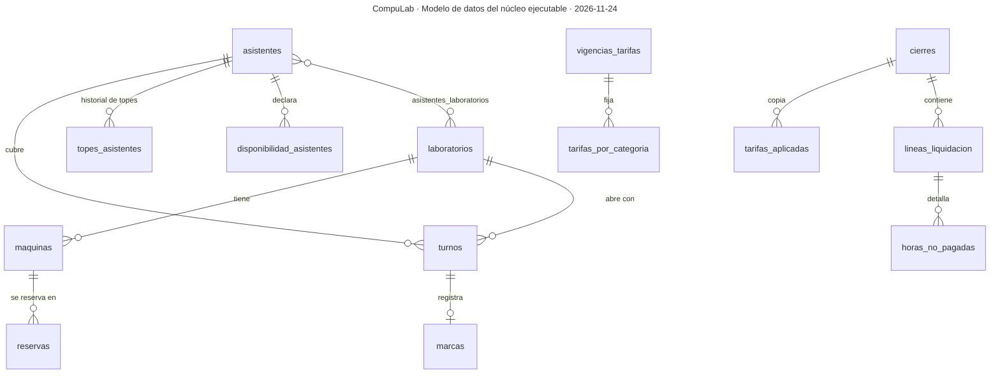

# 7. Arquitectura

> Responde: ¿cómo está armado CompuLab, qué se despliega, qué corre al mismo tiempo, cómo se organiza el código, qué reglas no se pueden romper y dónde se toca para cambiar algo?
> Vistas según 4+1 (lógica, procesos, desarrollo, física + escenarios) y C4 (niveles 1 a 3).
> Versión 2026-11-24 (revisión 1).

| Pregunta de quien lee | Sección |
| --- | --- |
| ¿Qué se despliega y con qué se habla? | 7.2 Contenedores (C4 nivel 2) |
| ¿Dónde toco para cambiar esto? | 7.3 Desarrollo y 7.10 Guía de cambios frecuentes |
| ¿Qué corre al mismo tiempo y cuánto tarda? | 7.6 Procesos |
| ¿Qué pasa si se cae algo? | 7.7 Física y `05-atributos-de-calidad.md` |
| ¿Qué hace cada pieza por dentro? | `08-componentes.md` (vista lógica, C4 nivel 3) |
| ¿Por qué se hizo así? | `adr/` |

## 7.1 Estilo arquitectónico

Se combinan tres estilos, cada uno elegido por un driver:

| Estilo | Dónde | Driver | Compra… | …y lo paga con | ADR |
| --- | --- | --- | --- | --- | --- |
| **Monolito modular** | El backend completo | Un equipo, un ritmo de cambio, volumen bajo: ninguna de las cuatro razones para separar servicios aplica | límites firmes entre módulos con un solo despliegue y sin fallos de red | disciplina: los límites solo existen si se verifican (FA-2) | ADR-0001 |
| **Puertos y adaptadores** | Dentro de cada módulo | QA-6, R-5 a R-8: probar todas las reglas sin base de datos, red ni reloj | comprobabilidad y poder cambiar Directorio, correo o formato de Becas sin tocar reglas | más interfaces y archivos | ADR-0001 |
| **Capas** | Dentro de cada módulo (`dominio → aplicacion → infraestructura`) | Mantenibilidad: separar reglas de mecanismos | cambiar la API o la base sin tocar el dominio | código de traspaso (DTOs) entre capas | ADR-0001 |

Otras decisiones estructurales: tareas programadas dentro del backend (ADR-0003), disponibilidad con reinicio automático sin réplicas (ADR-0004), control de concurrencia por asistente y con restricciones en la base (ADR-0009).

## 7.2 Vista de contenedores (C4 nivel 2)



Leyenda: rectángulo = contenedor o sistema; cilindro = base de datos; línea continua = llamada en tiempo de ejecución con su protocolo; línea punteada = entrega manual.

| Contenedor | Responsabilidad | Arranca después de |
| --- | --- | --- |
| `db` | Persistir todo el estado. Dedicada a CompuLab (QA-3). | — |
| `migraciones` | Dejar el esquema en la versión del repositorio. Corre una vez y termina. | `db` sano |
| `backend` | Toda la lógica: dominio, casos de uso, API REST, tareas programadas, integraciones. | `migraciones` terminado con éxito |
| `frontend` | Interfaz de usuario; sirve estáticos y reenvía `/api` al backend. Se agrega al compose cuando exista `frontend/Dockerfile`. | `backend` |

### Integraciones con sistemas externos

| Con quién | Estilo | Por qué ese | Lo que hubo que aceptar | ADR |
| --- | --- | --- | --- | --- |
| Directorio institucional | Petición-respuesta (LDAP u OIDC) | Sin la identidad no se puede continuar con el inicio de sesión. | Si está caído, nadie nuevo entra (fallar cerrado); quien ya tiene sesión sigue. Vocabulario ajeno encerrado en el adaptador (capa anticorrupción). | ADR-0008, ADR-0011 |
| Oficina de Becas / Planilla | Transferencia de archivo (CSV) | Becas no usa el sistema ni expone API; recibe un archivo al mes. | No hay confirmación automática de recepción; la entrega la hace el coordinador de soporte. | ADR-0007 |
| Correo institucional (SMTP) | Envío diferido (el aviso se guarda en la transacción y se envía después) | Nadie debe esperar a que salga un correo, y una caída del correo no debe impedir reservar. | Estado intermedio "aviso pendiente"; un correo enviado no se puede deshacer, por eso se envía después de confirmar. | — |

## 7.3 Vista de desarrollo: organización del código

La estructura de carpetas dice qué hace el sistema: se organiza por módulo de negocio, no por tipo técnico.

### Backend

```
backend/
├── src/
│   ├── modulos/
│   │   ├── horarios/                 ← un módulo = una razón de cambio
│   │   │   ├── dominio/              entidades, objetos valor, reglas y errores de dominio
│   │   │   ├── aplicacion/           un caso de uso por clase (AsignarTurno) + puertos que necesita
│   │   │   ├── infraestructura/      adaptadores: repositorio PostgreSQL, rutas HTTP
│   │   │   └── index.ts              interfaz provista del módulo
│   │   ├── reservas/                 máquinas y reservas (actor: estudiante)
│   │   ├── liquidacion/              tarifas y cierre mensual (actor: coord. soporte, Becas)
│   │   ├── asistentes/               asistentes, categoría, tope, disponibilidad
│   │   ├── asistencia/               marcas de entrada y salida
│   │   ├── reclutamiento/            convocatorias, postulaciones, entrevistas
│   │   ├── reportes/                 métricas de uso de máquinas, solo lectura (actor: coord. soporte)
│   │   ├── identidad/                sesión, roles, Directorio
│   │   └── notificaciones/           avisos en la app y por correo
│   ├── compartido/
│   │   ├── dominio/                  núcleo compartido: Franja, Semana, Dinero, Reloj, ErrorDeDominio
│   │   └── infraestructura/          piezas técnicas comunes: formato HTTP, reloj del sistema, unidad de trabajo en memoria
│   ├── tareas-programadas/           disparadores por tiempo que invocan casos de uso
│   └── arranque/                     raíz de composición: crea adaptadores, conecta módulos, levanta HTTP
├── tests/
│   ├── modulos/<modulo>/             pruebas de dominio y de casos de uso, con dobles
│   ├── dobles/                       fakes en memoria (repositorios, reloj, notificador)
│   └── aptitud/                      pruebas de las funciones de aptitud
└── Dockerfile
```

Cada módulo responde ante un solo actor: por eso las métricas para el presupuesto (CU-17, coordinador de soporte) viven en `reportes` y no en `reservas`, cuyo actor es el estudiante. `compartido/dominio` solo contiene objetos valor que varios módulos usan con el mismo significado; no es una carpeta de "utilidades".

### Frontend

```
frontend/src/
├── funcionalidades/
│   ├── horario-laboratorio/      CU-06: vista, presentador, modelo de vista
│   ├── reservar-maquina/         CU-11
│   └── cierre-mensual/           CU-14
├── compartido/
│   ├── api/                      cliente HTTP, tipos del contrato de la API (08-componentes.md), clave de solicitud
│   └── ui/                       componentes visuales reutilizables
└── app/                          rutas, sesión y selección de rol
```

Las rutas, el menú de cada rol y los flujos de pantalla están definidos en `diseno-ux-ui.md`.

Patrón *Humble Object*: el **presentador** convierte la respuesta de la API en un modelo de vista (fechas legibles, colones formateados, mensajes de error en lenguaje sencillo) y se prueba sin renderizar; la **vista** (componente React) solo muestra el modelo de vista.

### Otros directorios

| Directorio | Contenido |
| --- | --- |
| `database/migrations/` | Scripts Flyway `V1__descripcion.sql`, `V2__…`. Única fuente del esquema. |
| `docs/` | Este documento de diseño, `docs/adr/` con las decisiones y `docs/prototipo/` con el prototipo navegable. |

## 7.4 Regla de dependencias



Leyenda: rectángulo = capa o paquete; flecha = dependencia de código fuente (quién importa a quién). No existe ninguna flecha hacia afuera desde `dominio`.

1. Las dependencias de código apuntan **hacia adentro**: `infraestructura → aplicacion → dominio`.
2. El **dominio** no importa nada fuera de sí mismo y de `compartido/dominio`: ni librerías de npm ni módulos de Node (`fs`, `http`, etc.).
3. La **aplicación** define los puertos que necesita (interfaces requeridas) en su propio idioma; la infraestructura los implementa.
4. Un módulo **no importa a otro módulo**. Si `reservas` necesita saber si un laboratorio está abierto, declara un puerto requerido (`CoberturaDeLaboratorio`) y `arranque/` lo conecta con la interfaz provista de `horarios`. Así cada módulo se prueba solo y no hay ciclos.
5. Entre capas solo viajan **DTOs simples**: ni objetos de Fastify ni filas de la base llegan a los casos de uso.

## 7.5 Funciones de aptitud

Se verifican con dependency-cruiser en `npm test`; si alguna falla, el build falla. Cada una tiene una prueba en `tests/aptitud/` que crea un archivo con una violación a propósito y exige que la herramienta la reporte.

| ID | Propiedad verificada | Regla | Driver |
| --- | --- | --- | --- |
| FA-1 | El dominio es puro. | Ningún archivo bajo `src/modulos/*/dominio/` o `src/compartido/dominio/` importa `aplicacion/`, `infraestructura/`, `arranque/`, paquetes de `node_modules` ni módulos nativos de Node. | QA-6, R-6 |
| FA-2 | Los módulos no se conocen entre sí. | Ningún archivo bajo `src/modulos/X/` importa algo de `src/modulos/Y/` (X ≠ Y). Solo `src/arranque/` puede conectar módulos. | QA-6, ADR-0001 |
| FA-3 | La aplicación no depende de la infraestructura. | Ningún archivo bajo `*/aplicacion/` importa `*/infraestructura/`. | QA-6 |
| FA-4 | No hay ciclos. | No existen dependencias circulares en `src/`. | Mantenibilidad |
| FA-5 | La aplicación no importa paquetes. | Ningún archivo bajo `*/aplicacion/` importa paquetes de `node_modules` (`pg`, Kysely, Fastify…): la tecnología queda en `infraestructura/`. | QA-6, R-5 |

El núcleo ejecutable implementa al menos FA-1 y FA-2 (R-9).

## 7.6 Vista de procesos

### Qué corre y cuándo
| Elemento en ejecución | Dónde | Concurrencia |
| --- | --- | --- |
| Atención de peticiones HTTP | Proceso Node.js del contenedor `backend` (un hilo de eventos) | Muchas peticiones a la vez; cada una espera a la base sin bloquear a las demás. |
| Transacciones | PostgreSQL, a través de un grupo de 10 conexiones | Una transacción por caso de uso que cambia estado; las asignaciones al mismo asistente se serializan con un bloqueo de su agenda (ADR-0009). |
| Tareas programadas | El mismo proceso Node.js, con node-cron (ADR-0003) | Una ejecución a la vez por tarea; si la anterior no terminó, la siguiente se salta. |
| Respaldo | `cron` del servidor ejecuta `pg_dump` en el contenedor `db` | Diario, fuera del horario de laboratorios. |

### Tareas programadas
| Tarea | Frecuencia | Qué hace | Regla | Idempotente porque… |
| --- | --- | --- | --- | --- |
| `liberar-reservas-sin-presentacion` | cada minuto | Libera todas las reservas activas cuyo límite de presentación ya pasó. | RN-18 | Solo toca reservas todavía `ACTIVA`. |
| `vencer-ofertas` | cada minuto | Vence todas las ofertas abiertas de turnos que empiezan en menos de 24 h. | RN-11 | Solo toca ofertas todavía `ABIERTA`. |
| `avisar-turnos-sin-entrada` | cada minuto | Avisa al coordinador por turnos con 15 min sin entrada. | RN-13 | Marca el turno como avisado. |
| `cerrar-turnos-no-cubiertos` | cada minuto | Marca no cubiertos los turnos terminados sin entrada y cancela sus reservas. | RN-13, RN-19 | Solo toca turnos todavía `ASIGNADO`. |
| `enviar-avisos-pendientes` | cada minuto | Envía por correo los avisos pendientes; reintenta con espera creciente (1, 2, 4… hasta 30 min). | RF-35 | Marca cada aviso enviado. |
| `cerrar-mes` | día 1, 00:05 | Ejecuta `CerrarMes` para el mes anterior. | CU-14 | RN-26 y `UNIQUE (anio, mes)`. |
| `cerrar-semestre` | diario, 00:10 | Al pasar la fecha de fin, deja inactivos a los asistentes del semestre. | RN-04 | Solo toca asistentes activos. |

Todas procesan **todo lo pendiente**, no solo lo del último minuto: si el backend estuvo caído, al volver se ponen al día (riesgo RA-3).

### Una operación que cambia estado, en el tiempo



Leyenda: participante = proceso o componente en ejecución; flecha continua = llamada; flecha punteada = respuesta.

### Presupuesto de latencia (QA-1, p95 ≤ 1 s)
| Tramo | Presupuesto |
| --- | --- |
| Red del usuario + Nginx | 150 ms |
| Validación en el borde | 10 ms |
| Transacción (lecturas indexadas, reglas, escritura, commit) | 150 ms |
| Serialización de la respuesta | 10 ms |
| Margen (espera por bloqueo, picos) | 680 ms |

## 7.7 Vista física (despliegue)



Leyenda: recuadro exterior = servidor físico; recuadro interior = red de Docker; rectángulo = contenedor con su puerto; cilindro = almacenamiento; flecha = conexión con su protocolo.

- `restart: unless-stopped` y healthcheck en `db` y `backend`: si caen, Docker los levanta (QA-2).
- La base de datos solo se publica en `127.0.0.1` del servidor; desde afuera solo se llega al frontend.
- Respaldo diario con `pg_dump` (QA-2).
- Variables de entorno en `.env` (no se versiona); plantilla en `.env.example`.

## 7.8 Decisiones transversales

| Tema | Decisión |
| --- | --- |
| Hora oficial | El puerto `Reloj` devuelve la hora del **sistema operativo del servidor del backend, sincronizado por NTP** con el servidor de hora del TEC, expresada en `America/Costa_Rica` (UTC−6, sin horario de verano). Las marcas de asistencia, las reservas y los vencimientos usan la hora del servidor al recibir la solicitud, **nunca la del celular**. En la API las fechas viajan en ISO-8601 con desfase (`2026-11-24T18:00:00-06:00`); en la base, `timestamptz`. |
| Dinero | Colones en céntimos enteros (`Dinero`), nunca números de punto flotante (RN-27); toda cifra de dinero viaja con su moneda (`CRC`). |
| Errores | Cada regla que falla lanza un error de dominio con nombre propio (los de las tablas de extensiones). La capa HTTP lo traduce a un código y un cuerpo JSON uniforme (`08-componentes.md`); nunca se responde 500 por una regla de negocio. |
| Concurrencia | Una transacción por caso de uso que cambia estado; bloqueo por asistente y restricciones en la base según ADR-0009. |
| Idempotencia | Las operaciones de creación llevan una clave de solicitud generada por el frontend (ADR-0010). |
| Identidad y autorización | El backend autentica contra el Directorio, emite su propia sesión de 8 h (cookie `httpOnly`) y guarda los roles (ADR-0008, ADR-0011). Cada caso de uso recibe el usuario actual y verifica su permiso (QA-7). En el núcleo ejecutable el usuario actual lo provee un doble. |
| Trazas correlacionadas | Nginx genera `X-Request-Id` si no viene; el backend lo propaga, lo escribe en cada línea de bitácora (pino, JSON) y lo devuelve en la cabecera y en el cuerpo de error (`idSolicitud`). Con ese número se encuentra una operación en segundos. |
| Bitácora de seguridad | Cada intento denegado por permisos se registra con usuario, operación, recurso, hora e `idSolicitud` (QA-7). |
| Avisos | Los casos de uso llaman al puerto `Notificador`; el aviso se guarda en la misma transacción y el correo sale después con reintentos (7.6). |
| Trazabilidad en el código | Comentarios `// CU-06 paso 4`, `// ext 4a`, `// RN-07`; nombres de pruebas con el código del camino que cubren. |

## 7.9 Escenario que amarra las vistas (+1)

**CU-11 bajo QA-4:** dos estudiantes reservan la misma máquina en la misma franja en el mismo segundo.

| Vista | Cómo se ve el escenario |
| --- | --- |
| Lógica (`08-componentes.md`) | `ReservarMaquina` (módulo reservas) pide la cobertura a `CoberturaDeLaboratorio` (horarios) y guarda por `RepositorioReservas`; la regla "máquina libre" vive en el dominio de reservas. |
| Procesos (7.6) | Dos peticiones concurrentes, cada una en su transacción. Ambas validan con éxito; al confirmar, la restricción `EXCLUDE` por máquina rechaza a la segunda, que se traduce a `MaquinaNoDisponible` (409). |
| Desarrollo (7.3) | El código está en `src/modulos/reservas/`; el puente hacia horarios en `src/arranque/`. Ninguno importa al otro (FA-2). |
| Física (7.7) | Ambas peticiones llegan al único contenedor `backend` y la restricción vive en el contenedor `db`. |

## 7.10 Guía de cambios frecuentes

| Si cambia… | Se toca | No se toca | Pruebas a correr o agregar |
| --- | --- | --- | --- |
| Las tarifas o el porcentaje de recargo | Nada de código: el coordinador de soporte los registra con su vigencia (CU-15). | Todo el código | Ninguna |
| El formato del archivo de Becas | `src/modulos/liquidacion/infraestructura/` (adaptador `GeneradorArchivoBecas`) | Dominio de liquidación | Pruebas del adaptador |
| Un límite de reservas (2 h, 6 h, 15 min, 7 días) | `src/modulos/reservas/dominio/` (política de reservas) y RN correspondiente en `02-requerimientos.md` | Otros módulos | Pruebas de CU-11 |
| Una regla al asignar turnos | `src/modulos/horarios/dominio/`, el contrato de CU-06 y su tabla de extensiones | Reservas, liquidación | Pruebas de CU-06 |
| El protocolo del Directorio (LDAP ↔ OIDC) | `src/modulos/identidad/infraestructura/` | Todo lo demás | Pruebas del adaptador |
| La hora o frecuencia de una tarea | `src/tareas-programadas/` | Casos de uso | Pruebas de la tarea con `RelojFijo` |
| Se agrega un laboratorio o una máquina | Datos (RF-30), sin código | Todo el código | Ninguna |
| El esquema de la base | Nueva migración `V{n}__descripcion.sql` en `database/migrations/`; **nunca** se edita una migración ya aplicada | El dominio | Pruebas del repositorio afectado |
| Se necesita un aviso nuevo | Llamada a `Notificador` en el caso de uso y plantilla en `notificaciones/` | Otros casos de uso | Prueba de la poscondición del aviso |
| Una decisión difícil de revertir | Nuevo ADR en `docs/adr/`; si reemplaza a otro, se marca el anterior como sustituido (no se borra) | ADR anteriores | — |


## 7.11 Modelo de datos (PostgreSQL 14)

El esquema vive solo en `database/migrations/` (Flyway, V1 a V6) y los tipos de Kysely en `backend/src/compartido/infraestructura/postgres/esquema.ts` lo reflejan.



Leyenda: rectángulo = tabla; `||` = exactamente uno; `o{` = cero o muchos; `o|` = cero o uno. Sin dibujar: `semestres`, `roles_usuarios`, `sesiones` y `avisos`, que no se relacionan por llave con las demás.

| Restricción | Tabla | Regla | Error de dominio |
| --- | --- | --- | --- |
| `turnos_sin_traslape_asistente` | turnos | `EXCLUDE (id_asistente =, franja &&)` salvo `VACANTE` y `DESCARTADO` | `TraslapeDeTurno` |
| `turnos_sin_traslape_laboratorio` | turnos | `EXCLUDE (id_laboratorio =, franja &&)` con el mismo filtro | `FranjaOcupadaEnLaboratorio` |
| `reservas_sin_traslape_maquina` | reservas | `EXCLUDE (id_maquina =, franja &&)` sobre `ACTIVA` y `EN_USO` | `MaquinaNoDisponible` |
| `reservas_una_activa_por_estudiante` | reservas | índice único parcial sobre `ACTIVA` y `EN_USO` | `YaTieneReservaActiva` |
| `*_clave_de_solicitud_unica` | turnos, reservas | `UNIQUE (usuario, clave_solicitud)` (ADR-0010) | `ClaveDeSolicitudReutilizada` |
| `cierres_un_cierre_por_mes` | cierres | llave primaria `(anio, mes)` | `CierreYaExiste` → se devuelve el existente |
| `vigencias_tarifas_sin_traslape` | vigencias_tarifas | `EXCLUDE (daterange &&)` | — (lo impide el registro de tarifas) |

**Dos modos de persistencia** (variable `APP_PERSISTENCIA`): `postgres` en el contenedor y `memoria` para las pruebas y para correr sin base. Con `APP_DATOS_DEMO=true`, una base vacía se llena al arrancar con los mismos datos de demostración del modo en memoria (con un candado para que dos instancias no siembren a la vez). La franja se guarda como `inicio` y `fin` (`timestamptz`) más una columna generada `tstzrange` para las restricciones.

**Pruebas con la base real:** `tests/postgres/` corre solo si existe `APP_DB_PRUEBAS`. Cada archivo crea su propio esquema, le aplica las migraciones y lo borra al terminar. Ahí se comprueban `FOR UPDATE`, las restricciones y las transacciones, y la API completa corre también sobre PostgreSQL.
