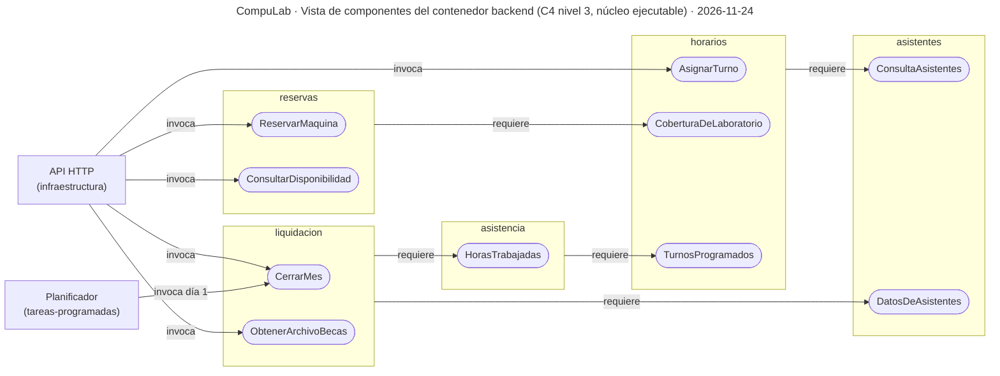

# 8. Componentes

> Responde: ¿qué ofrece y qué necesita cada módulo, con qué contrato, por qué otra pieza se puede reemplazar, y cuál es el contrato entre frontend y backend?
> Un componente es una unidad de reemplazo: tiene contrato explícito, esconde su interior y existe al menos una segunda implementación posible que se puede nombrar.
> Versión 2026-11-24 (revisión 1). Detalle completo para los módulos del núcleo ejecutable (horarios, reservas, liquidación); el resto se completará.

## 8.1 Módulos del backend

| Módulo | Actor ante el que responde | Razón de cambio | Interfaz provista (`index.ts`) | Interfaces requeridas | Núcleo |
| --- | --- | --- | --- | --- | --- |
| **horarios** | Coord. laboratorio | Reglas de armado del horario y cambios de turno | `AsignarTurno`, `ConsultarHorario`, `ListarLaboratorios`, `ConsultarAsistentesDelLaboratorio`, `CoberturaDeLaboratorio`, `TurnosProgramados` | `RepositorioTurnos`, `UnidadDeTrabajo`, `ConsultaAsistentes`, `AsistentesDelLaboratorio`, `CatalogoDeLaboratorios`, `CalendarioAcademico`, `Autorizacion`, `Notificador`, `Reloj` | ✔ |
| **reservas** | Estudiante | Reglas de uso de máquinas | `ReservarMaquina`, `ConsultarDisponibilidad`, `UsoDeMaquinas` | `RepositorioMaquinas`, `RepositorioReservas`, `UnidadDeTrabajo`, `CoberturaDeLaboratorio`, `Reloj` | ✔ |
| **liquidacion** | Coord. soporte (pago) y Becas (formato) | Reglas de pago, tarifas y formato de Becas | `CerrarMes`, `ConsultarCierre`, `ObtenerArchivoBecas` | `RepositorioCierres`, `HorasTrabajadas`, `DatosDeAsistentes`, `TablaTarifas`, `GeneradorArchivoBecas`, `Notificador`, `Reloj` | ✔ |
| asistencia | Asistente | Reglas de marcas y cobertura real | `RegistrarMarca`, `HorasTrabajadas` | `RepositorioMarcas`, `TurnosProgramados`, `VerificadorPresencia`, `Notificador`, `Reloj` | |
| asistentes | Coord. soporte | Estado, categoría, tope y disponibilidad del asistente | `ConsultaAsistentes`, `DatosDeAsistentes`, `TerminarAsistencia`, `CorregirTope` | `RepositorioAsistentes`, `AlTerminarAsistencia`, `Reloj` | |
| reclutamiento | Coord. soporte, postulante | Proceso de convocatoria y selección | `Postularse`, `EvaluarPostulacion` | `RepositorioPostulaciones`, `RegistroDeAsistentes`, `Reloj` | |
| reportes | Coord. soporte (presupuesto) | Qué métricas se piden para justificar presupuesto | `ConsultarUsoDeMaquinas` (CU-17) | `UsoDeMaquinas`, `CoberturaDeLaboratorio` | |
| identidad | Todos | Sesión y roles | `Autorizacion`, `IniciarSesion` | `DirectorioInstitucional`, `RepositorioRoles`, `BitacoraDeSeguridad` | |
| notificaciones | Todos | Canales de aviso | `Notificador` | `CanalCorreo`, `RepositorioAvisos` | |

Las interfaces requeridas se declaran en `aplicacion/` del módulo que las necesita, con su propio vocabulario. `arranque/` las conecta con la interfaz provista del otro módulo o con un adaptador de infraestructura (regla 4 de `07-arquitectura.md`).



Leyenda: recuadro = componente (módulo); óvalo = interfaz provista; flecha "requiere" = interfaz requerida conectada en `arranque/`; flecha "invoca" = quien dispara la operación. No hay ciclos: horarios → asistentes; reservas → horarios; asistencia → horarios; liquidación → asistencia y asistentes. Cuando un asistente deja de estar activo, `asistentes` avisa mediante su puerto requerido `AlTerminarAsistencia`, que implementa `horarios` (inversión de dependencia: evita el ciclo horarios ↔ asistentes).

## 8.2 Prueba de reemplazo

Si no se puede nombrar la implementación que sustituiría a una pieza sin tocar a quien la usa, el límite no existe.

| Pieza | Implementación actual | Se puede reemplazar por… | Quién no se entera |
| --- | --- | --- | --- |
| Módulo `horarios` (vía `CoberturaDeLaboratorio`) | Turnos asignados en CompuLab | Un calendario de apertura publicado por la Escuela | `reservas` |
| `RepositorioTurnos`, `RepositorioReservas`, `RepositorioCierres` | PostgreSQL con Kysely (`*Postgres` en la carpeta `infraestructura/` de cada módulo) | Repositorios en memoria (pruebas y `APP_PERSISTENCIA=memoria`) | Casos de uso y dominio |
| `TablaTarifas` | Tabla de vigencias en PostgreSQL (`TablaTarifasPostgres`) | Tarifas fijas (pruebas) o un catálogo publicado por la Coordinación | `CerrarMes` |
| `GeneradorArchivoBecas` | CSV (SUP-03) | XLSX o el formato nuevo que defina Becas | Dominio de liquidación |
| `DirectorioInstitucional` | Adaptador LDAP | Adaptador OIDC, o un doble con usuarios fijos | Todo lo que usa `Autorizacion` |
| `Notificador` | Aviso en la app + correo SMTP | Solo aviso en la app, o un doble que guarda avisos en memoria | Los casos de uso |
| `Reloj` | Hora del servidor sincronizada por NTP | `RelojFijo` (pruebas) | Dominio y casos de uso |
| `VerificadorPresencia` | Código QR del laboratorio (SUP-14) | Validación por red Wi-Fi del laboratorio | `RegistrarMarca` |

## 8.3 Puertos comunes

Formato de contrato: las cinco partes del material de clase (sintaxis, semántica, errores, calidad de servicio, versión), con la semántica escrita como precondiciones y poscondiciones.

### `Reloj`
| Parte | Contenido |
| --- | --- |
| Sintaxis | `ahora(): Instante` |
| Semántica | **Pre:** ninguna. **Post:** devuelve la hora oficial: la del sistema operativo del servidor del backend, sincronizado por NTP con el servidor de hora del TEC, en `America/Costa_Rica` (UTC−6). No tiene efectos. Es la única fuente de tiempo del dominio y la aplicación; la hora del celular nunca se usa. |
| Errores | Ninguno. |
| Calidad de servicio | Instantáneo; dos llamadas seguidas nunca retroceden en el tiempo. |
| Versión | v1. Cambiar de zona horaria rompe, aunque la firma no cambie. |

### `Notificador`
| Parte | Contenido |
| --- | --- |
| Sintaxis | `avisar(destinatario: IdUsuario, tipo: TipoDeAviso, datos: Record<string, string>): Promise<void>` |
| Semántica | **Pre:** se llama dentro de la transacción del caso de uso. **Post:** el aviso quedó registrado como pendiente en la misma transacción; si la transacción se revierte, el aviso no existe. No espera al correo. |
| Errores | Ninguno hacia el caso de uso: los fallos del correo se reintentan después (7.6 de `07-arquitectura.md`). |
| Calidad de servicio | ≤ 5 ms (una inserción). El correo sale en ≤ 1 min si el SMTP responde. |
| Versión | v1. Agregar un `TipoDeAviso` nuevo no rompe al que llama. |

### `Autorizacion`
| Parte | Contenido |
| --- | --- |
| Sintaxis | `puedeModificarHorario(usuario: UsuarioActual, idLaboratorio: string): Promise<boolean>` |
| Semántica | **Pre:** `usuario` viene de una sesión válida. **Post:** verdadero si el usuario es coordinador de ese laboratorio o coordinador de soporte. Si devuelve falso, la propia implementación registra el intento en la bitácora de seguridad (QA-7); así el caso de uso no necesita otra dependencia. |
| Errores | Ninguno: un laboratorio inexistente devuelve falso. |
| Calidad de servicio | ≤ 10 ms; sin efectos. |
| Versión | v1. |

### `UnidadDeTrabajo`
| Parte | Contenido |
| --- | --- |
| Sintaxis | `ejecutar<T>(trabajo: () => Promise<T>): Promise<T>` |
| Semántica | **Pre:** ninguna. **Post:** todo lo que `trabajo` escribió por los repositorios queda confirmado junto, o nada queda si lanzó un error. Los bloqueos tomados dentro se liberan al terminar. |
| Errores | Relanza el error de `trabajo`. Si una restricción de la base salta al confirmar, el repositorio que escribió ya la tradujo a su error de dominio (ADR-0009). |
| Calidad de servicio | Una transacción de PostgreSQL (`UnidadDeTrabajoPostgres`); una llamada anidada se une a la transacción en curso. Cada escritura que puede chocar con una restricción usa un `SAVEPOINT`, así el repositorio puede consultar el registro en conflicto antes de lanzar el error de dominio. En pruebas, `UnidadDeTrabajoEnMemoria`. |
| Versión | v1. |

### `DirectorioInstitucional` (diseño; fuera del núcleo)
| Parte | Contenido |
| --- | --- |
| Sintaxis | `autenticar(usuario: string, secreto: string): Promise<Identidad>` → `{ idUsuario, carne, nombre, correo, esEstudianteDeLaEscuela }` |
| Semántica | **Pre:** `usuario` y `secreto` no vacíos. **Post:** si las credenciales son válidas, devuelve la identidad traducida al vocabulario de CompuLab (capa anticorrupción). CompuLab nunca guarda el secreto. |
| Errores | `CredencialesInvalidas` (culpa de quien inicia sesión); `DirectorioNoDisponible` (tiempo agotado, error del Directorio o interruptor abierto). |
| Calidad de servicio | Tiempo de espera 3 s; un reintento ante error transitorio con espera aleatoria de 200–500 ms; interruptor que se abre tras 5 fallos seguidos durante 30 s. Ante `DirectorioNoDisponible`, fallar cerrado (ADR-0011). |
| Versión | v1. Pasar de LDAP a OIDC no cambia este contrato, solo el adaptador. |

## 8.4 Módulo horarios

### Interfaz provista
| Operación | Semántica | Errores |
| --- | --- | --- |
| `AsignarTurno.ejecutar(usuario, SolicitudAsignarTurno): { creado, turno: TurnoAsignadoDTO }` | CU-06 (contrato completo en `04-casos-de-uso.md`). Crea un turno asignado o pendiente de aceptación; con una clave ya usada devuelve el turno existente con `creado: false` (la API responde 200 en lugar de 201). **Implementado** en `backend/src/modulos/horarios/`. | `SinPermisoSobreLaboratorio`, `FranjaDeTurnoInvalida`, `FueraDelSemestre`, `TurnoEnElPasado`, `AsistenteNoExiste`, `AsistenteNoActivo`, `TraslapeDeTurno`, `FranjaOcupadaEnLaboratorio`, `TopeSemanalExcedido`, `ClaveDeSolicitudReutilizada` |
| `ConsultarHorario.ejecutar(idLaboratorio, lunes): HorarioSemanalDTO` | RF-11. Turnos del laboratorio en la semana que empieza ese lunes; `asistente` es `null` en un turno vacante. **Implementado.** | `LaboratorioNoExiste`, `DatoInvalido` (no es lunes) |
| `ListarLaboratorios.ejecutar(): Laboratorio[]` | `{ id, nombre, campus }` ordenados por nombre. **Implementado.** | — |
| `ConsultarAsistentesDelLaboratorio.ejecutar(idLaboratorio, lunes): AsistenteParaElegirDTO[]` | Asistentes activos del laboratorio con categoría, tope, minutos ya programados en la semana (RN-07) y disponibilidad. **Implementado.** | `LaboratorioNoExiste` |
| `CoberturaDeLaboratorio.franjasAbiertas(idLaboratorio, periodo): Franja[]` | Ver contrato abajo. **Implementado** como `ConsultarCobertura`. | `LaboratorioNoExiste` |
| `TurnosProgramados.delPeriodo(periodo): TurnoProgramadoDTO[]` | Turnos de todos los laboratorios que empiezan en el periodo, con responsable, franja y estado (lo usan asistencia y liquidación). **Implementado** como `ConsultarTurnosProgramados`. | — |

### Contrato · `CoberturaDeLaboratorio`
| Parte | Contenido |
| --- | --- |
| Sintaxis | `franjasAbiertas(idLaboratorio: string, periodo: Franja): Promise<Franja[]>` |
| Semántica | **Pre:** ninguna (la `Franja` ya garantiza inicio < fin). **Post:** devuelve, ordenadas y sin traslapes, las franjas dentro del periodo en que el laboratorio estará abierto según sus turnos `ASIGNADO` o `EN_CURSO`; dos turnos contiguos forman una sola franja. No cuenta turnos pendientes de aceptación, vacantes ni descartados (RN-15). No tiene efectos. |
| Errores | `LaboratorioNoExiste`. Un periodo sin turnos devuelve lista vacía, no error. |
| Calidad de servicio | ≤ 50 ms para un periodo de un día; se puede llamar las veces que sea. |
| Versión | v1. Agregar campos a `Franja` no rompe; cambiar qué estados cuentan sí rompe. |

### Interfaces requeridas
| Puerto | Operaciones | Para qué |
| --- | --- | --- |
| `RepositorioTurnos` | `porClaveDeSolicitud(idUsuario, clave): Turno \| null`; `bloquearAgendaDe(idAsistente): void`; `delAsistenteEntre(idAsistente, franja): Turno[]`; `delLaboratorioEntre(idLaboratorio, franja): Turno[]`; `delPeriodo(franja): Turno[]`; `guardar(turno): void` | Ext 5b (ADR-0010); serializar asignaciones al mismo asistente (ADR-0009); validar RN-06, RN-07, RN-09; registrar. `guardar` lanza `TraslapeDeTurno` o `FranjaOcupadaEnLaboratorio` si una restricción de la base salta. |
| `UnidadDeTrabajo` | ver 8.3 | Todo o nada. |
| `ConsultaAsistentes` | `obtener(idAsistente): AsistenteParaHorario \| null` → `{ id, nombre, activo, topeSemanalMinutos, disponibilidad: Bloque[] }` | Validar RN-04, RN-07, RN-08. |
| `AsistentesDelLaboratorio` | `activosDe(idLaboratorio): AsistenteDelLaboratorio[]` → lo mismo más `categoria` | Lista para elegir en la pantalla de CU-06. |
| `CatalogoDeLaboratorios` | `todos(): Laboratorio[]`; `porId(idLaboratorio): Laboratorio \| null` | `LaboratorioNoExiste` en las consultas. |
| `CalendarioAcademico` | `semestreVigente(): { inicio: Fecha, fin: Fecha } \| null` | Validar que la fecha esté dentro del semestre. |
| `GeneradorDeIds` | `nuevo(): string` | Identificador del turno nuevo, sin que el dominio genere números aleatorios (R-6). |
| `Autorizacion`, `Notificador`, `Reloj` | ver 8.3 | Ext 2a, ext 4d, ext 3c. |

## 8.5 Módulo reservas

### Interfaz provista
| Operación | Semántica | Errores |
| --- | --- | --- |
| `ReservarMaquina.ejecutar(usuario, SolicitudReserva): { creada, reserva: ReservaDTO }` | CU-11 (contrato completo en `04-casos-de-uso.md`). Crea una reserva activa; con una clave ya usada devuelve la reserva existente con `creada: false`. **Implementado** en `backend/src/modulos/reservas/`. | `FranjaDeReservaInvalida`, `FueraDeHorizonteDeReserva`, `ReservaExcedeDuracion`, `LaboratorioCerradoEnFranja`, `MaquinaFueraDeServicio`, `MaquinaNoDisponible`, `YaTieneReservaActiva`, `LimiteSemanalDeReservaExcedido`, `MaquinaNoExiste`, `ClaveDeSolicitudReutilizada` |
| `ConsultarDisponibilidad.ejecutar(idLaboratorio, fecha): DisponibilidadDTO` | RF-22. Franjas abiertas y estado de cada máquina con sus reservas activas del día; un día sin franjas devuelve la lista vacía (CU-11 ext 2a). **Implementado.** | `LaboratorioNoExiste` |
| `ConsultarMisReservas.ejecutar(usuario): MisReservasDTO` | Apoyo a CU-11 (no es un RF propio). Reserva activa del estudiante y minutos que lleva en la semana, para que la pantalla prevenga las ext 6a y 6b de CU-11 (`diseno-ux-ui.md` 15.6). **Implementado.** | — |
| `UsoDeMaquinas.delPeriodo(idLaboratorio, desde, hasta)` | Horas reservadas con presentación y periodos fuera de servicio por máquina (lo usa reportes). | `LaboratorioNoExiste` |

### Interfaces requeridas
| Puerto | Operaciones | Para qué |
| --- | --- | --- |
| `RepositorioMaquinas` | `porId(idMaquina): Maquina \| null`; `delLaboratorio(idLaboratorio): Maquina[]` | Estado de servicio (RN-20) y laboratorio de la máquina. |
| `RepositorioReservas` | `porClaveDeSolicitud(idEstudiante, clave): Reserva \| null`; `activaDelEstudiante(idEstudiante): Reserva \| null`; `delEstudianteEnSemana(idEstudiante, semana): Reserva[]`; `deMaquinaEntre(idMaquina, franja): Reserva[]`; `guardar(reserva): void` | Ext 7b; RN-17; traslape por máquina; registrar. `guardar` lanza `MaquinaNoDisponible` o `YaTieneReservaActiva` si una restricción de la base salta (ext 7a, 7c). |
| `UnidadDeTrabajo` | ver 8.3 | Todo o nada. |
| `CoberturaDeLaboratorio` | ver 8.4 (declarada de nuevo en reservas, con su propio `LaboratorioNoExiste`; el puente de `arranque/` traduce) | RN-15. |
| `GeneradorDeIds` | `nuevo(): string` | Identificador de la reserva nueva (R-6). |
| `Reloj` | ver 8.3 | Inicio en el futuro, hoy o los 6 días siguientes. |

## 8.6 Módulo liquidacion

### Interfaz provista
| Operación | Semántica | Errores |
| --- | --- | --- |
| `CerrarMes.ejecutar(anio, mes): ResumenDeCierreDTO` | CU-14 (contrato completo en `04-casos-de-uso.md`). Idempotente por mes (RN-26). | `MesNoTerminado`, `TarifaNoDefinida`, `ErrorAlGenerarArchivo` |
| `ConsultarCierre.ejecutar(anio, mes): ResumenDeCierreDTO` | Cierre ya hecho. | `CierreNoExiste` |
| `ObtenerArchivoBecas.ejecutar(anio, mes): ArchivoDTO` | Nombre, tipo `text/csv` y contenido del archivo guardado. | `CierreNoExiste` |
| `ListarCierresDelAnio.ejecutar(anio): MesDelAnioDTO[]` | Meses del año que ya empezaron, cada uno `CERRADO`, `POR_CERRAR` o `EN_CURSO`. **Implementado.** | `DatoInvalido` |

### Interfaces requeridas
| Puerto | Operaciones | Para qué |
| --- | --- | --- |
| `RepositorioCierres` | `porMes(mes: MesDeLiquidacion): CierreMensual \| null`; `delAnio(anio): CierreMensual[]`; `guardar(cierre): void` | RN-25, RN-26, garantía mínima. `guardar` es todo o nada; si ya existe un cierre del mes (ext 2c), lanza `CierreYaExiste` y el caso de uso devuelve el existente. |
| `HorasTrabajadas` | `delPeriodo(periodo: Franja): RegistroDeTurnoTrabajado[]` → `{ idAsistente, idTurno, inicioProgramado, finProgramado, entrada \| null, salida \| null, estado }` | Pasos 3 y 4. Devuelve los turnos que empiezan en el periodo, que va del lunes de la primera semana del mes al día 1 del mes siguiente (SUP-05). |
| `DatosDeAsistentes` | `obtener(idAsistente): { carne, nombre, categoria, topes: [{ minutosPorSemana, vigenteDesde }] }` | Categoría, historial de topes y datos del archivo. |
| `TablaTarifas` | `vigenciasEntre(desde, hasta): VigenciaDeTarifas[]` | RN-22, RN-23. El dominio elige el valor de cada fecha. |
| `GeneradorArchivoBecas` | `generar(cierre): Archivo` | Paso 7: capa anticorrupción con el formato de Becas. |
| `Notificador`, `Reloj` | ver 8.3 | Paso 8, `fechaDeCierre`, ext 2b. Avisos a `COORDINACION_DE_SOPORTE`: `CIERRE_LISTO` (P8, con los carnés que tuvieron horas sobre el tope) y `TARIFA_FALTANTE` (ext 5b). |

### Contrato · `TablaTarifas`
| Parte | Contenido |
| --- | --- |
| Sintaxis | `vigenciasEntre(desde: Fecha, hasta: Fecha): Promise<VigenciaDeTarifas[]>` → `[{ vigenteDesde, vigenteHasta?, tarifaPorHora: { [categoria]: Dinero }, porcentajeRecargo }]` |
| Semántica | **Pre:** `desde` ≤ `hasta`. **Post:** devuelve, ordenadas y sin traslapes, todas las vigencias que tocan el periodo, tal como las registró el coordinador de soporte (CU-15). Los valores pasados nunca cambian. No tiene efectos. Si alguna fecha del periodo queda sin vigencia, el **dominio** lanza `TarifaNoDefinida` al calcular. |
| Errores | Ninguno propio: un periodo sin vigencias devuelve lista vacía. |
| Calidad de servicio | ≤ 20 ms para un mes. |
| Versión | v1. Agregar una tercera categoría no rompe; expresar el porcentaje en otra unidad (25 frente a 0,25) sí rompe. |

### Contrato · `GeneradorArchivoBecas`
| Parte | Contenido |
| --- | --- |
| Sintaxis | `generar(cierre: CierreMensual): Archivo` → `{ nombre: string, tipo: "text/csv", contenido: string }` |
| Semántica | **Pre:** el cierre tiene al menos sus líneas calculadas. **Post:** devuelve el cierre traducido al formato de Becas (SUP-03): una fila por línea de liquidación, horas con dos decimales y monto en colones con dos decimales. Es el único lugar del sistema que conoce ese formato. No escribe en disco. |
| Errores | `ErrorAlGenerarArchivo` si un dato obligatorio viene vacío. |
| Calidad de servicio | Determinista: el mismo cierre produce siempre el mismo contenido. ≤ 1 s para 100 asistentes. |
| Versión | v1, ligada al formato de Becas. Si Becas cambia el formato, se cambia solo este adaptador. |

## 8.7 Contrato de la API HTTP (backend → frontend)

Es la interfaz provista del contenedor `backend` y el acuerdo que permite trabajar el frontend en paralelo con datos simulados.

### Convenciones
- Base: `/api/v1`. Cuerpos en JSON UTF-8. Validación de formato en el borde; las reglas de negocio, en el dominio.
- Fechas: `fecha` como `AAAA-MM-DD`; horas como `HH:MM`; instantes en ISO-8601 con desfase (`2026-11-26T08:00:00-06:00`).
- Duraciones en **minutos enteros**. Dinero en **céntimos enteros** y siempre acompañado de `"moneda": "CRC"`.
- Sesión por cookie; sin sesión → `401`.
- Cabecera `X-Request-Id`: si el cliente la envía se respeta; si no, se genera. Siempre vuelve en la respuesta.
- Cabecera `Idempotency-Key` (UUID generado por el frontend una vez por intención del usuario y reutilizado en cada reintento): **obligatoria** en `POST /laboratorios/{id}/turnos` y `POST /reservas`. Primera vez → `201`; reenvío con la misma clave → `200` con el mismo cuerpo; misma clave con datos distintos → `422 CLAVE_DE_SOLICITUD_REUTILIZADA` (ADR-0010).
- **Enumerados abiertos:** `estado`, `motivo` y `codigo` pueden recibir valores nuevos en una versión menor; el frontend debe tener una rama por omisión.
- Versionado: pedir menos y entregar más no rompe (agregar campos opcionales o de respuesta). Quitar o renombrar campos, cambiar un tipo, volver obligatorio un campo o endurecer una regla obliga a `/api/v2`.

### Formato de error
```json
{ "codigo": "TOPE_SEMANAL_EXCEDIDO",
  "mensaje": "Con este turno el asistente superaría su tope semanal.",
  "detalle": { "minutosProgramados": 600, "minutosDelTurno": 240, "topeSemanalMinutos": 720 },
  "idSolicitud": "4f1c2a9e-7b1d-4c55-9a0e-2f3b8d6c1e77" }
```

| HTTP | Códigos |
| --- | --- |
| 400 | `SOLICITUD_INVALIDA` (formato, campos faltantes o falta `Idempotency-Key`) |
| 401 | `NO_AUTENTICADO`, `CREDENCIALES_INVALIDAS` |
| 403 | `SIN_PERMISO_SOBRE_LABORATORIO`, `SIN_PERMISO` (el rol de la sesión no permite la operación) |
| 404 | `LABORATORIO_NO_EXISTE`, `MAQUINA_NO_EXISTE`, `CIERRE_NO_EXISTE`, `ASISTENTE_NO_EXISTE`, `RECURSO_NO_ENCONTRADO` (la ruta no existe) |
| 409 | `TRASLAPE_DE_TURNO`, `FRANJA_OCUPADA_EN_LABORATORIO`, `MAQUINA_NO_DISPONIBLE`, `YA_TIENE_RESERVA_ACTIVA` |
| 422 | `FRANJA_DE_TURNO_INVALIDA`, `FUERA_DEL_SEMESTRE`, `TURNO_EN_EL_PASADO`, `ASISTENTE_NO_ACTIVO`, `TOPE_SEMANAL_EXCEDIDO`, `FRANJA_DE_RESERVA_INVALIDA`, `FUERA_DE_HORIZONTE_DE_RESERVA`, `RESERVA_EXCEDE_DURACION`, `LABORATORIO_CERRADO_EN_FRANJA`, `MAQUINA_FUERA_DE_SERVICIO`, `LIMITE_SEMANAL_DE_RESERVA_EXCEDIDO`, `MES_NO_TERMINADO`, `TARIFA_NO_DEFINIDA`, `CLAVE_DE_SOLICITUD_REUTILIZADA` |
| 500 | `ERROR_AL_GENERAR_ARCHIVO`, `ERROR_INTERNO` (nunca por una regla de negocio) |
| 503 | `DIRECTORIO_NO_DISPONIBLE` (solo al iniciar sesión, ADR-0011) |

### Sesión (navegación por rol, `diseno-ux-ui.md`)
| Método y ruta | Uso | Respuesta |
| --- | --- | --- |
| `POST /api/v1/sesion` | Iniciar sesión. Cuerpo: `{ usuario, secreto }`. Deja la cookie `compulab_sesion` (`HttpOnly`, `SameSite=Lax`, 8 h). En el núcleo ejecutable autentica contra un Directorio de demostración; el selector de 15.7 envía el usuario elegido con la contraseña `demo`. | `201 { id, nombre, roles: [{ rol: "ESTUDIANTE" \| "ASISTENTE" \| "COORDINADOR_LABORATORIO" \| "COORDINADOR_SOPORTE", idLaboratorio? }] }` · `401 CREDENCIALES_INVALIDAS` · `503 DIRECTORIO_NO_DISPONIBLE` |
| `GET /api/v1/sesion` | Usuario actual y sus roles, para decidir la pantalla de inicio y el menú. | `200` mismo cuerpo · `401 NO_AUTENTICADO` |
| `DELETE /api/v1/sesion` | Cerrar sesión. | `204` |
| `GET /api/v1/sesion/usuarios-de-demostracion` | Solo en el núcleo ejecutable: usuarios para el selector de 15.7. | `200 [{ usuario, nombre, descripcion }]` |
| `GET /api/v1/hora` | Hora oficial del servidor (8.3), sin sesión. La interfaz la usa como "hoy"; la hora del dispositivo nunca se usa. | `200 { ahora }` |

### CU-06 · Horario y asignación de turnos
| Método y ruta | Uso | Respuesta |
| --- | --- | --- |
| `GET /api/v1/laboratorios` | Lista de laboratorios. | `200 [{ id, nombre, campus }]` |
| `GET /api/v1/laboratorios/{idLaboratorio}/turnos?semana=AAAA-MM-DD` | Horario de la semana que empieza ese lunes. | `200 { idLaboratorio, semana, turnos: [{ id, fecha, horaInicio, horaFin, estado, asistente: { id, nombre } \| null }] }` |
| `GET /api/v1/laboratorios/{idLaboratorio}/asistentes?semana=AAAA-MM-DD` | Asistentes activos con lo necesario para elegir. | `200 [{ id, nombre, categoria, topeSemanalMinutos, minutosProgramadosSemana, disponibilidad: [{ dia, horaInicio, horaFin }] }]` |
| `POST /api/v1/laboratorios/{idLaboratorio}/turnos` | Asignar turno (`asignarTurno`). Cabecera `Idempotency-Key`. Cuerpo: `{ idAsistente, fecha, horaInicio, horaFin }` | `201` (o `200` si es reenvío) `{ id, fecha, horaInicio, horaFin, estado: "ASIGNADO" \| "PENDIENTE_ACEPTACION", asistente: { id, nombre }, minutosSemanaAsistente, topeSemanalMinutos }` |

### CU-11 · Disponibilidad y reserva
| Método y ruta | Uso | Respuesta |
| --- | --- | --- |
| `GET /api/v1/laboratorios/{idLaboratorio}/disponibilidad?fecha=AAAA-MM-DD` | Franjas abiertas y máquinas (`consultarDisponibilidad`). | `200 { franjasAbiertas: [{ inicio, fin }], maquinas: [{ id, codigo, estado: "EN_SERVICIO" \| "FUERA_DE_SERVICIO", reservas: [{ inicio, fin }] }] }` |
| `GET /api/v1/reservas/mias` | Reserva activa y cupo de la semana del estudiante (`ConsultarMisReservas`). Solo rol estudiante. | `200 { semana, minutosReservadosSemana, limiteSemanalMinutos, activa: { id, idMaquina, codigoMaquina, idLaboratorio, inicio, fin, estado, limitePresentacion } \| null, deLaSemana: [...] }` · `403 SIN_PERMISO` |
| `POST /api/v1/reservas` | Reservar (`reservarMaquina`). Cabecera `Idempotency-Key`. Cuerpo: `{ idMaquina, inicio, fin }` | `201` (o `200` si es reenvío) `{ id, idMaquina, inicio, fin, estado: "ACTIVA", limitePresentacion }` |
| `GET /api/v1/reservas/mias` | Reservas del estudiante en la semana actual (para mostrar la activa y las horas usadas). | `200 { minutosReservadosSemana, reservas: [{ id, idMaquina, inicio, fin, estado }] }` |

### CU-14 · Cierre mensual
| Método y ruta | Uso | Respuesta |
| --- | --- | --- |
| `POST /api/v1/cierres` | Cerrar el mes (`cerrarMes`). Cuerpo: `{ anio, mes }`. Idempotente por mes. | `201` si se creó, `200` si ya existía: `{ id, anio, mes, fechaDeCierre, estado: "CERRADO", moneda: "CRC", totalCentimos, tarifasAplicadas: [{ vigenteDesde, vigenteHasta, tarifaPorHoraCentimos: { "<categoria>": n }, porcentajeRecargo }], lineas: [{ idAsistente, carne, nombre, categoria, minutosNormales, minutosConRecargo, minutosNoPagados, montoCentimos, noPagados: [{ semana, motivo: "SOBRE_TOPE" \| "MARCA_INCOMPLETA", minutos }] }] }` |
| `GET /api/v1/cierres?anio=AAAA` | Meses del año con su estado, para la lista de `/cierres`. | `200 [{ anio, mes, estado: "CERRADO" \| "POR_CERRAR" \| "EN_CURSO" }]` |
| `GET /api/v1/cierres/{anio}/{mes}` | Consultar un cierre. | `200` mismo cuerpo |
| `GET /api/v1/cierres/{anio}/{mes}/archivo` | Descargar el CSV para Becas. | `200 text/csv` con `Content-Disposition: attachment; filename="becas-AAAA-MM.csv"` |

## 8.8 Pendiente en esta sección
- Contratos de los módulos asistencia, asistentes, reclutamiento, reportes, identidad y notificaciones.
- Diagrama UML de componentes con notación de paleta (provista) y enchufe (requerida) para el informe final.
