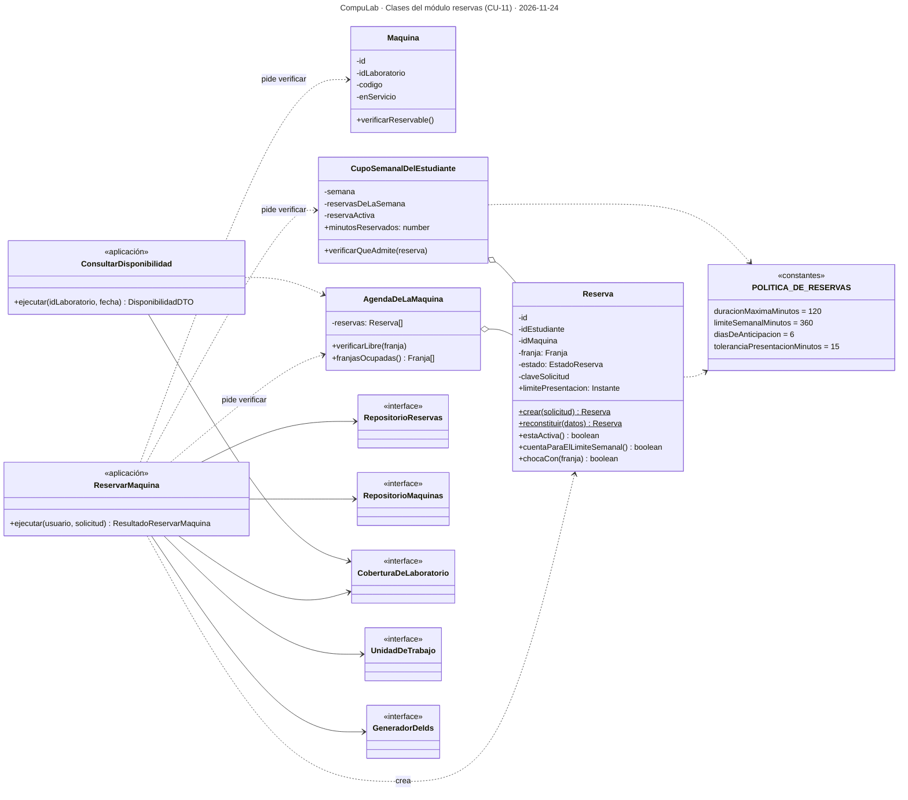
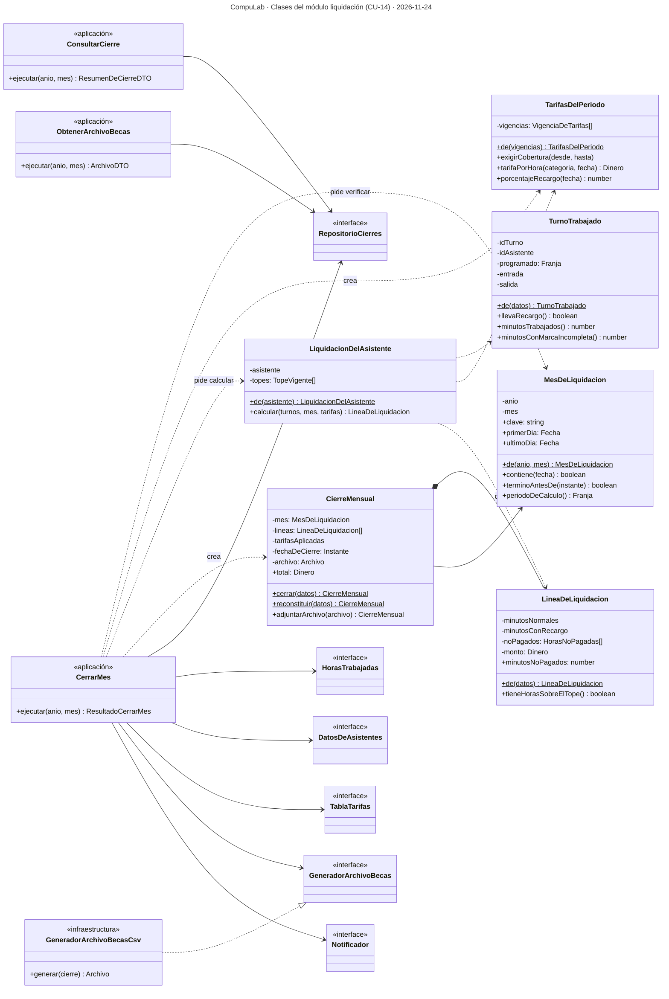

# 9. Clases

> Responde: ¿qué clases tiene el dominio, qué invariantes protegen y quién usa a quién?
> Reglas de construcción (R-7): atributos privados (`#campo`), constructor privado y fábricas estáticas que verifican las invariantes antes de crear el objeto; los objetos valor son inmutables. Nada de modelo anémico: la regla vive en la clase que tiene los datos.
> Versión 2026-11-24. Se completa sección por sección de la implementación: 9.1 a 9.5 están implementadas.

## 9.1 Núcleo compartido (`backend/src/compartido/dominio/`)

Objetos valor que varios módulos usan con el mismo significado. Ninguno depende de librerías, de módulos nativos de Node ni del reloj real (FA-1).

Leyenda: rectángulo = clase; `-` = atributo privado; `+` = público; `$` = fábrica estática; `<<interface>>` = puerto; flecha continua = asociación; flecha punteada = uso; triángulo = herencia.

| Clase | Responsabilidad | Invariantes verificadas al crear | Error si se violan | Reglas que sostiene |
| --- | --- | --- | --- | --- |
| `Fecha` | Día del calendario en Costa Rica, sin hora | Existe en el calendario (no hay 30 de febrero); año entre 1970 y 9999; formato `AAAA-MM-DD` | `DatoInvalido` | RN-05 (fecha del turno), RN-23 (fin de semana) |
| `Hora` | Hora del día con minutos | Entre 00:00 y 24:00 (24:00 solo como fin del día); formato `HH:MM` | `DatoInvalido` | RN-05, RN-23 (inicio a las 18:00) |
| `Instante` | Momento en la hora oficial de Costa Rica (UTC−6) | Fecha y hora válidas; al leer ISO exige zona horaria y la convierte a Costa Rica | `DatoInvalido` | 7.8 "Hora oficial" |
| `Franja` | Intervalo [inicio, fin) | Inicio anterior al fin | `FranjaInvalida` | RN-06 y RN-09 (traslape; franjas contiguas no se traslapan), RN-15 (cubierta por turnos contiguos), RN-16 |
| `Semana` | Lunes 00:00 a domingo 23:59 | Siempre empieza un lunes | `DatoInvalido` | RN-07, RN-17, RN-24, SUP-05 |
| `Dinero` | Colones en céntimos enteros | Entero no negativo y seguro; las fracciones se redondean al céntimo, mitad hacia arriba, con aritmética entera | `DatoInvalido` | RN-27, SUP-25 |
| `Reloj` (puerto) | Única fuente de la hora actual | — | — | R-6, 8.3 |
| `ErrorDeDominio` | Base de los errores de reglas, con `codigo` estable para la API y `detalle` inmutable | — | — | 7.8 "Errores", 8.7 |

**Doble de prueba:** `backend/tests/dobles/reloj-fijo.ts` (`RelojFijo`) implementa `Reloj` con una hora fija que se puede avanzar.

## 9.2 Módulo horarios (CU-06) · `backend/src/modulos/horarios/`

```mermaid
---
title: CompuLab · Clases del módulo horarios (CU-06) · 2026-11-24
---
classDiagram
    direction LR
    class AsignarTurno {
        <<aplicación>>
        -dependencias
        +ejecutar(usuario, solicitud) ResultadoAsignarTurno
    }
    class Turno {
        -id
        -idLaboratorio
        -idAsistente
        -franja: Franja
        -estado: EstadoTurno
        -creadoPor
        -claveSolicitud
        +asignar(solicitud)$ Turno
        +reconstituir(datos)$ Turno
        +ocupaLaFranja() boolean
        +abreElLaboratorio() boolean
        +chocaCon(franja) boolean
        +fueCreadoCon(usuario, clave) boolean
    }
    class AgendaDelAsistente {
        -activo
        -topeSemanalMinutos
        -disponibilidad
        -semana
        -turnos: Turno[]
        +de(datos)$ AgendaDelAsistente
        +minutosProgramados: number
        +evaluar(franja) dentroDeDisponibilidad
    }
    class AgendaDelLaboratorio {
        -turnos: Turno[]
        +de(idLaboratorio, turnos)$ AgendaDelLaboratorio
        +verificarLibre(franja)
    }
    class Disponibilidad {
        -bloques
        +de(bloques)$ Disponibilidad
        +cubre(franja) boolean
    }
    class RepositorioTurnos { <<interface>> }
    class ConsultaAsistentes { <<interface>> }
    class CalendarioAcademico { <<interface>> }
    class Autorizacion { <<interface>> }
    class UnidadDeTrabajo { <<interface>> }
    class Notificador { <<interface>> }
    class GeneradorDeIds { <<interface>> }
    AsignarTurno ..> AgendaDelAsistente : pide evaluar
    AsignarTurno ..> AgendaDelLaboratorio : pide verificar
    AsignarTurno ..> Turno : crea
    AsignarTurno --> RepositorioTurnos
    AsignarTurno --> ConsultaAsistentes
    AsignarTurno --> CalendarioAcademico
    AsignarTurno --> Autorizacion
    AsignarTurno --> UnidadDeTrabajo
    AsignarTurno --> Notificador
    AsignarTurno --> GeneradorDeIds
    AgendaDelAsistente o-- Turno
    AgendaDelAsistente --> Disponibilidad
    AgendaDelLaboratorio o-- Turno
```

Leyenda: igual que 9.1; `<<aplicación>>` = controlador del caso de uso; rombo vacío = agrega turnos que no le pertenecen. `AsignarTurno` también usa el puerto `Reloj` de 9.1.

| Clase | Responsabilidad | Invariantes verificadas al crear | Errores que lanza | Reglas |
| --- | --- | --- | --- | --- |
| `Turno` | Un laboratorio, una franja de un día y un responsable | Identificadores y clave no vacíos; inicio y fin el mismo día (fin hasta 24:00); exactamente un responsable salvo si está `VACANTE` | `DatoInvalido` | RN-05, RN-08 (estado inicial), I4, I5, SUP-01, SUP-21 |
| `EstadoTurno` | Los 8 estados de 10.5 | — | — | Cuentan para traslape y tope todos salvo `VACANTE` y `DESCARTADO`; abren el laboratorio `ASIGNADO` y `EN_CURSO` |
| `Disponibilidad` | Bloques semanales declarados por el asistente | Día de 1 a 7; cada bloque termina después de empezar | `DatoInvalido` | RN-08 (bloques contiguos cuentan como uno) |
| `AgendaDelAsistente` | Los turnos de un asistente en una semana, de cualquier laboratorio; decide si puede tomar uno más | Tope entero mayor que cero; todos los turnos son de ese asistente y de esa semana | `AsistenteNoActivo`, `TraslapeDeTurno`, `TopeSemanalExcedido` | RN-03, RN-04, RN-06, RN-07, RN-08 |
| `AgendaDelLaboratorio` | Los turnos de un laboratorio en un periodo | Todos los turnos son de ese laboratorio | `FranjaOcupadaEnLaboratorio` | RN-09 |
| `AsignarTurno` (aplicación) | Coordina CU-06 paso por paso; no contiene reglas | — | `SinPermisoSobreLaboratorio`, `FranjaDeTurnoInvalida`, `FueraDelSemestre`, `TurnoEnElPasado`, `AsistenteNoExiste`, `ClaveDeSolicitudReutilizada` y los del dominio | CU-06, ADR-0009, ADR-0010 |

Siete dependencias en `AsignarTurno` (más el `Reloj`): la revisión de 10.1 lo justifica; `Autorizacion` registra los accesos denegados por su cuenta para no sumar una octava.

**Consultas (sección 6):** `ListarLaboratorios`, `ConsultarHorario`, `ConsultarAsistentesDelLaboratorio`, `ConsultarCobertura` (interfaz provista `CoberturaDeLaboratorio`) y `ConsultarTurnosProgramados` (`TurnosProgramados`) viven en `aplicacion/consultas.ts`. No cambian nada y reutilizan las reglas del dominio: los minutos de la semana salen de `AgendaDelAsistente.minutosProgramados` y qué turnos abren el laboratorio, de `Turno.abreElLaboratorio()`.

**Dobles de prueba:** `tests/modulos/horarios/dobles.ts` (consulta de asistentes, calendario y autorización fijos) y `tests/dobles/` (`NotificadorEnMemoria`, `GeneradorDeIdsSecuencial`, `RelojFijo`). El repositorio de turnos en memoria (bloqueo por asistente y restricciones como las de la base) y la `UnidadDeTrabajoEnMemoria` pasaron a `src/` en la sección 6 porque también los usa el backend del núcleo; las pruebas los reexportan.

## 9.3 Módulo reservas (CU-11) · `backend/src/modulos/reservas/`

Leyenda: igual que 9.1 y 9.2; `<<constantes>>` = límites de uso agrupados en un solo lugar. `ReservarMaquina` también usa el puerto `Reloj`.

| Clase | Responsabilidad | Invariantes verificadas al crear | Errores que lanza | Reglas |
| --- | --- | --- | --- | --- |
| `Reserva` | Una máquina reservada por un estudiante en una franja | Empieza en el futuro; su día es hoy o uno de los 6 siguientes; dura como máximo 2 h; identificadores y clave no vacíos | `FranjaDeReservaInvalida`, `FueraDeHorizonteDeReserva`, `ReservaExcedeDuracion`, `DatoInvalido` | RN-16, RN-18 (límite de presentación), I4, I5 |
| `EstadoReserva` | Los 6 estados de 10.5 | — | — | Activa: `ACTIVA` y `EN_USO`. Para las 6 h cuentan además `FINALIZADA` y `LIBERADA` (SUP-15) |
| `Maquina` | Qué máquina es, de qué laboratorio y si está en servicio | Identificador, laboratorio y código no vacíos | `MaquinaFueraDeServicio` | RN-20 |
| `AgendaDeLaMaquina` | Las reservas de una máquina; sabe si está libre | Todas las reservas son de esa máquina | `MaquinaNoDisponible` | I1 |
| `CupoSemanalDelEstudiante` | Lo que el estudiante puede reservar todavía | Reservas del estudiante y de esa semana; la reserva activa está activa | `YaTieneReservaActiva`, `LimiteSemanalDeReservaExcedido` | RN-17, I2, I3 |
| `POLITICA_DE_RESERVAS` | Los límites de uso en un solo lugar (guía de cambios 7.10) | — | — | RN-16 a RN-18 |
| `ReservarMaquina` (aplicación) | Coordina CU-11 paso por paso | — | `MaquinaNoExiste`, `LaboratorioCerradoEnFranja`, `ClaveDeSolicitudReutilizada` y los del dominio | CU-11, RN-15, ADR-0009, ADR-0010 |
| `ConsultarDisponibilidad` (aplicación) | Consulta de franjas abiertas y estado de las máquinas; no cambia nada | — | `LaboratorioNoExiste` | RF-22, CU-11 ext 2a |

**Concurrencia (ADR-0009):** reservas no necesita bloqueo. La exclusión por máquina rechaza dos reservas simultáneas de la misma máquina (ext 7a) y el índice de una reserva activa por estudiante rechaza dos del mismo estudiante (ext 7c). Como solo puede haber una activa, dos reservas simultáneas tampoco pueden sumar más de 6 h.

**Dobles de prueba:** `tests/modulos/reservas/dobles.ts` (repositorio de reservas con esas restricciones, repositorio de máquinas y `CoberturaFija`), más los dobles comunes de `tests/dobles/`.

## 9.4 Módulo liquidación (CU-14) · `backend/src/modulos/liquidacion/`

Leyenda: igual que 9.1 a 9.3; `<<infraestructura>>` = adaptador que implementa un puerto. `CerrarMes` también usa el puerto `Reloj`.

| Clase | Responsabilidad | Invariantes verificadas al crear | Errores que lanza | Reglas |
| --- | --- | --- | --- | --- |
| `MesDeLiquidacion` | El mes que se liquida y su periodo de cálculo | Mes de 1 a 12; año entre 1970 y 9998 | `DatoInvalido` | Ext 2b (termina a las 00:00 del día 1 siguiente), SUP-05 (el periodo empieza el lunes de la semana del día 1) |
| `TarifasDelPeriodo` | Elige la tarifa y el recargo vigentes en la fecha de cada turno | Cada vigencia termina después de empezar, tiene al menos una tarifa y un recargo entero ≥ 0; no hay traslapes | `TarifaNoDefinida`, `DatoInvalido` | RN-22, RN-23, SUP-17, ext 5b, 5c |
| `TurnoTrabajado` | Un turno con sus marcas; sabe cuánto se trabajó y si lleva recargo | Franja programada válida; no hay salida sin entrada; la salida es posterior a la entrada | `DatoInvalido` | RN-12, SUP-06 (un solo recargo), SUP-07 (intersección con lo programado), SUP-08 (marca incompleta) |
| `LiquidacionDelAsistente` | Calcula la línea de un asistente: recorre cada semana en orden, paga hasta el tope y aplica la tarifa y el recargo de cada fecha | Datos del asistente no vacíos; al menos un tope, todos enteros > 0 | `TarifaNoDefinida`, `DatoInvalido` | RN-24, RN-27, RF-07 (tope vigente el lunes de cada semana), ext 3a–3c, 4a, 4b, 5a, 5c |
| `LineaDeLiquidacion` | Lo que se le paga a un asistente por el mes y lo que no se paga, por semana y motivo | Datos del asistente no vacíos; minutos enteros ≥ 0; cada grupo no pagado > 0; al menos un minuto en total | `DatoInvalido` | P3, P4, SUP-26 |
| `CierreMensual` | El cierre del mes: líneas, tarifas aplicadas, fecha y archivo. Inmutable | Se cierra después de terminado el mes; a lo sumo una línea por asistente; el archivo se adjunta una sola vez | `DatoInvalido` | P1, P2, P5–P7, I2, I3 (el total siempre es la suma de las líneas), RN-25 |
| `CerrarMes` (aplicación) | Coordina CU-14 paso por paso | — | `MesNoTerminado`, `TarifaNoDefinida`, `ErrorAlGenerarArchivo` | CU-14, RN-26, ext 2a, 2c, 7a, P8 |
| `ConsultarCierre`, `ObtenerArchivoBecas` (aplicación) | Consultas de un cierre hecho; no cambian nada | — | `CierreNoExiste` | RF-32 (descargar el archivo) |
| `GeneradorArchivoBecasCsv` (infraestructura) | Traduce el cierre al CSV de Becas: CRLF y comillas según RFC 4180, filas ordenadas por carné, horas y colones con dos decimales calculados con enteros, y textos que empiezan con `=`, `+`, `-` o `@` precedidos de un apóstrofo para que una hoja de cálculo no los ejecute | — | `ErrorAlGenerarArchivo` | SUP-03, RF-32, capa anticorrupción |

**Cálculo del monto (RN-27):** el numerador acumula `tarifa en céntimos × minutos pagables × (100 + recargo)` de cada turno y se divide una sola vez entre 6000 (60 minutos × 100 %), con redondeo a la mitad hacia arriba. Así no se pierden céntimos por redondear turno por turno.

**Concurrencia (ADR-0009):** liquidación no necesita bloqueo. Con la restricción `UNIQUE (anio, mes)`, el segundo de dos cierres simultáneos falla al guardar con `CierreYaExiste`; `CerrarMes` lo atrapa y devuelve el cierre que ganó (ext 2c), sin repetir el aviso.

**Garantía mínima:** el archivo se genera antes de guardar y `guardar` es todo o nada, así que un fallo del generador (ext 7a) o una tarifa faltante (ext 5b) dejan el mes sin cerrar. El aviso `CIERRE_LISTO` va de último.

**Dobles de prueba:** `tests/modulos/liquidacion/dobles.ts` (horas, asistentes, tarifas, un generador que falla y la ayuda `turno`), más los dobles comunes de `tests/dobles/`. El repositorio de cierres en memoria, con la restricción única, está en `src/modulos/liquidacion/infraestructura/` desde la sección 6.

## 9.5 Módulo identidad (sesión) · `backend/src/modulos/identidad/`

Implementación mínima de ADR-0008 y ADR-0011 para que la API sepa quién llama. El Directorio real queda fuera del núcleo; lo reemplaza un doble con usuarios fijos detrás del mismo puerto `DirectorioInstitucional`.

| Clase | Responsabilidad | Invariantes verificadas al crear | Errores que lanza | Reglas |
| --- | --- | --- | --- | --- |
| `Sesion` | La sesión propia de CompuLab: usuario, roles y vencimiento a las 8 h. Inmutable | Token de al menos 32 caracteres; usuario y nombre no vacíos; al menos un rol válido; un coordinador de laboratorio indica su laboratorio | `DatoInvalido` | ADR-0008 |
| `IniciarSesion` (aplicación) | Autentica contra el Directorio, junta los roles internos (más `ESTUDIANTE` si es estudiante de la Escuela) y guarda la sesión | — | `CredencialesInvalidas`, `DirectorioNoDisponible`, `SinAccesoACompuLab` | ADR-0008, ADR-0011 (falla cerrado) |
| `ObtenerSesion`, `CerrarSesion` (aplicación) | La sesión vigente de un token; cerrar no falla si ya no existe | — | `NoAutenticado` | — |
| `ConsultarRoles` (aplicación) | Interfaz provista: roles de un usuario, para la `Autorizacion` de horarios | — | — | QA-7 |

**Adaptadores del núcleo:** `DirectorioDeDemostracion` compara el secreto en tiempo constante, `RepositorioSesionesEnMemoria` indexa las sesiones por la huella SHA-256 del token y `GeneradorDeTokensAleatorio` entrega 32 bytes aleatorios. La cookie `compulab_sesion` es `HttpOnly` y `SameSite=Lax`; con `APP_COOKIE_SEGURA=true` también lleva `Secure`.

**Permisos en el borde HTTP:** `AsignarTurno` verifica el permiso con su puerto `Autorizacion` (403 `SIN_PERMISO_SOBRE_LABORATORIO`). Las demás operaciones exigen el rol en la ruta (403 `SIN_PERMISO`): reservar pide `ESTUDIANTE`; el cierre y sus consultas piden `COORDINADOR_SOPORTE`; la lista de asistentes pide coordinador de laboratorio o de soporte.
