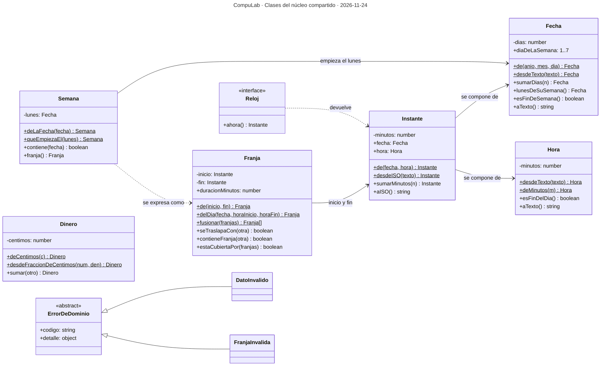
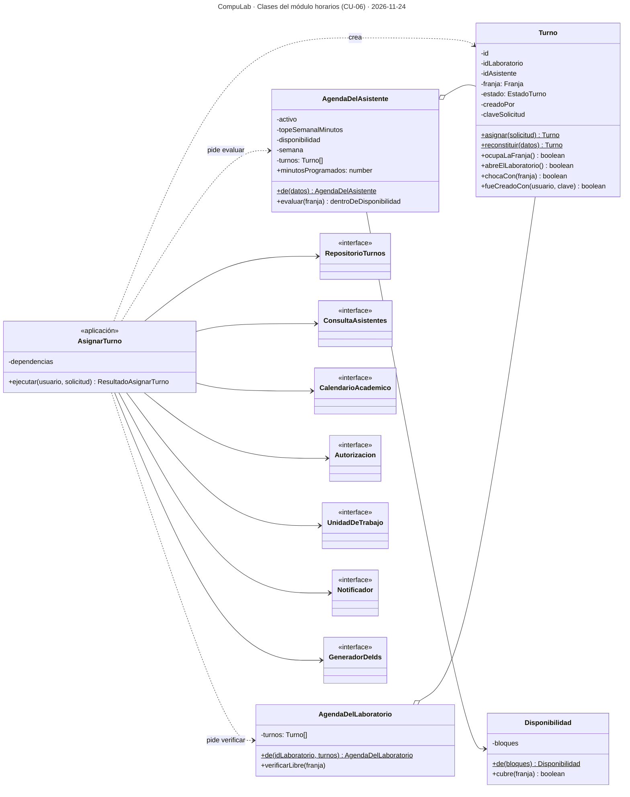

# 9. Clases

> Responde: ¿qué clases tiene el dominio, qué invariantes protegen y quién usa a quién?
> Reglas de construcción (R-7): atributos privados (`#campo`), constructor privado y fábricas estáticas que verifican las invariantes antes de crear el objeto; los objetos valor son inmutables. Nada de modelo anémico: la regla vive en la clase que tiene los datos.
> Versión 2026-11-24. Se completa sección por sección de la implementación: 9.1, 9.2 y 9.3 están implementadas; 9.4 se escribe al empezar la sección 5.

## 9.1 Núcleo compartido (`backend/src/compartido/dominio/`)

Objetos valor que varios módulos usan con el mismo significado. Ninguno depende de librerías, de módulos nativos de Node ni del reloj real (FA-1).

Leyenda: rectángulo = clase; `-` = atributo privado; `+` = público; `$` = fábrica estática; `<<interface>>` = puerto; flecha continua = asociación; flecha punteada = uso; triángulo = herencia.

| Clase | Responsabilidad | Invariantes verificadas al crear | Error si se violan | Reglas que sostiene |
| --- | --- | --- | --- | --- |
| `Fecha` | Día del calendario en Costa Rica, sin hora | Existe en el calendario (no hay 30 de febrero); año entre 1970 y 9999; formato `AAAA-MM-DD` | `DatoInvalido` | RN-05 (fecha del turno), RN-23 (fin de semana) |
| `Hora` | Hora del día con minutos | Entre 00:00 y 24:00 (24:00 solo como fin del día); formato `HH:MM` | `DatoInvalido` | RN-05, RN-23 (inicio a las 18:00) |
| `Instante` | Momento en la hora oficial de Costa Rica (UTC−6) | Fecha y hora válidas; al leer ISO exige zona horaria y la convierte a Costa Rica | `DatoInvalido` | 7.8 "Hora oficial" |
| `Franja` | Intervalo [inicio, fin) | Inicio anterior al fin | `FranjaInvalida` | RN-06 y RN-09 (traslape; franjas contiguas no se traslapan), RN-15 (cubierta por turnos contiguos), RN-16 |
| `Semana` | Lunes 00:00 a domingo 23:59 | Siempre empieza un lunes | `DatoInvalido` | RN-07, RN-17, RN-24, SUP-05 |
| `Dinero` | Colones en céntimos enteros | Entero no negativo y seguro; las fracciones se redondean al céntimo, mitad hacia arriba, con aritmética entera | `DatoInvalido` | RN-27, SUP-25 |
| `Reloj` (puerto) | Única fuente de la hora actual | — | — | R-6, 8.3 |
| `ErrorDeDominio` | Base de los errores de reglas, con `codigo` estable para la API y `detalle` inmutable | — | — | 7.8 "Errores", 8.7 |

**Doble de prueba:** `backend/tests/dobles/reloj-fijo.ts` (`RelojFijo`) implementa `Reloj` con una hora fija que se puede avanzar.

## 9.2 Módulo horarios (CU-06) · `backend/src/modulos/horarios/`

Leyenda: igual que 9.1; `<<aplicación>>` = controlador del caso de uso; rombo vacío = agrega turnos que no le pertenecen. `AsignarTurno` también usa el puerto `Reloj` de 9.1.

| Clase | Responsabilidad | Invariantes verificadas al crear | Errores que lanza | Reglas |
| --- | --- | --- | --- | --- |
| `Turno` | Un laboratorio, una franja de un día y un responsable | Identificadores y clave no vacíos; inicio y fin el mismo día (fin hasta 24:00); exactamente un responsable salvo si está `VACANTE` | `DatoInvalido` | RN-05, RN-08 (estado inicial), I4, I5, SUP-01, SUP-21 |
| `EstadoTurno` | Los 8 estados de 10.5 | — | — | Cuentan para traslape y tope todos salvo `VACANTE` y `DESCARTADO`; abren el laboratorio `ASIGNADO` y `EN_CURSO` |
| `Disponibilidad` | Bloques semanales declarados por el asistente | Día de 1 a 7; cada bloque termina después de empezar | `DatoInvalido` | RN-08 (bloques contiguos cuentan como uno) |
| `AgendaDelAsistente` | Los turnos de un asistente en una semana, de cualquier laboratorio; decide si puede tomar uno más | Tope entero mayor que cero; todos los turnos son de ese asistente y de esa semana | `AsistenteNoActivo`, `TraslapeDeTurno`, `TopeSemanalExcedido` | RN-03, RN-04, RN-06, RN-07, RN-08 |
| `AgendaDelLaboratorio` | Los turnos de un laboratorio en un periodo | Todos los turnos son de ese laboratorio | `FranjaOcupadaEnLaboratorio` | RN-09 |
| `AsignarTurno` (aplicación) | Coordina CU-06 paso por paso; no contiene reglas | — | `SinPermisoSobreLaboratorio`, `FranjaDeTurnoInvalida`, `FueraDelSemestre`, `TurnoEnElPasado`, `AsistenteNoExiste`, `ClaveDeSolicitudReutilizada` y los del dominio | CU-06, ADR-0009, ADR-0010 |

Siete dependencias en `AsignarTurno` (más el `Reloj`): la revisión de 10.1 lo justifica; `Autorizacion` registra los accesos denegados por su cuenta para no sumar una octava.

**Dobles de prueba:** `tests/modulos/horarios/dobles.ts` (repositorio en memoria con bloqueo por asistente y restricciones como las de la base, consulta de asistentes, calendario y autorización fijos) y `tests/dobles/` (`UnidadDeTrabajoEnMemoria` con transacciones aisladas, `NotificadorEnMemoria`, `GeneradorDeIdsSecuencial`, `RelojFijo`).

## 9.3 Módulo reservas (CU-11) · `backend/src/modulos/reservas/`

Leyenda: igual que 9.1 y 9.2; `<<constantes>>` = límites de uso agrupados en un solo lugar. `ReservarMaquina` también usa el puerto `Reloj`.

| Clase | Responsabilidad | Invariantes verificadas al crear | Errores que lanza | Reglas |
| --- | --- | --- | --- | --- |
| `Reserva` | Una máquina reservada por un estudiante en una franja | Empieza en el futuro; su día es hoy o uno de los 6 siguientes; dura como máximo 2 h; identificadores y clave no vacíos | `FranjaDeReservaInvalida`, `FueraDeHorizonteDeReserva`, `ReservaExcedeDuracion`, `DatoInvalido` | RN-16, RN-18 (límite de presentación), I4, I5 |
| `EstadoReserva` | Los 6 estados de 10.5 | — | — | Activa: `ACTIVA` y `EN_USO`. Para las 6 h cuentan además `FINALIZADA` y `LIBERADA` (SUP-15) |
| `Maquina` | Qué máquina es, de qué laboratorio y si está en servicio | Identificador, laboratorio y código no vacíos | `MaquinaFueraDeServicio` | RN-20 |
| `AgendaDeLaMaquina` | Las reservas de una máquina; sabe si está libre | Todas las reservas son de esa máquina | `MaquinaNoDisponible` | I1 |
| `CupoSemanalDelEstudiante` | Lo que el estudiante puede reservar todavía | Reservas del estudiante y de esa semana; la reserva activa está activa | `YaTieneReservaActiva`, `LimiteSemanalDeReservaExcedido` | RN-17, I2, I3 |
| `POLITICA_DE_RESERVAS` | Los límites de uso en un solo lugar (guía de cambios 7.10) | — | — | RN-16 a RN-18 |
| `ReservarMaquina` (aplicación) | Coordina CU-11 paso por paso | — | `MaquinaNoExiste`, `LaboratorioCerradoEnFranja`, `ClaveDeSolicitudReutilizada` y los del dominio | CU-11, RN-15, ADR-0009, ADR-0010 |
| `ConsultarDisponibilidad` (aplicación) | Consulta de franjas abiertas y estado de las máquinas; no cambia nada | — | `LaboratorioNoExiste` | RF-22, CU-11 ext 2a |

**Concurrencia (ADR-0009):** reservas no necesita bloqueo. La exclusión por máquina rechaza dos reservas simultáneas de la misma máquina (ext 7a) y el índice de una reserva activa por estudiante rechaza dos del mismo estudiante (ext 7c). Como solo puede haber una activa, dos reservas simultáneas tampoco pueden sumar más de 6 h.

**Dobles de prueba:** `tests/modulos/reservas/dobles.ts` (repositorio de reservas con esas restricciones, repositorio de máquinas y `CoberturaFija`), más los dobles comunes de `tests/dobles/`.

## 9.4 Módulo liquidación (CU-14)
Pendiente: sección 5. Clases previstas: `MesDeLiquidacion`, `TarifasDelPeriodo`, `LiquidacionDelAsistente`, `LineaDeLiquidacion`, `CierreMensual`.
