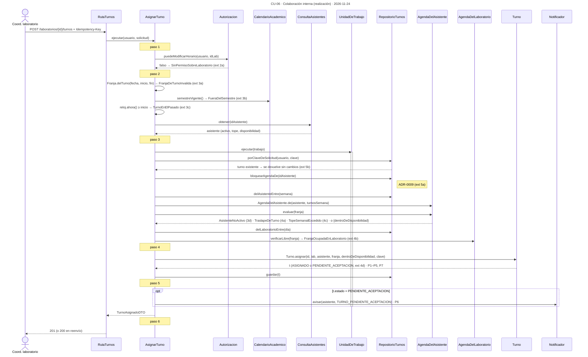
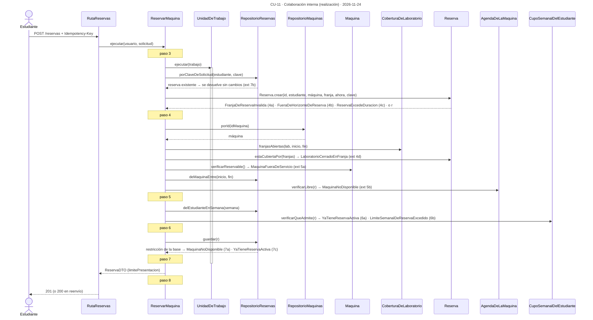
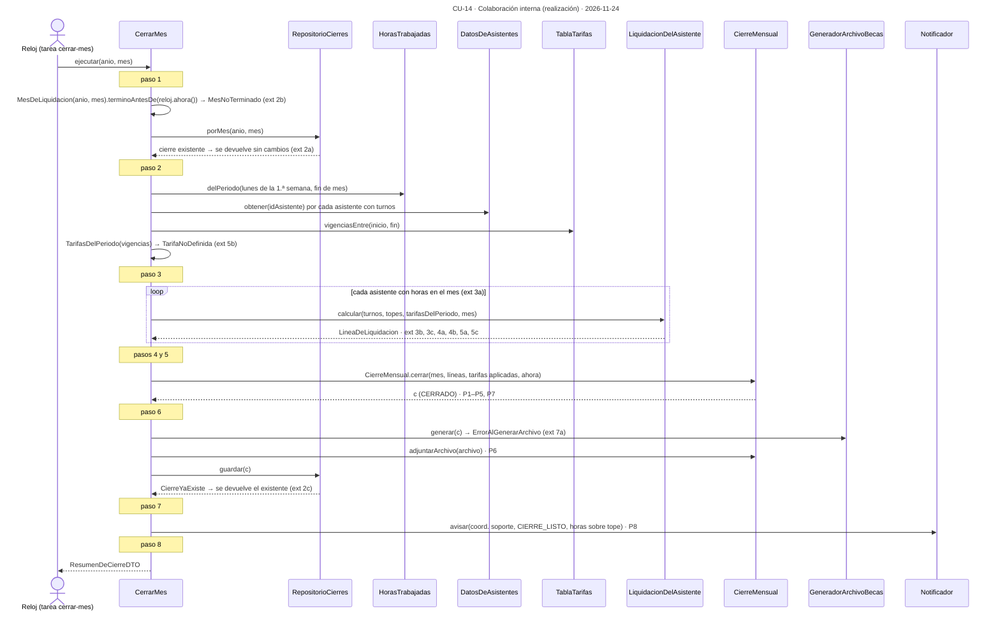
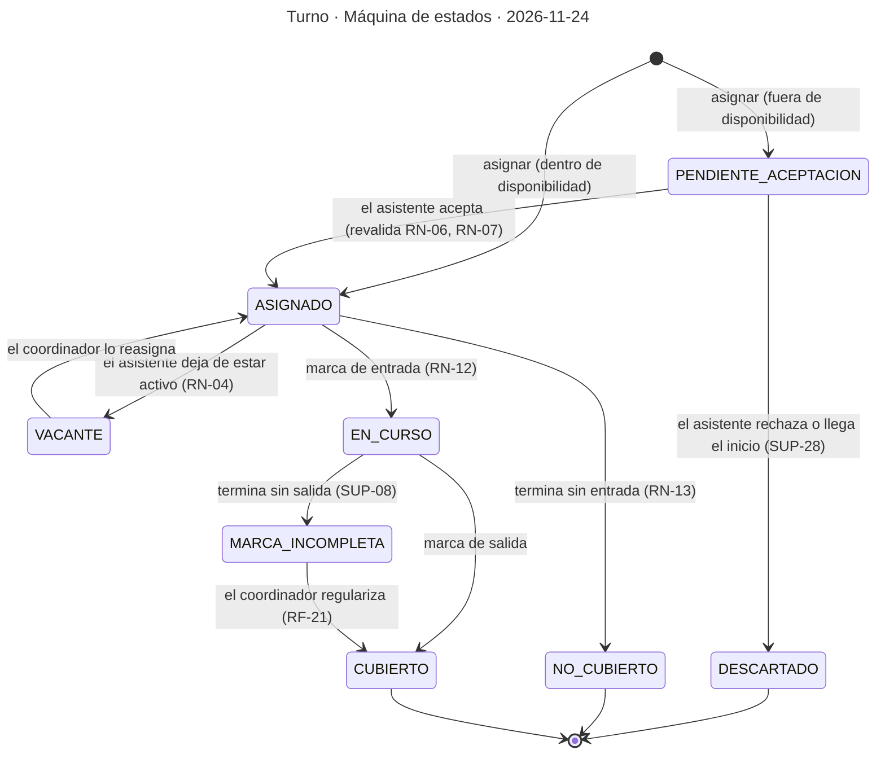
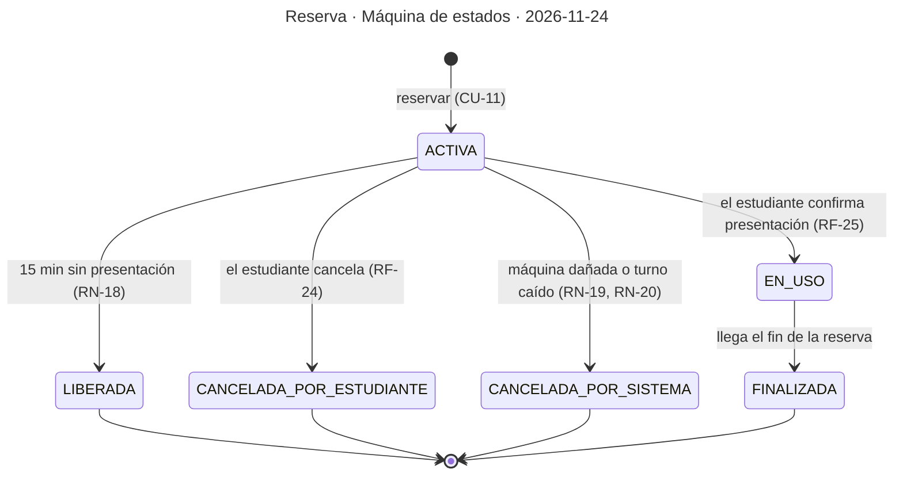

# 10. Comportamiento

> Responde: ¿qué objetos colaboran para cumplir cada caso de uso, en qué orden, y qué estados recorren las entidades?
> Es la realización de los casos de uso: cada mensaje se rastrea a un paso del escenario o a una extensión de `04-casos-de-uso.md`. Un mensaje que no se puede rastrear sobra, o el escenario está incompleto.
> Versión 2026-11-24. Completo para el núcleo ejecutable (CU-06, CU-11, CU-14); el resto se completará.

## 10.1 Quién recibe cada evento del sistema

Un controlador por caso de uso (patrón Controlador de GRASP): una clase de la capa de aplicación con un único método público `ejecutar()`. Coordina; las reglas viven en el dominio.

| Evento del sistema | Controlador (aplicación) | Dependencias por constructor | Objetos de dominio que tienen las reglas |
| --- | --- | --- | --- |
| `asignarTurno` (CU-06) | `AsignarTurno` | `Autorizacion`, `CalendarioAcademico`, `ConsultaAsistentes`, `RepositorioTurnos`, `UnidadDeTrabajo`, `Notificador`, `Reloj` | `Franja`, `Turno`, `AgendaDelAsistente`, `AgendaDelLaboratorio` |
| `reservarMaquina` (CU-11) | `ReservarMaquina` | `RepositorioMaquinas`, `RepositorioReservas`, `CoberturaDeLaboratorio`, `UnidadDeTrabajo`, `Reloj` | `Franja`, `Reserva`, `Maquina`, `AgendaDeLaMaquina`, `CupoSemanalDelEstudiante` |
| `cerrarMes` (CU-14) | `CerrarMes` | `RepositorioCierres`, `HorasTrabajadas`, `DatosDeAsistentes`, `TablaTarifas`, `GeneradorArchivoBecas`, `Notificador`, `Reloj` | `MesDeLiquidacion`, `TarifasDelPeriodo`, `LiquidacionDelAsistente`, `LineaDeLiquidacion`, `CierreMensual` |

`AsignarTurno` y `CerrarMes` tienen siete dependencias, por encima de las cinco que el material marca como señal de alerta. Se revisó: `UnidadDeTrabajo`, `Notificador` y `Reloj` son técnicas y comunes a todo caso de uso que cambia estado; las otras cuatro son las que el caso de uso necesita. No se parten en dos casos de uso porque el actor tiene un solo objetivo.

## 10.2 CU-06 · Asignar un turno

| Mensaje | Paso / extensión | Poscondición o invariante |
| --- | --- | --- |
| `puedeModificarHorario` | 2 · ext 2a | — |
| `Franja.delTurno`, `semestreVigente`, `reloj.ahora` | 3 · ext 3a, 3b, 3c | — |
| `obtener(idAsistente)` y `AgendaDelAsistente.evaluar` | 3 y 4 · ext 3d, 4a, 4c | I1, I2 |
| `porClaveDeSolicitud` | ext 5b | I5 |
| `bloquearAgendaDe` | ext 5a | I1, I2 bajo concurrencia |
| `AgendaDelLaboratorio.verificarLibre` | 4 · ext 4b | I3 |
| `Turno.asignar` | 5 · ext 4d | P1–P5, P7, I4 |
| `guardar` | 5 | P1 (persistido) |
| `avisar` | ext 4d | P6 |
| `TurnoAsignadoDTO` | 6 | — |

Dónde vive cada regla: traslape y tope en `AgendaDelAsistente` (es quien conoce todos los turnos del asistente en la semana); franja ocupada en `AgendaDelLaboratorio`; forma válida del turno (un responsable, inicio < fin, mismo día) en el constructor de `Turno`. `AsignarTurno` solo coordina.

## 10.3 CU-11 · Reservar una máquina

| Mensaje | Paso / extensión | Poscondición o invariante |
| --- | --- | --- |
| `porClaveDeSolicitud` | ext 7b | I5 |
| `Reserva.crear` | 4 · ext 4a, 4b, 4c | P1–P7; I4 (duración) |
| `franjasAbiertas` + `estaCubiertaPor` | 4 · ext 4d | I4 (cobertura) |
| `Maquina.verificarReservable` | 5 · ext 5a | — |
| `AgendaDeLaMaquina.verificarLibre` | 5 · ext 5b | I1 |
| `CupoSemanalDelEstudiante.verificarQueAdmite` | 6 · ext 6a, 6b | I2, I3 |
| `guardar` | 7 · ext 7a, 7c | I1, I2 bajo concurrencia |
| `ReservaDTO` | 8 | — |

Los pasos 1 y 2 del escenario (consultar disponibilidad) son otra operación del sistema, `ConsultarDisponibilidad`, sin cambio de estado.

## 10.4 CU-14 · Cerrar el mes

| Mensaje | Paso / extensión | Poscondición o invariante |
| --- | --- | --- |
| `MesDeLiquidacion.terminoAntesDe` | 2 · ext 2b | — |
| `porMes` | 2 · ext 2a | I1 |
| `delPeriodo`, `obtener`, `vigenciasEntre` | 3 | — |
| `TarifasDelPeriodo` | ext 5b, 5c | — |
| `LiquidacionDelAsistente.calcular` | 3, 4, 5 · ext 3a–3c, 4a, 4b, 5a | P3, P4, I4 |
| `CierreMensual.cerrar` | 6 | P1, P2, P5, P7, I2, I3 |
| `generar` + `adjuntarArchivo` | 7 · ext 7a | P6 |
| `guardar` | 6 · ext 2c | I1 (todo o nada) |
| `avisar` | 8 | P8 |

El archivo se genera **antes** de guardar para que el cierre quede completo o no quede (garantía mínima), y el aviso va **de último** porque es lo único que no se puede deshacer. El cálculo no aparece como mensajes sueltos: ocurre dentro de `LiquidacionDelAsistente`, que tiene los datos.

## 10.5 Máquinas de estado

### Turno

Leyenda: rectángulo = estado; flecha = transición con el evento que la dispara. Cuentan para traslape y tope (RN-06, RN-07, RN-09): `PENDIENTE_ACEPTACION`, `ASIGNADO`, `EN_CURSO`. Abren el laboratorio para reservas (RN-15): `ASIGNADO` y `EN_CURSO`. Un cambio de responsable aprobado (CU-09) no cambia el estado, solo el asistente.

### Reserva

Leyenda: igual que la anterior. Una reserva es "activa" para RN-17 en `ACTIVA` o `EN_USO`. Para las 6 h semanales cuentan `ACTIVA`, `EN_USO`, `FINALIZADA` y `LIBERADA` (SUP-15).
