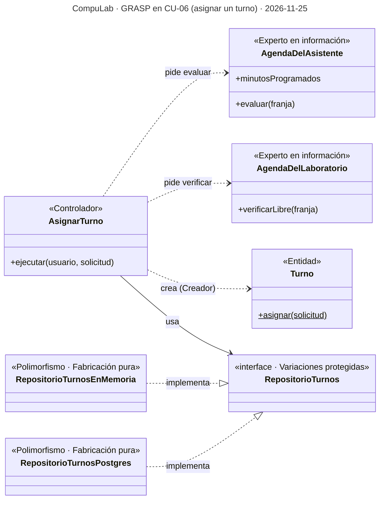

# 11. Patrones

> Responde: ¿qué patrones se usaron, qué problema resuelve cada uno aquí, dónde está en el código y qué cuesta?
> Criterio del curso: un patrón se usa donde la variación o el riesgo lo justifican, no por catálogo. Cada uno se nombra por el problema que resuelve en CompuLab; si no se puede nombrar ese problema, no debería estar.
> Versión 2026-11-25. Las rutas de archivo son relativas a la raíz del repositorio.

## 11.1 Mapa

| Familia | Patrones | Problema de CompuLab que los justifica |
| --- | --- | --- |
| Asignación de responsabilidades (GRASP) | Controlador, Experto en información, Creador, Fabricación pura, Indirección, Variaciones protegidas, Polimorfismo | Reglas como el tope semanal o el recargo deben tener un dueño claro y probarse sin base de datos (QA-6, R-7) |
| Arquitectura | Monolito modular, Puertos y adaptadores, Raíz de composición | Despliegue simple en la infraestructura del TEC sin acoplar las reglas a PostgreSQL, Fastify o el Directorio (ADR-0001, R-5, R-6) |
| Modelo de dominio | Objeto valor, Fábrica estática, Entidad con invariantes, Objeto inmutable | Fechas, franjas y dinero con reglas propias; ningún modelo anémico (R-7) |
| Persistencia y concurrencia | Repositorio, Unidad de trabajo, Bloqueo pesimista, Restricción como segunda barrera | Dos coordinadores o dos estudiantes actuando a la vez (QA-4, ADR-0009) |
| Integración | Idempotencia, Reintentos con espera creciente, Capa anticorrupción, Bandeja de salida (outbox), Interruptor, Fallar cerrado | Respuestas que se pierden, el archivo de Becas y el Directorio institucional (ADR-0007, ADR-0010, ADR-0011) |
| Presentación | Humble Object, DTO | Probar la lógica de pantalla sin dibujarla; no filtrar entidades del dominio a la API |
| Pruebas | Doble de prueba (fake en memoria), Reloj fijo | R-8: una prueba por poscondición y extensión, sin base de datos |

## 11.2 Asignación de responsabilidades (GRASP)

Leyenda: rectángulo = clase con su rol GRASP entre `<< >>`; flecha punteada = dependencia con su verbo; flecha con triángulo hueco = implementa la interfaz.

| Patrón | Problema aquí | Solución y dónde | Costo |
| --- | --- | --- | --- |
| **Controlador** (un controlador por caso de uso) | ¿Quién recibe la operación del sistema y coordina sin contener reglas? | Una clase de aplicación por caso de uso con un solo `ejecutar`: `AsignarTurno`, `ReservarMaquina`, `CerrarMes` (`backend/src/modulos/*/aplicacion/`). Las consultas también tienen su propia clase (`ConsultarHorario`, `ListarCierresDelAnio`). | `AsignarTurno` recibe 8 dependencias, por encima de las 5 que la materia toma como señal de alarma. Se aceptó porque todas sirven al mismo paso del escenario (10.2); `Autorizacion` registra los accesos denegados por su cuenta para no sumar una novena. |
| **Experto en información** | ¿Quién decide si el asistente puede tomar otro turno, o cuánto se le paga? | La clase que tiene los datos: `AgendaDelAsistente` (traslape, tope, disponibilidad), `AgendaDelLaboratorio` (un responsable por franja), `CupoSemanalDelEstudiante` (una activa y 6 h), `LiquidacionDelAsistente` (tope por semana y monto), `TurnoTrabajado` (minutos y recargo). | Hay que cargar la agenda completa de la semana antes de decidir. Con decenas de turnos por semana no pesa. |
| **Creador** | ¿Quién crea cada objeto? | Quien tiene los datos de inicialización: el caso de uso crea `Turno` y `Reserva` con sus fábricas, `LiquidacionDelAsistente` crea cada `LineaDeLiquidacion` y `CierreMensual.cerrar` arma el cierre. | — |
| **Fabricación pura** | Guardar, generar identificadores o dar la hora no le corresponde a ninguna clase del negocio. | Clases inventadas para eso: repositorios, `GeneradorDeIdsAleatorio`, `RelojDelSistema`, `GeneradorArchivoBecasCsv`. | Más clases, pero el dominio sigue sin saber de PostgreSQL ni del reloj (R-6). |
| **Indirección** | `reservas` necesita saber si un laboratorio está abierto, pero los módulos no se importan entre sí (FA-2). | El puerto `CoberturaDeLaboratorio` de reservas se conecta con `ConsultarCobertura` de horarios mediante un puente en `backend/src/arranque/puentes.ts` (`CoberturaParaReservas`), que además traduce `LaboratorioNoExiste`. Lo mismo para `HorasTrabajadas` y `Autorizacion`. | Un archivo de puentes que mantener; a cambio, cada módulo se prueba solo. |
| **Variaciones protegidas** | Lo que se sabe que va a cambiar: el formato de Becas, el protocolo del Directorio, la base de datos, las tarifas. | Una interfaz estable delante de cada punto de variación: `GeneradorArchivoBecas`, `DirectorioInstitucional`, los repositorios y `TablaTarifas` (prueba de reemplazo en 8.2). | Una interfaz por punto de variación; solo se ponen donde hay una segunda implementación que se pueda nombrar. |
| **Polimorfismo** | El mismo backend debe correr con base de datos y sin ella. | Dos juegos de adaptadores con la misma interfaz: `crearAdaptadoresEnMemoria` y `crearAdaptadoresPostgres` (`backend/src/arranque/adaptadores.ts`), elegidos con `APP_PERSISTENCIA`. | Dos implementaciones que deben respetar el mismo contrato. Lo vigilan las pruebas de `backend/tests/postgres/` y la suite de la API, que corre en ambos modos. |

## 11.3 Arquitectura

| Patrón | Problema aquí | Solución y dónde | Costo |
| --- | --- | --- | --- |
| **Monolito modular** | Un equipo pequeño, una sola base y contenedores del TEC: los microservicios cobrarían red y operación sin necesidad (ADR-0001). | Un despliegue (`backend`) con módulos por actor y razón de cambio: `horarios`, `reservas`, `liquidacion`, `identidad`. FA-2 impide que se importen entre sí. | Los módulos comparten la base. Cada tabla tiene un módulo dueño (16.2) y nadie más escribe en ella. |
| **Puertos y adaptadores** (arquitectura hexagonal) | Las reglas no pueden depender de Fastify, `pg` ni del reloj (R-5, R-6) y deben probarse sin base de datos (R-8). | Cada módulo declara sus puertos en `aplicacion/puertos.ts`; los adaptadores viven en `infraestructura/`. Las funciones de aptitud FA-1, FA-3 y FA-5 hacen fallar el build si la regla se rompe. | Más interfaces y archivos de los que pediría un CRUD. Se paga porque la base, el Directorio y el formato de Becas sí cambian. |
| **Raíz de composición** | ¿Dónde se decide qué implementación recibe cada puerto? | En un solo lugar: `backend/src/arranque/servidor.ts` y `adaptadores.ts`. Los constructores reciben sus dependencias; no hay localizador de servicios ni dependencias globales. | Es el único archivo que conoce a todos los módulos. |

## 11.4 Modelo de dominio

| Patrón | Problema aquí | Solución y dónde | Costo |
| --- | --- | --- | --- |
| **Objeto valor** | Una franja que termina antes de empezar, una hora "25:00" o dinero con decimales flotantes son errores clásicos. | Objetos inmutables que se validan al crearse y se comparan por valor: `Fecha`, `Hora`, `Instante`, `Franja`, `Semana`, `Dinero` (`backend/src/compartido/dominio/`) y `MesDeLiquidacion`. | Hay que convertir al entrar y al salir de la API y de la base. |
| **Fábrica estática y constructor privado** | R-7: ningún objeto puede existir con sus invariantes rotas. | `Turno.asignar` / `reconstituir`, `Reserva.crear` / `reconstituir`, `CierreMensual.cerrar`: validan y lanzan un error de dominio con nombre propio; el constructor es privado. | Dos fábricas por entidad: una para crear (con las reglas del caso de uso) y otra para reconstruir lo guardado. |
| **Objeto inmutable** | Un mes cerrado no se recalcula ni se corrige (RN-25). | `CierreMensual` no tiene métodos que cambien su estado; `adjuntarArchivo` devuelve otro cierre y solo se puede usar una vez. En la base no hay `UPDATE` de cierres. | Para "cambiar" hay que crear otro objeto. |
| **Política como constantes de dominio** | Los límites de uso (2 h, 6 h, 15 min, 7 días) cambian por decisión de la Escuela. | `POLITICA_DE_RESERVAS` concentra los límites en un solo lugar (guía de cambios de 7.10). | — |

## 11.5 Persistencia y concurrencia

| Patrón | Problema aquí | Solución y dónde | Costo |
| --- | --- | --- | --- |
| **Repositorio** | Los casos de uso necesitan guardar y buscar objetos del dominio sin hablar SQL. | Una interfaz por agregado en el idioma del módulo (`delAsistenteEntre`, `activaDelEstudiante`, `porMes`), con dos implementaciones: `*EnMemoria` y `*Postgres`. | Las consultas se escriben dos veces. |
| **Unidad de trabajo** | Un caso de uso escribe varias cosas que deben quedar juntas o no quedar. | `UnidadDeTrabajo.ejecutar(trabajo)`: una transacción de PostgreSQL (`UnidadDeTrabajoPostgres`) o su equivalente en memoria. La transacción en curso viaja en `AsyncLocalStorage` hasta los repositorios. | Hay que respetar que todo ocurra dentro de `ejecutar`; `transaccion()` falla a propósito si no es así. |
| **Bloqueo pesimista** | Dos asignaciones simultáneas al mismo asistente podrían pasar juntas su tope (CU-06 ext 5a). | `bloquearAgendaDe` toma la fila del asistente con `SELECT … FOR UPDATE`: la segunda transacción espera y ve el turno de la primera (ADR-0009). | Las asignaciones al mismo asistente se hacen de una en una. |
| **Restricción como segunda barrera** | Aunque cada transacción valide bien, dos pueden confirmar cosas que chocan entre sí. | `EXCLUDE` con traslape de rangos y `UNIQUE` en la base (16.4). Si una salta, un `SAVEPOINT` deja viva la transacción para consultar el registro en conflicto y lanzar el error de dominio con detalle. | La regla queda escrita dos veces: en el dominio, para el mensaje, y en la base, para la garantía. |

## 11.6 Integración

Son los patrones que la materia pide para sobrevivir a la red: un mensaje se pierde, llega dos veces o llega tarde.

| Patrón | Problema aquí | Solución y dónde | Estado |
| --- | --- | --- | --- |
| **Idempotencia por clave de solicitud** | Se pierde la respuesta de "asignar turno" o "reservar" y el usuario reintenta: no debe quedar duplicado (ADR-0010). | La clave la genera quien llama (`nuevaClave()` en `frontend/src/compartido/api/cliente.ts`, una por intención del usuario). Se guarda con el turno o la reserva en la misma transacción, con `UNIQUE (usuario, clave)`, y repetirla devuelve el mismo resultado con `200`. | Implementado |
| **Reintentos con espera creciente y aleatoria** | Un reintento inmediato de muchos clientes remata a un servidor lento. | El cliente reintenta solo lo idempotente (lecturas y operaciones con clave) y solo errores transitorios (sin respuesta, 502, 503, 504). Lo hace a lo sumo dos veces, con esperas de 600 ms y 1,5 s multiplicadas por un factor aleatorio entre 0,5 y 1,5. | Implementado (`cliente.test.ts`) |
| **Capa anticorrupción** | El formato de Becas y el vocabulario del Directorio no deben filtrarse al dominio. | `GeneradorArchivoBecasCsv` es el único lugar que conoce el CSV (SUP-03); `DirectorioInstitucional` traduce la identidad externa a `Identidad`. | Implementado (el Directorio, como doble de demostración) |
| **Bandeja de salida (outbox)** | Un aviso por correo no puede perderse si el correo falla, ni enviarse si la operación se revierte. | El `Notificador` guarda el aviso en la tabla `avisos` dentro de la transacción del caso de uso. Una tarea programada lo enviaría después con reintentos (7.6, `enviar-avisos-pendientes`). | Guardado implementado; el envío queda fuera del núcleo |
| **Interruptor (circuit breaker)** | Si el Directorio no responde, no conviene seguir esperándolo en cada ingreso. | Diseñado en el contrato de `DirectorioInstitucional` (8.3): se abre tras 5 fallos seguidos durante 30 s. | Diseñado, no implementado: el núcleo no se conecta a un Directorio real |
| **Fallar cerrado** | Con el Directorio caído, dejar entrar a cualquiera sería peor que no dejar entrar a nadie (ADR-0011). | `IniciarSesion` no emite sesión si el Directorio falla; la API responde `503 DIRECTORIO_NO_DISPONIBLE` y la pantalla lo explica. | Implementado (`sesiones.test.ts`) |
| **Saga** | — | No se usa: hay una sola base de datos y cada caso de uso cabe en una transacción local. | Descartado |

## 11.7 Presentación

| Patrón | Problema aquí | Solución y dónde | Costo |
| --- | --- | --- | --- |
| **Humble Object** (presentador y vista humilde) | La lógica de pantalla, como qué horas se ofrecen, qué máquinas están libres o el mensaje de cada error, se rompe sin que nadie lo note si vive dentro de los componentes. | Cada funcionalidad tiene un `presentador.ts` que convierte la respuesta de la API en un modelo de vista y se prueba en Node, y un `pantallas.tsx` que solo lo muestra (`frontend/src/funcionalidades/`). FF-1 impide que un presentador importe React. | Dos archivos por pantalla. |
| **DTO** | Pasar entidades ricas a la API filtraría su estructura interna y ataría el contrato al dominio. | Los casos de uso devuelven estructuras simples (`TurnoAsignadoDTO`, `ResumenDeCierreDTO`…) que coinciden con 8.7; el frontend tiene sus propios tipos del contrato en `frontend/src/compartido/api/tipos.ts`. | Mapeos de ida y vuelta. |

## 11.8 Pruebas

| Patrón | Problema aquí | Solución y dónde |
| --- | --- | --- |
| **Doble de prueba (fake en memoria)** | R-8 exige probar cada poscondición y extensión sin base de datos, incluidas las de concurrencia. | Repositorios en memoria que imitan las restricciones y los bloqueos de la base (`Cerrojos`, transacciones aisladas). Se comprobó por mutación: al quitarles el bloqueo o la restricción, las pruebas de concurrencia fallan. |
| **Reloj fijo** | Reglas que dependen de "ahora": turno en el pasado, horizonte de 7 días, mes terminado. | `RelojFijo` en las pruebas y `RelojDelSistema` (con hora simulada opcional) en ejecución, detrás del puerto `Reloj`. |

## 11.9 Patrones considerados y descartados

| Patrón | Por qué no |
| --- | --- |
| Estrategia para calcular el pago | Las tarifas y el recargo cambian cada semestre, pero cambia el **valor**, no el **algoritmo**: se guardan como datos con vigencia (ADR-0005), no como clases intercambiables. |
| Active Record u ORM con entidades anotadas | Mete la persistencia en las clases del dominio y empuja hacia el modelo anémico (contradice R-6 y R-7). Se usa Kysely, que solo arma SQL, detrás de los repositorios. |
| Servicio genérico ("un servicio para todo") | Es el anti-patrón que la materia contrasta con el Controlador: una clase con todas las operaciones crece sola y nadie puede decir por qué existe cada método. |
| Microservicios, saga, mensajería | Sin requisito que los justifique: una base, un despliegue, transacciones locales (ADR-0001). |
| Event sourcing | El cierre inmutable y la copia de tarifas aplicadas ya dan la trazabilidad que pide RN-25, sin su complejidad. |
