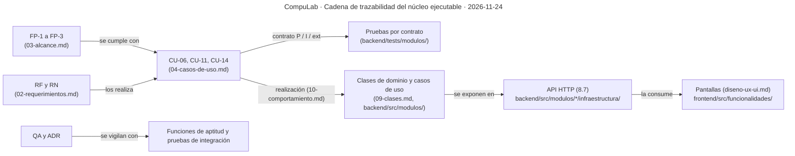

# 12. Trazabilidad

> Responde: ¿dónde quedó implementado cada requisito del núcleo ejecutable, y qué prueba lo demuestra?
> Versión 2026-11-24. Cubre el núcleo ejecutable (FP-1 a FP-3); el resto de los requisitos se diseña pero no se programa en esta entrega (`03-alcance.md`).

Los códigos se citan tal cual en el código (`// RN-07`, `// CU-06 paso 4`, `// ext 4a`) y en los nombres de las pruebas (`"4c · rechaza un turno que haría superar el tope semanal…"`). Por eso esta matriz se puede reconstruir buscando el código en `backend/`, `frontend/` y `database/`. Todas las rutas de archivo son relativas a la raíz del repositorio.

Pruebas al cerrar la implementación: en el backend, **234 sin base de datos**; con `APP_DB_PRUEBAS` se suman las 17 de los repositorios PostgreSQL y la API completa vuelve a correr sobre la base, **277 en total**. En el frontend, **35**.

## 12.1 Del alcance a las pruebas

Leyenda: rectángulo = artefacto con el archivo donde vive; flecha = relación de trazabilidad con su verbo.

| Funcionalidad prioritaria | Caso de uso | Criterio de aceptación (`03-alcance.md`) | Evidencia |
| --- | --- | --- | --- |
| FP-1 Asignar un turno | CU-06 | Una prueba por poscondición y una por extensión; todas pasan | `backend/tests/modulos/horarios/asignar-turno.test.ts`: 26 pruebas (P1–P7, 2a, 3a–3d, 4a–4d, 5a, 5b) |
| FP-2 Reservar una máquina | CU-11 | Ídem | `backend/tests/modulos/reservas/reservar-maquina.test.ts`: 30 pruebas (P1–P7, 2a, 4a–4d, 5a, 5b, 6a, 6b, 7a–7c) |
| FP-3 Cerrar el mes | CU-14 | Ídem, más casos de cálculo | `backend/tests/modulos/liquidacion/cerrar-mes.test.ts`: 26 pruebas (P1–P8, 2a–2c, 3a–3c, 4a, 4b, 5a–5c, 7a); cálculo en `dominio.test.ts` y el CSV en `generador-archivo-becas-csv.test.ts` |

## 12.2 Requisitos funcionales del núcleo

| RF | Qué pide | Caso de uso | Dónde vive | Ruta de la API | Pantalla | Pruebas |
| --- | --- | --- | --- | --- | --- | --- |
| RF-10 | Asignar un turno validando RN-04 a RN-09 | CU-06 | `backend/src/modulos/horarios/aplicacion/asignar-turno.ts` | `POST /api/v1/laboratorios/{id}/turnos` | `/laboratorios/:id/horario` (panel "Asignar turno") | `asignar-turno.test.ts`; `api.test.ts` "CU-06"; `horario-laboratorio/presentador.test.ts` |
| RF-11 | Consultar el horario semanal | CU-06 (apoyo) | `horarios/aplicacion/consultas.ts` (`ConsultarHorario`) | `GET /api/v1/laboratorios/{id}/turnos?semana=` | `/laboratorios/:id/horario` | `horarios/consultas.test.ts`; `api.test.ts` |
| RF-22 | Franjas abiertas y máquinas libres | CU-11 (apoyo) | `reservas/aplicacion/consultar-disponibilidad.ts`; `horarios/aplicacion/consultas.ts` (`ConsultarCobertura`) | `GET /api/v1/laboratorios/{id}/disponibilidad?fecha=` | `/reservar`, `/reservar/:id` | `reservar-maquina.test.ts` (2a y consultas); `horarios/consultas.test.ts`; `reservar-maquina/presentador.test.ts` |
| RF-23 | Reservar validando RN-15 a RN-17 y RN-20 | CU-11 | `reservas/aplicacion/reservar-maquina.ts` | `POST /api/v1/reservas` | `/reservar/:id` | `reservar-maquina.test.ts`; `api.test.ts` "CU-11" |
| — | Ver la reserva activa y el uso de la semana: apoyo a CU-11 (`diseno-ux-ui.md` 15.6), no es un RF propio | CU-11 (apoyo) | `reservas/aplicacion/consultar-mis-reservas.ts` | `GET /api/v1/reservas/mias` | `/mis-reservas` y el aviso de `/reservar` | `api.test.ts` "apoyo a la interfaz"; `reservar-maquina/presentador.test.ts` "cupo semanal" |
| RF-31 | Cerrar el mes anterior con horas y montos | CU-14 | `liquidacion/aplicacion/cerrar-mes.ts`; `liquidacion/dominio/liquidacion-del-asistente.ts` | `POST /api/v1/cierres` | `/cierres/:anio/:mes` | `cerrar-mes.test.ts`; `liquidacion/dominio.test.ts`; `api.test.ts` "CU-14" |
| RF-32 | Generar y descargar el CSV para Becas | CU-14 | `liquidacion/infraestructura/generador-archivo-becas-csv.ts` | `GET /api/v1/cierres/{anio}/{mes}/archivo` | botón "Descargar archivo para Becas" | `generador-archivo-becas-csv.test.ts`; `cerrar-mes.test.ts` P6; `api.test.ts` |
| RF-33 | Informar las horas sobre el tope | CU-14 | `CerrarMes` (aviso `CIERRE_LISTO`); `LineaDeLiquidacion.noPagados` | respuesta de `POST /api/v1/cierres` | filas resaltadas en `/cierres/:anio/:mes` | `cerrar-mes.test.ts` P8 y 4a; `cierre-mensual/presentador.test.ts` |

En la columna "Dónde vive", las rutas sin prefijo están bajo `backend/src/modulos/`; las pruebas sin prefijo, bajo `backend/tests/` o junto al presentador en `frontend/src/funcionalidades/`.

## 12.3 Reglas de negocio del núcleo

| RN | Regla (resumen) | Clase que la hace cumplir | Barrera en la base (`database/migrations/`) | Prueba que la demuestra |
| --- | --- | --- | --- | --- |
| RN-03 | Tope semanal mayor que cero | `AgendaDelAsistente` | `topes_asistentes` `CHECK (minutos_por_semana > 0)` | `horarios/dominio.test.ts` |
| RN-04 | Solo asistentes activos | `AgendaDelAsistente.evaluar` | — | `asignar-turno.test.ts` 3d |
| RN-05 | Turno de un día, inicio antes del fin, un responsable | `Turno` | `turnos` `CHECK` de franja y de responsable | `asignar-turno.test.ts` 3a, P4; `horarios/dominio.test.ts` |
| RN-06 | Un asistente sin turnos traslapados | `AgendaDelAsistente` | `turnos_sin_traslape_asistente` (`EXCLUDE`) | `asignar-turno.test.ts` 4a, 5a; `postgres/repositorios.test.ts` |
| RN-07 | Tope semanal | `AgendaDelAsistente` (con bloqueo por asistente, ADR-0009) | `FOR UPDATE` sobre `asistentes` | `asignar-turno.test.ts` 4c, 5a; `postgres/repositorios.test.ts` ("bloquearAgendaDe serializa…") |
| RN-08 | Dentro de la disponibilidad o queda pendiente | `Disponibilidad`, `Turno.asignar` | — | `asignar-turno.test.ts` 4d, P5, P6 |
| RN-09 | Un responsable por franja del laboratorio | `AgendaDelLaboratorio` | `turnos_sin_traslape_laboratorio` (`EXCLUDE`) | `asignar-turno.test.ts` 4b, 5a; `postgres/repositorios.test.ts` |
| RN-12 | Horas pagadas según las marcas | `TurnoTrabajado` | `marcas` `CHECK (entrada < salida)` | `liquidacion/dominio.test.ts`; `cerrar-mes.test.ts` 3b, 3c |
| RN-15 | Reservar solo en franjas cubiertas por turnos | `ReservarMaquina` + `CoberturaDeLaboratorio` | — | `reservar-maquina.test.ts` 4d; `horarios/consultas.test.ts` |
| RN-16 | Máximo 2 h, en el futuro, horizonte de 7 días | `Reserva.crear`, `POLITICA_DE_RESERVAS` | — | `reservar-maquina.test.ts` 4a, 4b, 4c; `reservar-maquina/presentador.test.ts` |
| RN-17 | Una activa y 6 h por semana | `CupoSemanalDelEstudiante` | `reservas_una_activa_por_estudiante` (índice único parcial) | `reservar-maquina.test.ts` 6a, 6b, 7c |
| RN-18 | Límite de presentación de 15 min | `Reserva.limitePresentacion` | — | `reservar-maquina.test.ts` P6 |
| RN-20 | Máquina fuera de servicio no se reserva | `Maquina.verificarReservable` | — | `reservar-maquina.test.ts` 5a; `reservas/dominio.test.ts` |
| RN-22 | Tarifa de la categoría vigente en la fecha | `TarifasDelPeriodo` | `vigencias_tarifas_sin_traslape` (`EXCLUDE`) | `cerrar-mes.test.ts` 5b, 5c |
| RN-23 | Recargo desde las 18:00 o en fin de semana, sin acumular | `TurnoTrabajado.llevaRecargo` | — | `cerrar-mes.test.ts` 5a; `liquidacion/dominio.test.ts` |
| RN-24 | Horas sobre el tope no se pagan y se informan | `LiquidacionDelAsistente` | — | `cerrar-mes.test.ts` 4a, 4b, P8 |
| RN-25 | Un mes cerrado no cambia | `CierreMensual` (inmutable) | sin `UPDATE` en el código | `liquidacion/dominio.test.ts` ("adjuntar el archivo… solo se puede una vez") |
| RN-26 | Un solo cierre por mes | `CerrarMes` | `cierres_un_cierre_por_mes` (llave primaria) | `cerrar-mes.test.ts` 2a, 2c; `postgres/repositorios.test.ts` ("dos CerrarMes simultáneos…") |
| RN-27 | Céntimos enteros, un solo redondeo a la mitad hacia arriba | `Dinero`, `LiquidacionDelAsistente` | `bigint` en montos | `compartido/dinero-errores-reloj.test.ts`; `liquidacion/dominio.test.ts` |

## 12.4 Contratos: poscondiciones, invariantes y extensiones

Las poscondiciones (P) y extensiones (ext) tienen una prueba cuyo nombre empieza con su código, en el archivo de 12.1. Los invariantes no son un paso del escenario: se demuestran con las pruebas de esta tabla.

| Caso de uso | Invariante | Pruebas |
| --- | --- | --- |
| CU-06 | I1 sin traslapes por asistente | 4a, 5a; `postgres/repositorios.test.ts` (EXCLUDE por asistente) |
| CU-06 | I2 tope semanal | 4c, 5a |
| CU-06 | I3 sin traslapes por laboratorio | 4b, 5a ("dos asistentes distintos en la misma franja…") |
| CU-06 | I4 un responsable | P4; `horarios/dominio.test.ts` |
| CU-06 | I5 clave de solicitud única | 5b; `postgres/repositorios.test.ts` (clave repetida) |
| CU-11 | I1 sin dos reservas activas por máquina | 5b, 7a; `postgres/repositorios.test.ts` (reservas simultáneas) |
| CU-11 | I2 una activa por estudiante | 6a, 7c |
| CU-11 | I3 6 h por semana | 6b |
| CU-11 | I4 dentro de una franja cubierta y de 2 h o menos | 4c, 4d |
| CU-11 | I5 clave de solicitud única | 7b |
| CU-14 | I1 un cierre por mes | 2a, 2c; `postgres/repositorios.test.ts` |
| CU-14 | I2 un cierre no cambia | `liquidacion/dominio.test.ts` |
| CU-14 | I3 total = suma de líneas | `liquidacion/dominio.test.ts` ("el total del cierre es la suma de sus líneas") |
| CU-14 | I4 sin monto para horas sobre el tope | 4a, 4b |

Cada extensión de las tablas de `04-casos-de-uso.md` (11 de CU-06, 12 de CU-11 y 12 de CU-14) tiene al menos una prueba. Las de concurrencia (5a de CU-06, 7a y 7c de CU-11, 2c de CU-14) se comprobaron con mutación: al quitar el bloqueo o la restricción del doble, la prueba falla.

## 12.5 Atributos de calidad y decisiones

| QA | Mecanismo | Dónde | Evidencia |
| --- | --- | --- | --- |
| QA-4 Integridad ante concurrencia | Bloqueo por asistente, `EXCLUDE`, `UNIQUE`, transacción por caso de uso, clave de solicitud (ADR-0009, ADR-0010) | `database/migrations/V3`–`V5`; repositorios `*Postgres` y `*EnMemoria` | Pruebas de concurrencia de los tres contratos; `postgres/repositorios.test.ts` |
| QA-9 Directorio caído | Fallar cerrado; sesión propia (ADR-0008, ADR-0011) | `backend/src/modulos/identidad/` | `identidad/sesiones.test.ts` ("falla cerrado si el Directorio no responde") |
| QA-6 Capacidad de ser probado | Puertos y adaptadores, reloj inyectado, funciones de aptitud | `.dependency-cruiser.cjs` del backend (FA-1 a FA-5) y del frontend (FF-1 a FF-4) | `aptitud/funciones-de-aptitud.test.ts` (una violación plantada por regla); todos los contratos se prueban con dobles |
| QA-2 Disponibilidad y recuperación | `restart: unless-stopped`, healthchecks; `/health` responde 503 sin base y no se cae | `docker-compose.yml`, `backend/src/arranque/servidor.ts`, `postgres/conexion.ts` | Verificado con Docker en la sección 7: base detenida → 503 sin reinicio; base de vuelta → 200 |
| QA-7 Autorización | Puerto `Autorizacion` en CU-06; rol exigido en cada ruta; rutas protegidas en el frontend; bitácora de accesos denegados | `horarios/aplicacion/asignar-turno.ts`, `compartido/infraestructura/http.ts`, `frontend/src/app/vistas-generales.tsx` | `asignar-turno.test.ts` 2a; `api.test.ts` (403 en cada módulo); `app/navegacion.test.ts` |
| QA-5 Modificabilidad | Tarifas como datos con vigencia; copia en cada cierre (ADR-0005) | `vigencias_tarifas`, `TarifasDelPeriodo` | `cerrar-mes.test.ts` P5, 5c |
| QA-8 Uso en móvil | Pantallas del estudiante diseñadas primero para celular; objetivos táctiles de 44 px | `frontend/src/compartido/ui/estilos.css` | Revisado en el navegador a 375 px en la sección 8 |
| QA-1 Tiempo de respuesta | Índices por responsable, laboratorio y máquina; transacciones cortas | `database/migrations/`, `16-diseno-bd.md` (16.7) | Sin medición de carga en el núcleo (pendiente) |
| QA-3 Picos externos | Base y contenedores dedicados, límites de memoria | `docker-compose.yml` | Configuración; sin prueba de carga |

## 12.6 Restricciones del curso

| R | Exigencia | Cómo se cumple | Evidencia |
| --- | --- | --- | --- |
| R-5 | Dependencias externas como interfaces inyectadas | `interface` de TypeScript en cada `aplicacion/puertos.ts`; se conectan en `backend/src/arranque/` | FA-3 y FA-5 |
| R-6 | Nada de red, archivos ni reloj en el dominio | Puerto `Reloj`; dominio sin paquetes ni módulos de Node | FA-1 (tres reglas, cada una con su prueba) |
| R-7 | Invariantes en el constructor, atributos privados | Campos `#privados`, constructor privado, fábricas que validan | `*/dominio.test.ts` de cada módulo; `09-clases.md` |
| R-8 | Una prueba por poscondición y por extensión, con dobles | 12.1 y 12.4 | `npm test` en `backend/` sin base de datos |
| R-9 | Dos o más funciones de aptitud que fallen el build | FA-1 a FA-5 en `npm test` y `npm run build` | `aptitud/funciones-de-aptitud.test.ts` |
| R-10 | README con instalación y pruebas en ≤ 10 líneas | `README.md` de la raíz | — |
| R-1, R-2 | Contenedores Linux; PostgreSQL 14 | Cuatro contenedores en `docker-compose.yml`; `postgres:14`; Flyway | Pila completa levantada en las secciones 7 y 8 |
| R-3, R-4 | Sin nube externa; solo código abierto | Sin servicios SaaS; Roboto servida desde el propio sitio; dependencias MIT, ISC y Apache 2.0 | `06-restricciones-tecnologicas.md` (6.3) |

## 12.7 Lo que queda fuera del núcleo

Se diseñan pero no se implementan en esta entrega, así que no tienen prueba: reclutamiento (CU-01 a CU-05), cambios de turno (CU-07 a CU-09), marcas de asistencia (CU-10), mantenimiento de máquinas (CU-12, CU-13), tarifas (CU-15), cobertura (CU-16), reportes (CU-17), la bandeja de avisos con correo, el Directorio real y el reloj programado (tareas del día 1 y liberación de reservas). En el núcleo, los datos que esos módulos producirían (asistentes, marcas, tarifas, calendario) vienen de los datos de demostración, detrás de los mismos puertos (`backend/src/arranque/puentes.ts` y `lectores-postgres.ts`).
