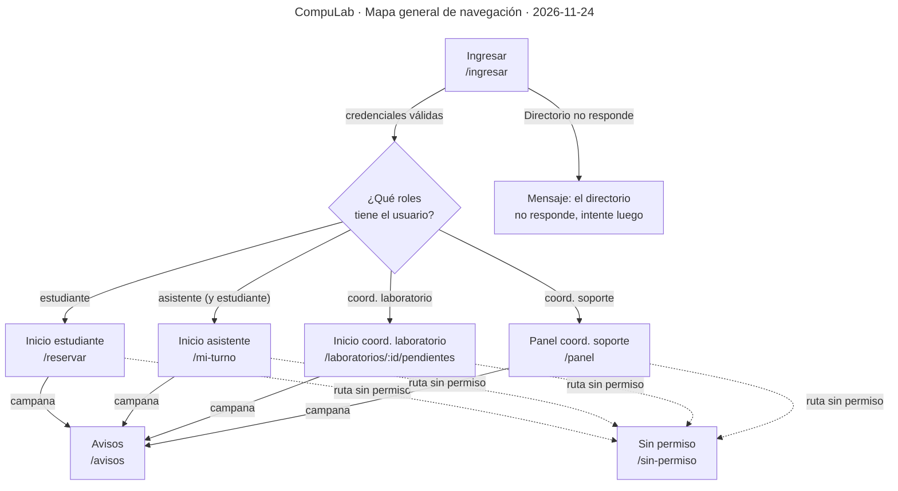
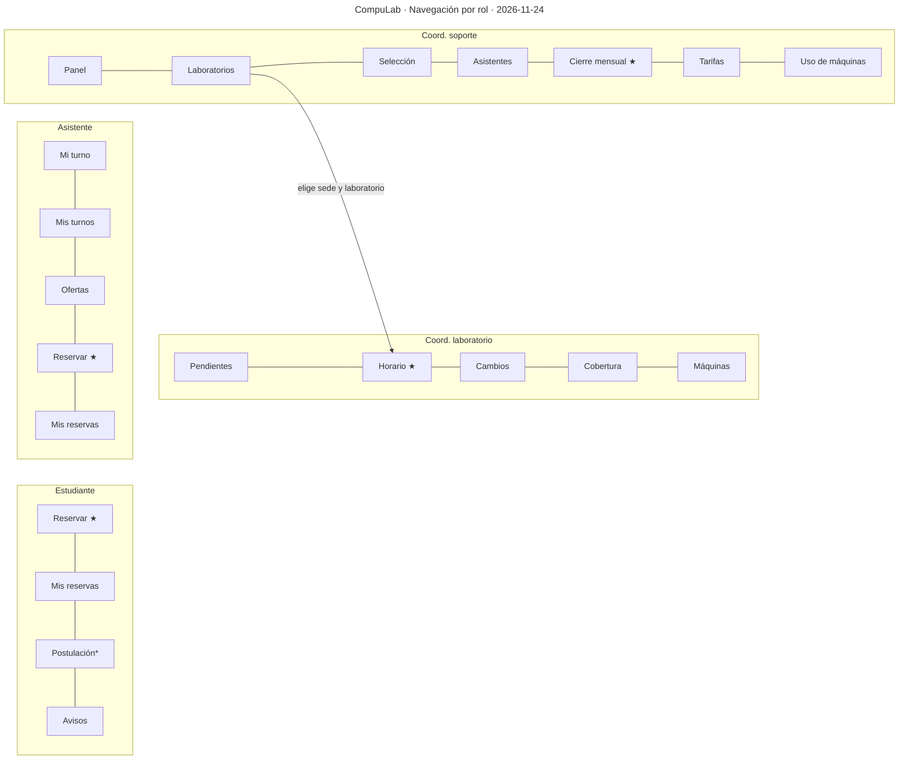
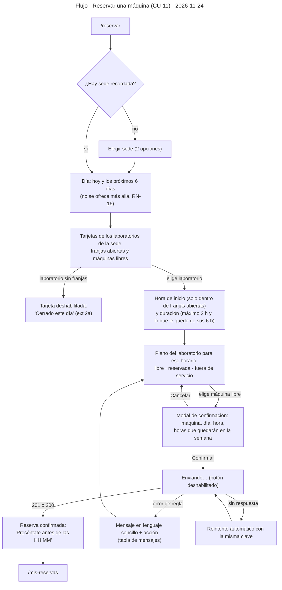
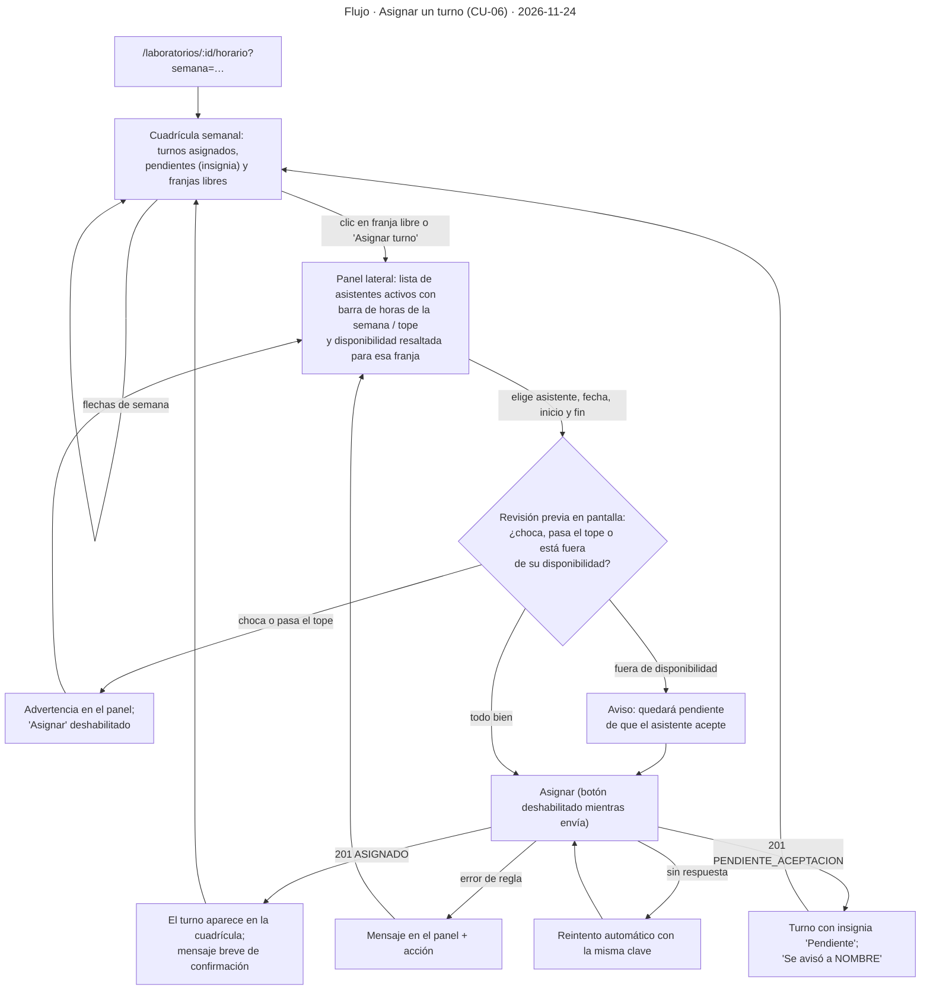
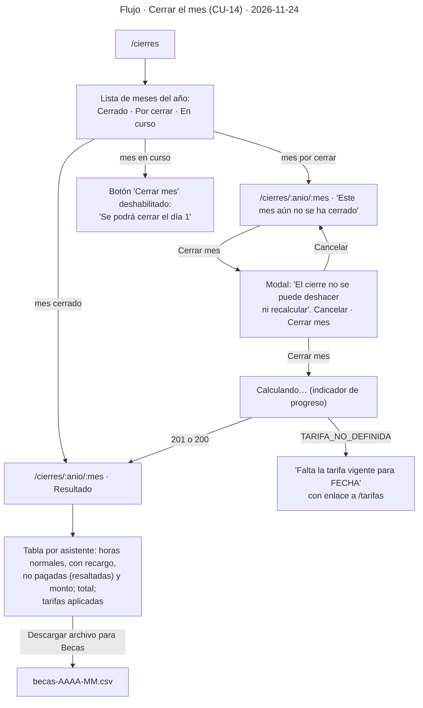

# 15. Diseño UX/UI

> Responde: ¿cómo se mueve cada actor por CompuLab, qué ve primero, por qué se organizó así y qué pasa en pantalla cuando algo falla?
> Criterios: presentaciones de UX/UI del curso (conceptos de usabilidad, heurísticas de Nielsen y leyes de diseño, componentes de UI).
> Versión 2026-11-24. Esta primera parte cubre la **arquitectura de información y el flujo de navegación**. El prototipo navegable está en `docs/prototipo/` (15.9); la guía visual completa y la evaluación heurística se agregarán después (15.10).

## 15.1 Principios de navegación

| # | Decisión | Fundamento del curso |
| --- | --- | --- |
| N-1 | La navegación depende del **rol**: cada actor ve solo las opciones que puede usar. | Heurística 8 (diseño minimalista); ley de Hick (menos opciones, decisión más rápida). |
| N-2 | Cada rol tiene una **pantalla de inicio con lo que tiene pendiente** (su turno, sus aprobaciones, sus alertas). | Heurística 1 (visibilidad del estado del sistema). |
| N-3 | Un solo **esqueleto** para toda la aplicación: barra de pestañas inferior en el celular y menú lateral en escritorio. Cambia el contenido, no la forma de moverse. | Heurística 4 (consistencia); ley de Jakob (patrones que el usuario ya conoce). |
| N-4 | Como máximo **5 pestañas** en el celular y **7 opciones** en el menú lateral; si hay más, se agrupan en secciones con nombre. | Ley de Miller y agrupación (*chunking*). |
| N-5 | El **contexto** (sede, laboratorio, semana) está siempre visible y se puede cambiar sin volver atrás; en escritorio se muestran migas de pan. | Heurística 6 (reconocer en lugar de recordar); heurística 3 (control y libertad). |
| N-6 | La aplicación **recuerda** la última sede y el último laboratorio usados. | Heurística 7 (aceleradores para el usuario frecuente). |
| N-7 | Se **previenen** los errores antes de enviar: solo se ofrecen franjas abiertas, duraciones válidas y botones habilitados cuando la acción es posible. | Heurística 5 (prevención de errores). |
| N-8 | Si aun así algo falla, el mensaje está en **lenguaje sencillo**, sin códigos, dice qué pasó y ofrece la salida. | Heurística 9 (reconocer, diagnosticar y recuperarse de errores); heurística 2 (idioma del usuario). |
| N-9 | Las acciones **irreversibles** (cerrar el mes) piden confirmación en un modal con salida clara. | Heurística 5; regla de uso de modales de la presentación de componentes. |
| N-10 | Las vistas del **estudiante y el asistente** se diseñan primero para el celular; las de los **coordinadores**, para escritorio. | Contexto de uso (ISO 9241-11); QA-8. |

## 15.2 Esqueleto común

| Zona | Celular (< 768 px) | Tableta (768–1023 px) | Escritorio (≥ 1024 px) |
| --- | --- | --- | --- |
| Navegación principal | Barra de pestañas inferior (≤ 5) | Barra de pestañas inferior | Menú lateral fijo, con secciones |
| Encabezado | Título de la pantalla, campana de avisos, menú de usuario | Igual que en celular, más el selector de contexto | Selector de contexto (sede / laboratorio / semana), migas de pan, avisos y usuario |
| Contenido | Una columna; listas y tarjetas | Dos columnas cuando aplica | Cuadrículas y tablas |

Comunes a todos los roles: **Avisos** (campana con contador), **menú de usuario** (nombre, roles, cerrar sesión), objetivos táctiles de al menos 44×44 px y foco visible para navegar con teclado (WCAG 2.2).

## 15.3 Mapa general de navegación

Leyenda: rectángulo = pantalla con su ruta; rombo = decisión; flecha continua = navegación por una acción del usuario; flecha punteada = redirección del sistema.

Un usuario con varios roles entra a la pantalla de inicio de su rol de mayor responsabilidad (soporte > laboratorio > asistente > estudiante) y ve un menú **combinado** con las opciones de todos sus roles (SUP-20). Solo si el menú combinado superara el límite de N-4 se ofrece un selector "Entrar como…" en el menú de usuario.

## 15.4 Navegación por rol

### Estudiante · celular primero

| Pestaña | Ruta | Qué hace | CU / RF |
| --- | --- | --- | --- |
| **Reservar** (inicio) | `/reservar` | Disponibilidad de su sede para un día y reserva. | CU-11, RF-22, RF-23 |
| Mis reservas | `/mis-reservas` | Reserva activa con hora límite de presentación, horas usadas en la semana (de 6), historial; cancelar o confirmar presentación. | RF-24, RF-25 |
| Postulación | `/postulacion` | Formulario de postulación; después, el estado. **Solo visible si hay convocatoria abierta o si ya se postuló.** | CU-02 |
| Avisos | `/avisos` | Reservas canceladas o liberadas, resultado de la postulación. | RF-35 |

El postulante **no es un usuario aparte**: es un estudiante que entra con su cuenta del Directorio. La postulación es un formulario: una cuadrícula semanal donde marca los bloques en que puede trabajar y la lista de laboratorios que le interesan (RF-04). No se adjuntan documentos.

### Asistente · celular primero (incluye lo del estudiante)

| Pestaña | Ruta | Qué hace | CU / RF |
| --- | --- | --- | --- |
| **Mi turno** (inicio) | `/mi-turno` | Turno actual o próximo, con el botón grande de **Marcar entrada / salida**. Desde aquí, "Reportar máquina dañada" y "Registrar reparación" del laboratorio del turno en curso. | CU-10, CU-12, CU-13, QA-8 |
| Mis turnos | `/mis-turnos` | Sus turnos por semana; aceptar los pendientes de aceptación; ofrecer un turno o retirar la oferta. | RF-13, CU-07 |
| Ofertas | `/ofertas` | Ofertas de turnos de sus laboratorios para tomar. | CU-08 |
| Reservar | `/reservar` | Igual que el estudiante. | CU-11 |
| Mis reservas | `/mis-reservas` | Igual que el estudiante. | RF-24, RF-25 |

Avisos va en la campana del encabezado para no pasar de 5 pestañas (N-4).

### Coordinador de laboratorio · escritorio

Su laboratorio es fijo: no hay selector. Todas las rutas cuelgan de `/laboratorios/:idLaboratorio/`.

| Opción del menú | Ruta | Qué hace | CU / RF |
| --- | --- | --- | --- |
| **Pendientes** (inicio) | `…/pendientes` | Turnos vacantes de la semana, turnos sin entrada hoy, cambios por aprobar, máquinas fuera de servicio. Cada elemento lleva a su pantalla. | N-2 |
| Horario | `…/horario?semana=AAAA-MM-DD` | Cuadrícula semanal del laboratorio; asignar turnos. | CU-06, RF-11 |
| Cambios por aprobar | `…/cambios` | Tomas de ofertas pendientes; aprobar o rechazar. | CU-09 |
| Cobertura | `…/cobertura?semana=AAAA-MM-DD` | Turnos vacantes y no cubiertos de una semana; regularizar marcas incompletas. | CU-16, RF-21 |
| Máquinas | `…/maquinas` | Estado de las máquinas; registrar reparación. | CU-13 |

### Coordinador de soporte · escritorio

| Sección del menú | Opción | Ruta | Qué hace | CU / RF |
| --- | --- | --- | --- | --- |
| — | **Panel** (inicio) | `/panel` | Alertas: postulaciones por evaluar, turnos vacantes en cualquier laboratorio, horas sobre el tope, estado del cierre del mes, tarifas por vencer. | N-2 |
| Operación | Laboratorios | `/laboratorios` | Selector **sede → laboratorio**; abre las mismas pantallas del coordinador de laboratorio para el laboratorio elegido, con migas de pan "Laboratorios › Sede › Laboratorio › Horario". Incluye la administración de laboratorios, máquinas y coordinadores. | CU-06, CU-09, CU-16, RF-02, RF-30 |
| Operación | Selección de asistentes | `/seleccion` | Convocatoria del semestre y postulaciones; entrevista y decisión en `/seleccion/postulaciones/:id`. | CU-01, CU-03 |
| Operación | Asistentes | `/asistentes` | Asistentes del semestre; corregir tope, dar de baja (`/asistentes/:id`). | CU-04, CU-05 |
| Pagos | Cierre mensual | `/cierres` | Meses y su estado; cierre, resultado y archivo para Becas (`/cierres/:anio/:mes`). | CU-14 |
| Pagos | Tarifas | `/tarifas` | Tarifas por categoría y recargo con su vigencia. | CU-15 |
| Informes | Uso de máquinas | `/uso-de-maquinas?semana=AAAA-MM-DD` | Tablero por laboratorio y semana. | CU-17 |

Siete opciones en tres secciones (N-4). El tablero de uso muestra solo los indicadores clave: máquinas fuera de servicio y porcentaje de uso por laboratorio, con barras (no gráficos de pastel), siguiendo la guía de reportes de la presentación de componentes.

Leyenda: recuadro = rol; rectángulo = opción de la navegación principal, en orden; ★ = pantalla del núcleo ejecutable; \* = visible solo con convocatoria abierta o postulación enviada; flecha = el coordinador de soporte llega a las pantallas del laboratorio mediante el selector.

## 15.5 Tabla de rutas

| Ruta | Pantalla | Roles que pueden entrar | API que consume (`08-componentes.md`) | Núcleo |
| --- | --- | --- | --- | --- |
| `/ingresar` | Ingreso (en el núcleo: selector de rol simulado, 15.7) | Sin sesión | `POST /api/v1/sesion` | ✔ (simulado) |
| `/` | Redirige al inicio del rol | Con sesión | `GET /api/v1/sesion` | ✔ |
| `/reservar` | Disponibilidad y reserva | Estudiante, asistente | `GET /laboratorios`, `GET /laboratorios/{id}/disponibilidad`, `GET /reservas/mias`, `POST /reservas` | ✔ |
| `/mis-reservas` | Mis reservas | Estudiante, asistente | `GET /reservas/mias` | |
| `/postulacion` | Postulación y su estado | Estudiante | (por definir) | |
| `/mi-turno`, `/mis-turnos`, `/ofertas` | Vistas del asistente | Asistente | (por definir) | |
| `/laboratorios/:id/horario` | Horario y asignación | Coord. de ese laboratorio, coord. soporte | `GET /laboratorios/{id}/turnos`, `GET /laboratorios/{id}/asistentes`, `POST /laboratorios/{id}/turnos` | ✔ |
| `/laboratorios/:id/pendientes`, `…/cambios`, `…/cobertura`, `…/maquinas` | Vistas del laboratorio | Coord. de ese laboratorio, coord. soporte | (por definir) | |
| `/panel`, `/laboratorios`, `/seleccion`, `/asistentes`, `/tarifas`, `/uso-de-maquinas` | Vistas del coord. de soporte | Coord. soporte | (por definir) | |
| `/cierres` | Lista de meses | Coord. soporte | `GET /cierres?anio=AAAA` | ✔ |
| `/cierres/:anio/:mes` | Cierre de un mes | Coord. soporte | `GET /cierres/{anio}/{mes}`, `POST /cierres`, `GET /cierres/{anio}/{mes}/archivo` | ✔ |
| `/avisos` | Avisos | Con sesión | (por definir) | |
| `/sin-permiso` | Página de acceso denegado con enlace al inicio | Con sesión | — | ✔ |

**Protección en tres niveles:** (1) el menú solo muestra lo que el rol puede usar; (2) cada ruta verifica el rol antes de mostrarse y, si no corresponde, lleva a `/sin-permiso`; (3) el backend vuelve a verificar el permiso en cada operación (QA-7). Los dos primeros mejoran la experiencia; solo el tercero protege.

## 15.6 Flujos de las pantallas del núcleo ejecutable

### Reservar una máquina (CU-11)

Leyenda: rectángulo = estado de la pantalla; rombo = decisión; flecha = transición con la acción o respuesta que la provoca.

Primero se elige la hora y después la máquina: así el plano solo ofrece las máquinas libres en ese horario y el estudiante no puede elegir una que choque (N-7). Antes de mostrar las máquinas, la pantalla consulta `GET /reservas/mias`. Si el estudiante ya tiene una reserva activa o usó sus 6 horas, lo dice arriba ("Ya tienes una reserva activa hoy a las 10:00") y deshabilita "Reservar" con la explicación. Así se previenen las extensiones 6a y 6b en lugar de mostrarlas como error (N-7).

| Código de la API | Mensaje al estudiante | Acción que se ofrece |
| --- | --- | --- |
| `MAQUINA_NO_DISPONIBLE` | "Alguien acaba de reservar esa máquina para ese horario." | Elegir otra máquina (lista refrescada) |
| `MAQUINA_FUERA_DE_SERVICIO` | "Esa máquina se acaba de reportar dañada." | Elegir otra máquina |
| `LABORATORIO_CERRADO_EN_FRANJA` | "El laboratorio no estará abierto durante todo ese horario." | Ver franjas abiertas |
| `YA_TIENE_RESERVA_ACTIVA` | "Ya tienes una reserva activa. Solo se permite una a la vez." | Ir a Mis reservas |
| `LIMITE_SEMANAL_DE_RESERVA_EXCEDIDO` | "Con esta reserva pasarías de 6 horas esta semana; te quedan N min." | Acortar la reserva |
| `RESERVA_EXCEDE_DURACION` / `FRANJA_DE_RESERVA_INVALIDA` / `FUERA_DE_HORIZONTE_DE_RESERVA` | (no deberían ocurrir: la pantalla no ofrece esos valores) "Revisa el horario elegido." | Volver a elegir horario |

### Asignar un turno (CU-06)

Leyenda: igual que el flujo anterior. La revisión previa usa los datos ya cargados (`GET …/turnos` y `GET …/asistentes`) solo para **prevenir**; la decisión final la toma siempre el backend.

| Código de la API | Mensaje al coordinador | Acción que se ofrece |
| --- | --- | --- |
| `TRASLAPE_DE_TURNO` | "NOMBRE ya tiene un turno de HH:MM a HH:MM en LABORATORIO (SEDE)." | Elegir otro asistente u horario |
| `FRANJA_OCUPADA_EN_LABORATORIO` | "Ese horario ya tiene responsable en este laboratorio." | Ver el turno existente |
| `TOPE_SEMANAL_EXCEDIDO` | "NOMBRE llegaría a N h esta semana y su tope es de M h." | Acortar el turno o elegir otro asistente |
| `ASISTENTE_NO_ACTIVO` | "NOMBRE ya no es asistente activo." | Refrescar la lista de asistentes |
| `TURNO_EN_EL_PASADO` / `FUERA_DEL_SEMESTRE` / `FRANJA_DE_TURNO_INVALIDA` | "Revisa la fecha y las horas: el turno debe ser futuro, del semestre y terminar después de empezar." | Corregir fecha u horas |
| `SIN_PERMISO_SOBRE_LABORATORIO` | (no debería ocurrir: la ruta ya está protegida) | Ir a `/sin-permiso` |

### Cerrar el mes (CU-14)

Leyenda: igual que los flujos anteriores. La tabla se usa porque el coordinador necesita comparar valores exactos (guía de tablas de datos de la presentación de componentes); las horas no pagadas se resaltan porque son lo que el coordinador debe atender (RN-24).

## 15.7 Ingreso en el núcleo ejecutable (selector de rol simulado)

En el núcleo no hay Directorio real. `/ingresar` muestra tarjetas con usuarios de demostración, uno por rol (estudiante, coordinador de un laboratorio y coordinador de soporte; opcionalmente un asistente). Al elegir uno, el frontend guarda una sesión simulada con sus roles y laboratorio, y navega a su inicio como lo haría con una sesión real. Este selector existe solo en la versión de demostración y se reemplaza por el formulario real sin cambiar el resto de la navegación.

## 15.8 Comportamientos comunes

| Situación | Comportamiento | Fundamento |
| --- | --- | --- |
| Esperando respuesta | Indicador de carga en el botón y botón deshabilitado | Heurística 1; evita dobles envíos |
| Reintento | La clave `Idempotency-Key` se genera al pulsar la acción y se reutiliza en cada reintento (ADR-0010) | QA-4 |
| Sesión vencida (`401`) | Lleva a `/ingresar` y, al volver, regresa a la pantalla donde estaba | Heurística 3 |
| Sin permiso (`403`) | Página `/sin-permiso` con enlace al inicio | Heurística 9 |
| Directorio caído (`503`) | Mensaje en `/ingresar`: "El directorio institucional no responde; intente en unos minutos" | QA-9 |
| Error interno (`500`) | Mensaje genérico con el número de la solicitud (`idSolicitud`) para reportarlo | Heurística 9; trazas correlacionadas |
| Lista vacía | Texto que explica por qué está vacía y qué hacer (por ejemplo, "No hay laboratorios abiertos este día; prueba otro día") | Heurística 1 |

## 15.9 Prototipo

El prototipo navegable de alta fidelidad está en `docs/prototipo/` (instrucciones, sistema de diseño y exportación a Figma en su `README.md`). Implementa el selector de rol simulado, el esqueleto por rol de 15.2 a 15.4 y los tres flujos de 15.6, con un control para simular respuestas del servidor (normal, conflicto y sin respuesta).

## 15.10 Pendiente en esta sección
- Prototipos de baja fidelidad (wireframes) para documentar la evolución del diseño.
- Guía visual completa: grilla y componentes (Atomic Design); los tokens de color y tipografía ya están en `docs/prototipo/README.md`.
- Accesibilidad: contraste y textos alternativos según WCAG 2.2.
- Evaluación heurística de los prototipos y plan de medición (tasa de éxito, tiempo en tarea y cuestionario SUS).
- Justificación de cada decisión visual con heurísticas y leyes.
