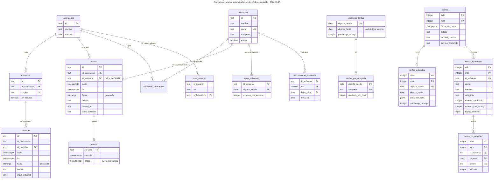

# 16. Diseño de la base de datos

> Responde: ¿cómo se guardan los datos del núcleo, qué protege la base por sí misma y por qué se diseñó así?
> Restricciones: PostgreSQL 14 (R-2), código abierto (R-4). El esquema vive solo en `database/migrations/` (Flyway); este documento lo explica.
> Versión 2026-11-25. Resumen en `07-arquitectura.md` (7.11). Las rutas de archivo son relativas a la raíz del repositorio.

## 16.1 Principios

| # | Decisión | Por qué |
| --- | --- | --- |
| BD-1 | **La base es un detalle detrás de puertos.** El dominio y los casos de uso no conocen tablas ni SQL; los repositorios `*Postgres` traducen filas a objetos del dominio. | Las reglas se prueban sin base de datos (R-8) y la base se conectó al final, sin tocar el dominio (ADR-0001). |
| BD-2 | **Flyway es la única fuente del esquema.** Migraciones versionadas `V{n}__descripcion.sql`; una migración aplicada nunca se edita. | El esquema de cada ambiente se puede reconstruir y auditar; el contenedor `migraciones` corre antes que el backend (`docker-compose.yml`). |
| BD-3 | **Cada tabla tiene un módulo dueño** y solo ese módulo escribe en ella. | Es un monolito modular con una sola base: el dueño evita que un cambio de tabla rompa a otro módulo sin aviso. |
| BD-4 | **La base también protege las reglas críticas.** Las reglas que dos transacciones simultáneas podrían violar juntas se repiten como restricciones (`EXCLUDE`, `UNIQUE`, `CHECK`). | El dominio da el mensaje claro; la base da la garantía aun con concurrencia (ADR-0009, QA-4). |
| BD-5 | **Lo cerrado no se modifica.** El código no tiene `UPDATE` de cierres ni de sus líneas. | RN-25: un mes cerrado no se recalcula ni se corrige. |

## 16.2 Modelo de datos

Leyenda: rectángulo = tabla con sus columnas (PK = llave primaria, FK = llave foránea, UK = única); `||` = exactamente uno; `o{` = cero o muchos; `o|` = cero o uno; la frase sobre cada línea dice la relación. Las tablas `semestres`, `sesiones` y `avisos` no se relacionan por llave con las demás y se describen en 16.3.

**Usuarios sin tabla propia.** Las personas vienen del Directorio institucional (ADR-0008): CompuLab no guarda contraseñas ni datos personales que el Directorio ya tiene. Por eso `reservas.id_estudiante`, `turnos.creado_por` y `roles_usuarios.id_usuario` son identificadores del Directorio sin llave foránea. Los asistentes sí tienen tabla, porque CompuLab guarda datos que solo existen aquí: categoría, tope, disponibilidad y laboratorios.

## 16.3 Diccionario de datos

| Tabla | Módulo dueño | Qué guarda | Restricciones propias |
| --- | --- | --- | --- |
| `laboratorios` | horarios | Laboratorios por sede | — |
| `maquinas` | reservas | Máquinas de cada laboratorio y si están en servicio (RN-20) | `codigo` único |
| `asistentes` | asistentes (fuera del núcleo; en el núcleo solo se lee) | Asistentes con su categoría | `carne` único |
| `asistentes_laboratorios` | asistentes | En qué laboratorios puede cubrir turnos cada asistente | PK compuesta |
| `topes_asistentes` | asistentes | Historial de topes semanales: nunca se sobrescribe, se agrega una vigencia (RF-07) | `minutos_por_semana > 0` (RN-03) |
| `disponibilidad_asistentes` | asistentes | Bloques semanales declarados (RN-08); día 1 = lunes … 7 = domingo | `dia` de 1 a 7; `hora_inicio < hora_fin` |
| `semestres` | horarios (calendario) | Fechas de cada semestre | `inicio <= fin`; `semestres_sin_traslape` |
| `turnos` | horarios | Turnos con su franja `[inicio, fin)` y su estado (10.5) | Ver 16.4 |
| `marcas` | asistencia (fuera del núcleo; en el núcleo solo se lee) | Entrada y salida de cada turno (RN-12) | `salida` nula o posterior a `entrada` |
| `reservas` | reservas | Reservas con su franja, estado y clave de solicitud | Ver 16.4 |
| `vigencias_tarifas` | liquidación | Vigencias del recargo; una por fecha de inicio (ADR-0005) | `porcentaje_recargo >= 0`; `vigencias_tarifas_sin_traslape` |
| `tarifas_por_categoria` | liquidación | Tarifa por hora de cada categoría en cada vigencia, en céntimos | `centimos_por_hora >= 0` |
| `cierres` | liquidación | Un cierre por mes, con el CSV para Becas | `cierres_un_cierre_por_mes` (llave primaria); `estado = 'CERRADO'` |
| `tarifas_aplicadas` | liquidación | Copia de las tarifas que se usaron en el cierre (P5) | FK a `cierres` |
| `lineas_liquidacion` | liquidación | Una línea por asistente con horas (P3, P4) | Minutos y monto no negativos; FK a `cierres` |
| `horas_no_pagadas` | liquidación | Horas no pagadas por semana y motivo (RN-24) | `motivo` en `SOBRE_TOPE`, `MARCA_INCOMPLETA`; `minutos > 0` |
| `roles_usuarios` | identidad | Roles internos de CompuLab (ADR-0008) | `rol` válido; un coordinador de laboratorio indica su laboratorio; sin roles repetidos (`roles_usuarios_unicos`) |
| `sesiones` | identidad | Sesiones de 8 h, guardadas por la huella SHA-256 del token | PK `huella_token` |
| `avisos` | notificaciones | Avisos registrados en la transacción del caso de uso (bandeja de salida, 11.6) | — |

## 16.4 Restricciones de integridad y concurrencia

Estas restricciones son la segunda barrera de ADR-0009: el dominio ya valida, pero dos transacciones simultáneas podrían validar bien y confirmar cosas que chocan. El repositorio traduce cada violación al error de dominio de la última columna.

| Restricción | Tabla | Regla | Requisito | Error de dominio |
| --- | --- | --- | --- | --- |
| `turnos_sin_traslape_asistente` | turnos | `EXCLUDE USING gist (id_asistente WITH =, franja WITH &&)` en todos los estados salvo `VACANTE` y `DESCARTADO` | RN-06, CU-06 I1 | `TraslapeDeTurno` |
| `turnos_sin_traslape_laboratorio` | turnos | `EXCLUDE USING gist (id_laboratorio WITH =, franja WITH &&)` con el mismo filtro | RN-09, CU-06 I3 | `FranjaOcupadaEnLaboratorio` |
| `CHECK ((estado = 'VACANTE') = (id_asistente IS NULL))` | turnos | Exactamente un responsable salvo si está vacante | RN-05, CU-06 I4, SUP-01 | — (lo impide `Turno`) |
| `turnos_clave_de_solicitud_unica` | turnos | `UNIQUE (creado_por, clave_solicitud)` | ADR-0010, CU-06 I5 | `ClaveDeSolicitudReutilizada` |
| `reservas_sin_traslape_maquina` | reservas | `EXCLUDE USING gist (id_maquina WITH =, franja WITH &&)` sobre `ACTIVA` y `EN_USO` | CU-11 I1, ext 7a | `MaquinaNoDisponible` |
| `reservas_una_activa_por_estudiante` | reservas | Índice único parcial sobre `id_estudiante` con `ACTIVA` y `EN_USO` | RN-17, CU-11 I2, ext 7c | `YaTieneReservaActiva` |
| `reservas_clave_de_solicitud_unica` | reservas | `UNIQUE (id_estudiante, clave_solicitud)` | ADR-0010, CU-11 I5 | `ClaveDeSolicitudReutilizada` |
| `cierres_un_cierre_por_mes` | cierres | Llave primaria `(anio, mes)` | RN-26, CU-14 I1, ext 2c | `CierreYaExiste` → se devuelve el existente |
| `vigencias_tarifas_sin_traslape` | vigencias_tarifas | `EXCLUDE USING gist (daterange(vigente_desde, vigente_hasta, '[]') WITH &&)` | RN-22, ADR-0005 | — |
| `FOR UPDATE` sobre `asistentes` | — | No es una restricción sino un bloqueo: serializa las asignaciones a un mismo asistente | RN-07, CU-06 I2, ext 5a | — |

El tope semanal (RN-07) y las 6 horas por semana (RN-17) no se pueden expresar como una restricción de una fila. El tope se protege con el bloqueo por asistente; las 6 horas, con el índice de una reserva activa por estudiante, porque si solo puede haber una activa, dos reservas simultáneas no pueden sumar juntas.

Las restricciones `EXCLUDE` necesitan la extensión `btree_gist` (V1), incluida en la imagen oficial `postgres:14`.

## 16.5 Tipos y convenciones

| Dato | Tipo | Decisión |
| --- | --- | --- |
| Instantes (inicio, fin, marcas, cierre) | `timestamptz` | Se escriben con su desfase (`-06:00`) y se leen como instante absoluto; el dominio los lleva a la hora de Costa Rica. La zona del servidor no influye. |
| Franja | `tstzrange` generada: `tstzrange(inicio, fin, '[)')` | Las columnas `inicio` y `fin` son las que se escriben; el rango existe para las restricciones `EXCLUDE`. Al ser `[)`, dos turnos contiguos no se traslapan (RN-06). |
| Fechas sin hora | `date` | Se leen como texto `AAAA-MM-DD` (`backend/src/compartido/infraestructura/postgres/conexion.ts`), sin conversión de zona. |
| Horas de disponibilidad | `time` | Admite `24:00` para los bloques que terminan a medianoche. |
| Dinero | `bigint` en céntimos | Nunca decimales flotantes (RN-27); se leen como `number` con verificación de rango seguro. |
| Copias congeladas | `jsonb` | `tarifas_aplicadas.tarifa_por_hora`, `sesiones.roles` y `avisos.datos`: guardan una fotografía del momento, no datos que se consulten por partes. |
| Estados | `text` con `CHECK` | Los valores de 10.5; agregar un estado nuevo es una migración, no un cambio de tipo. |
| Nombres | Español en `snake_case` | El mismo vocabulario que el dominio (`turnos`, `minutos_con_recargo`). |

## 16.6 Normalización y desnormalizaciones deliberadas

Las tablas están en tercera forma normal salvo tres copias intencionales:

| Copia | Por qué |
| --- | --- |
| `lineas_liquidacion` repite `carne`, `nombre` y `categoria` del asistente | Un cierre es una fotografía inmutable (RN-25): si el asistente cambia de categoría o de nombre después, el cierre de ese mes no debe cambiar. |
| `tarifas_aplicadas` copia las tarifas en `jsonb` | P5 de CU-14: el cierre guarda las tarifas que usó, aunque luego se registren otras vigencias. |
| `sesiones.roles` copia los roles al iniciar sesión | Evita leer roles en cada solicitud. **Costo:** un cambio de rol se nota en el siguiente ingreso; como la sesión dura 8 h, es el retraso máximo. |

## 16.7 Consultas principales e índices

| Operación | Consulta | Índice que la apoya |
| --- | --- | --- |
| Agenda del asistente (CU-06) | Turnos del asistente que tocan la semana | Índice GiST de `turnos_sin_traslape_asistente` (filtra por `id_asistente`) |
| Agenda del laboratorio, horario y cobertura (CU-06, CU-11) | Turnos del laboratorio que tocan el día o la semana | Índice GiST de `turnos_sin_traslape_laboratorio` |
| Turnos de un periodo (CU-14) | Turnos que empiezan entre el lunes de la primera semana y el fin del mes | `turnos_por_inicio` |
| Disponibilidad de máquinas (CU-11) | Reservas de cada máquina en el día | Índice GiST de `reservas_sin_traslape_maquina` |
| Cupo del estudiante (CU-11) | Reserva activa y reservas de la semana | `reservas_una_activa_por_estudiante`, `reservas_por_estudiante` |
| Cierre de un mes (CU-14) | Cierre por `(anio, mes)` y sus líneas | Llaves primarias de `cierres`, `lineas_liquidacion` y `horas_no_pagadas` |
| Sesión de cada solicitud | Sesión por huella del token | Llave primaria `huella_token` |

Con el volumen de la Escuela (decenas de laboratorios, cientos de turnos y reservas por semana) estas consultas leen pocas filas. Una mejora pendiente: hoy los repositorios filtran el traslape con `inicio < fin_buscado AND fin > inicio_buscado`. Escribirlo como `franja && tstzrange(…)` aprovecharía por completo los índices GiST. No se midió carga (QA-1 queda sin evidencia de rendimiento, `12-trazabilidad.md` 12.5).

## 16.8 Evolución, datos iniciales y operación

- **Migraciones.** Se aplican en orden V1 a V6 con el contenedor `migraciones` (Flyway 11), que debe terminar bien antes de que arranque el backend. Un cambio de esquema es una migración nueva; nunca se edita una aplicada (guía de cambios, 7.10).
- **Datos de demostración.** No hay datos en las migraciones. Con `APP_DATOS_DEMO=true`, el backend llena una base vacía al arrancar (`backend/src/arranque/siembra-postgres.ts`), usando los mismos datos que el modo en memoria. Un candado `pg_advisory_xact_lock` evita que dos instancias siembren a la vez.
- **Pruebas.** `backend/tests/postgres/` crea un esquema propio por archivo, le aplica las migraciones, prueba restricciones, bloqueos y transacciones, y lo borra al terminar. Solo corren si existe `APP_DB_PRUEBAS`.
- **Disponibilidad.** El volumen `postgres_data` conserva los datos entre reinicios; `/health` responde 503 si la base no responde, y el backend se recupera solo cuando vuelve (comprobado en la sección 7 de la implementación).
- **Respaldo.** `Context/Servicios.md` pide un respaldo diario con `pg_dump`. Es un procedimiento de operación, todavía no automatizado en `docker-compose.yml`. Ejemplo: `docker compose exec db pg_dump -U <usuario> -Fc <base> > respaldo-AAAA-MM-DD.dump`.
- **Riesgo aceptado.** PostgreSQL 14 dejó de tener soporte comunitario en noviembre de 2026 (ADR-0006).
- **Limpieza pendiente.** Las sesiones vencidas se borran cuando alguien intenta usarlas; una tarea programada debería borrar las demás. El índice `sesiones_por_vencimiento` ya existe para eso.

## 16.9 Tablas del sistema completo (fuera del núcleo)

El resto de los módulos se diseña pero no se programa en esta entrega. Cuando se implementen, agregarán sus tablas en migraciones nuevas:

| Módulo | Tablas previstas | Casos de uso |
| --- | --- | --- |
| reclutamiento | `convocatorias`, `postulaciones`, `postulaciones_bloques`, `postulaciones_laboratorios`, `entrevistas` | CU-01 a CU-03 |
| horarios (cambios) | `ofertas_de_turno` | CU-07 a CU-09 |
| asistencia | Escritura en `marcas`; constancia de regularización | CU-10, CU-16 |
| reservas (mantenimiento) | `periodos_fuera_de_servicio` | CU-12, CU-13 |
| liquidación | Escritura en `vigencias_tarifas` y `tarifas_por_categoria`; `constancias_de_cierre` | CU-15, RN-25 |
| reportes | Solo lectura de las tablas anteriores | CU-17 |
| notificaciones | Columnas de envío y reintentos en `avisos` | RF-35 |
